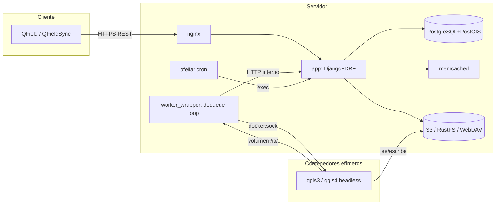

# Arquitectura del backend QFieldCloud

Repositorio: `../../qfieldcloud`

## 1. Stack tecnológico

- **Lenguaje/Framework**: Python 3.12/3.13, **Django 5.2.16** (`docker-app/requirements/requirements.in:22`).
- **API**: Django REST Framework 3.17.1 + `drf-spectacular` (OpenAPI).
- **Sin Celery/Redis**: la cola de trabajos está implementada **directamente sobre PostgreSQL** (patrón `SELECT ... FOR UPDATE SKIP LOCKED`), no hay broker externo. La única mención a Redis en el código es un TODO sin implementar.
- **Librerías clave**:
  - `django-allauth[socialaccount]` — auth, login social, invitaciones.
  - `django-axes` — bloqueo de fuerza bruta en login.
  - `django-storages` + `boto3` — backend S3-compatible.
  - `django-fernet-encrypted-fields` — cifrado de campos sensibles (p.ej. secretos de proyecto).
  - `django-cron-django5` — cron jobs (`qfieldcloud/core/cron.py`, vía `manage.py runcrons`).
  - `django-constance` — configuración dinámica en runtime (límites de memoria/CPU de workers, etc.).
  - `django-model-utils` (`InheritanceManagerMixin`) — herencia multi-tabla: `User`→`Person`/`Organization`/`Team`, `Job`→`PackageJob`/`ApplyJob`/etc.
  - `docker` (SDK Python) — el propio Django lanza contenedores Docker (docker-in-docker) para procesar proyectos QGIS.
  - `stripe`, `sentry-sdk`, `pymemcache`.
- **Gestión de dependencias**: archivos `.in`/`.txt` compilados con `uv pip compile`, separados en `requirements.in` (base), `requirements_runtime.in` (gunicorn, etc.), `requirements_test.in`, `requirements_worker_wrapper.in`.
- **Estructura** (monorepo, 3 "servicios" de código):
  - `docker-app/` — proyecto Django (`qfieldcloud/`) + `worker_wrapper/` (proceso que sondea la cola y lanza contenedores QGIS).
  - `docker-qgis/` — imagen QGIS headless con el paquete `qfc_worker` (comandos ejecutados *dentro* del contenedor QGIS).
  - `docker-nginx/`, `docker-createbuckets/` — infraestructura auxiliar.
- **Apps Django** (`docker-app/qfieldcloud/`): `core`, `project`, `filestorage`, `subscription`, `authentication`, `notifs`. Cada una con `models.py`, `migrations/`, `tests/` propios.

## 2. Arquitectura de servicios (docker-compose)

| Servicio | Rol |
|---|---|
| `app` | Django + Gunicorn (`qfieldcloud.wsgi:application`) — API REST y admin. En local: `runserver` + `debugpy`. |
| `nginx` | Reverse proxy TLS, sirve estáticos/media, límites de tamaño de body configurables. |
| `mkcert`/`certbot` | Certificados TLS (dev/prod). |
| `qgis3`/`qgis4` | Imágenes que **solo se construyen** (no corren como daemon); quedan disponibles para ser instanciadas dinámicamente por el wrapper. Dos versiones de QGIS en paralelo (3.44 LTR y 4.0). |
| `worker_wrapper` | Mismo código Django, ejecuta `python manage.py dequeue` en loop infinito; monta el socket Docker para lanzar contenedores `qgis3`/`qgis4` efímeros (docker-in-docker). Escalable (`scale: ${QFIELDCLOUD_WORKER_REPLICAS}`). |
| `ofelia` | Scheduler de cron por labels Docker; ejecuta `python manage.py runcrons` cada minuto dentro de `app`. |
| `mirror_transformation_grids` | Descarga grids de transformación de coordenadas PROJ (`cdn.proj.org`) a volumen compartido. |
| `memcached` | Cache de Django. |
| `db` (override standalone) | `postgis/postgis` — PostgreSQL + PostGIS. |
| `rustfs` (override standalone) | Storage S3-compatible (sucesor de MinIO en este repo). |
| `createbuckets` | Job de un solo uso: crea buckets S3 según la variable `STORAGES`. |
| `webdav` (override standalone) | Storage alternativo WebDAV. |
| `smtp4dev` (override standalone) | Servidor SMTP de pruebas con UI. |
| `test_postgis_db` (override test) | BD PostGIS separada solo para tests. |

**Comunicación**: red Docker compartida. El `worker_wrapper` habla con `app` vía HTTP (`http://app:8000/api/v1/`) usando un `AuthToken` de tipo `WORKER`. Los contenedores QGIS efímeros comparten un volumen temporal (`/io/`) con el wrapper para intercambiar el deltafile/proyecto.

## 3. API REST

- Router DRF + `path()` explícitos en `core/urls.py`, agregando urls de sub-apps (`filestorage`, `subscription`, `project`).
- Endpoints principales: `users/`, `collaborators/<projectid>/`, `packages/<project_id>/latest/`, `members/<organization>/`, `deltas/<projectid>/`, `organizations/<name>/teams/`, `jobs/`, `server/info/`.
- **Views** organizadas por dominio en `core/views/` (`deltas_views.py`, `jobs_views.py`, `collaborators_views.py`, `members_views.py`, `package_views.py`, `teams_views.py`, `users_views.py`, `server_views.py`, `status_views.py`) y en `project/views.py`.
- **Autenticación**: `TokenAuthentication` custom (basada en modelo `AuthToken` propio, no el de DRF) + `SessionAuthentication`. `DEFAULT_PERMISSION_CLASSES = [IsAuthenticated]`. `AUTHENTICATION_BACKENDS` incluye `axes.backends.AxesBackend` + backend custom sobre `allauth`.
- **Permisos** centralizados en `core/permissions_utils.py` (~60 funciones `can_*`/`check_*`): patrón de "policy functions" puras `(user, recurso) -> bool`, además de wrappers `BasePermission` de DRF por vista. Ejemplos: `can_create_deltas`, `can_apply_pending_deltas_for_project`, `can_modify_qgis_projectfile`, `can_create_collaborators`.
- Documentación OpenAPI autogenerada con `drf-spectacular`.

## 4. Procesamiento asíncrono / Jobs (sin Celery)

Cola propia sobre PostgreSQL — patrón **"poll + SELECT FOR UPDATE SKIP LOCKED"**:

- `core/management/commands/dequeue.py`: comando ejecutado en loop infinito por `worker_wrapper`.
- Algoritmo: en transacción `REPEATABLE READ`, selecciona jobs `PENDING` cuyo proyecto no tenga ya un job `QUEUED`/`STARTED` activo, con `select_for_update(skip_locked=True)` para que réplicas del worker compitan sin duplicar trabajo. Toma el más antiguo, lo marca `QUEUED` y lo ejecuta.
- Verifica que está conectado al nodo master de PostgreSQL (`pg_is_in_recovery()` debe ser `FALSE`) antes de tomar jobs.
- Ejecución delegada a `worker_wrapper/wrapper.py`: clase `JobRun` (y subclases `PackageJobRun`, `ApplyDeltaJobRun`, `ProcessProjectfileJobRun`, `CreateProjectJobRun`):
  1. Prepara directorio temporal compartido (`shared_tempdir` → `/io/`).
  2. Construye env/comando según tipo de job.
  3. Lanza contenedor Docker efímero de la imagen QGIS apropiada vía SDK Docker (`client.containers.run(...)`), con límites de memoria/CPU dinámicos (`django-constance`).
  4. Espera (`container.wait(timeout=...)`), lee logs, detiene y elimina el contenedor.
  5. Hooks `before_docker_run()`/`after_docker_run()`/`after_docker_exception()` actualizan el estado en BD (p.ej. `ApplyDeltaJobRun.after_docker_run` actualiza `Delta.last_status` por cada delta del feedback).
- **Dentro del contenedor QGIS** (`docker-qgis/entrypoint.py` + `docker-qgis/qfc_worker/commands/`): cada comando (`apply_deltas.py`, `package.py`, `process_projectfile.py`, `create_project.py`) define un `Workflow` de `Step`s (patrón pipeline: `start_qgis_app` → `download_project_directory` → `apply_deltas`/`package` → `stop_qgis_app` → `upload_project_directory`), con feedback estructurado (JSON) guardado en `Job.feedback`.
- **Cron periódico** (no relacionado a jobs de proyecto): `django-cron` disparado cada minuto por `ofelia` dentro del contenedor `app`.
- **Tipos de Job**: `PACKAGE` (empaquetar proyecto para uso offline), `DELTA_APPLY` (aplicar cambios subidos), `PROCESS_PROJECTFILE` (parsear `.qgs`/`.qgz`), `CREATE_PROJECT` (inicialización).

## 5. Seguridad y autenticación

- **`AuthToken` custom** (no el `rest_framework.authtoken` estándar): expiración configurable (default 720h/30 días), detección de tipo de cliente por User-Agent (`BROWSER/CLI/SDK/QFIELD/QFIELDSYNC/WORKER/UNKNOWN`), invalidación de tokens previos para clientes "single-session".
- `django-axes` contra fuerza bruta en login (primero en `AUTHENTICATION_BACKENDS`).
- `django-allauth` para registro/login social e invitaciones.
- **Permisos por roles en dos niveles**: organización (`OrganizationMember`) y proyecto (`ProjectCollaborator.Roles`: admin > manager > editor > reporter > reader), consolidados vía vistas SQL `organizations_with_roles_vw`/`projects_with_roles_vw` (combinan ownership directo, membresía de equipo y colaboración explícita en un único `role`+`origin`).
- Campos sensibles cifrados con `django-fernet-encrypted-fields` (modelo `Secret`).
- CORS explícito, `SECURE_PROXY_SSL_HEADER` para operar detrás de nginx TLS-terminating.

## 6. Testing y CI

- Tests Django estándar por app (`authentication/tests/`, `core/tests/`, `project/tests/`, `filestorage/tests/`, `subscription/tests/`, `notifs/tests/`), más tests dedicados en `docker-qgis/tests/` que corren contra el contenedor QGIS con datos reales (`bees.gpkg`, `simple_bee_farming.qgs`).
- **CI** (`.github/workflows/test.yml`): matriz por app Django + un job `__flaky__` separado para tests inestables con reintento tolerado. Pipeline: `pre-commit` (lint) → `docker compose up` (perfil test) → `makemigrations --check` → `migrate` → `collectstatic` → `manage.py test --keepdb`. Job separado `django_checks` corre `manage.py check --deploy`.
- Lint: `pre-commit`, `ruff.toml`, `.flake8`, `.mypy.ini` (tipado estricto con `django-stubs`/`djangorestframework-stubs`).

## 7. Patrones reutilizables para VisitaCampo

1. **Cola de trabajos sin Celery** (`SELECT ... FOR UPDATE SKIP LOCKED` sobre Postgres) es viable y simple para volumen moderado — evita infra adicional (Redis/RabbitMQ).
2. **Separar "app" de "procesamiento pesado"** en contenedores efímeros lanzados dinámicamente — aísla dependencias pesadas/inestables del proceso web principal.
3. **Modelo de permisos por roles con vistas SQL consolidadas** evita N+1 y lógica de permisos duplicada (a cambio de migraciones manuales de las vistas, no gestionadas por el ORM).
4. **Multi-entorno con `COMPOSE_FILE` + overrides** (ver [05-infraestructura-despliegue.md](05-infraestructura-despliegue.md)) simplifica scripts de CI/deploy frente a múltiples archivos compose invocados manualmente.
