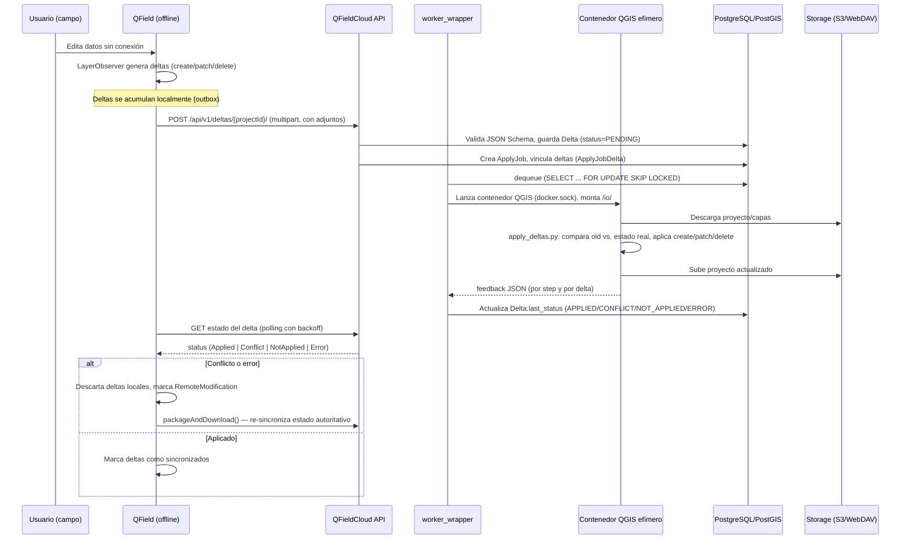

# Integración cliente-servidor: sincronización offline-first

Cómo QField (cliente) y QFieldCloud (backend) se integran: autenticación, protocolo de sincronización por deltas, adjuntos y resolución de conflictos.

## 1. Visión general del flujo

## 2. Autenticación en el flujo de sync

- **Login**: `POST /api/v1/auth/token/` (usuario/password) o flujo OAuth2/SSO delegado al `QgsAuthManager` de QGIS (ver [01-arquitectura-cliente-qfield.md](01-arquitectura-cliente-qfield.md#4-autenticación)).
- **Token propio del backend** (`AuthToken`, no el estándar de DRF): expira por defecto a los 30 días, detecta el tipo de cliente por User-Agent y, para clientes "single-session" (QField, QFieldSync, desconocidos), invalida tokens previos al emitir uno nuevo — un dispositivo no tiene múltiples tokens vivos simultáneos.
- **401 → logout forzado**: el cliente invalida el token local y pasa a `ConnectionStatus::Disconnected` ante cualquier respuesta 401.
- Endpoints de auth usados por el cliente: `/api/v1/auth/providers/`, `/api/v1/auth/token/`, `/api/v1/auth/user/`, `/api/v1/auth/logout/`.

## 3. Formato del delta

JSON Schema formal, **compartido cliente/servidor/worker** (`core/deltafile_01.json` en el backend, idéntico a `docker-qgis/schemas/deltafile_01.json`):

- Estructura del archivo: `version`, `project`, `id`, `deltas[]`, `files[]`, `clientPks{}`.
- Cada delta individual: `uuid` (generado en cliente, usado como PK también en servidor — garantiza idempotencia), `localPk`/`sourcePk`, `localLayerId`/`sourceLayerId`, `method` (`create`/`patch`/`delete`), objetos `old`/`new` con `geometry` (WKT) y `attributes` (merge tipo JSON-merge-patch), y `files_sha256` para adjuntos referenciados.
- En el cliente, `DeltaFileWrapper` (`src/core/qfieldcloud/deltafilewrapper.h/.cpp`) serializa los deltas a este formato (`DeltaFormatVersion = "1.0"`).
- `LayerObserver` (cliente) genera los deltas conectándose a señales de `QgsVectorLayer` (`onBeforeCommitChanges`, `onCommittedFeaturesAdded/Removed`, `onCommittedAttributeValuesChanges/GeometriesChanges`).

## 4. Subida y aplicación de deltas (lado servidor)

Flujo en `core/views/deltas_views.py` (`ListCreateDeltasView.post`):

1. Valida el deltafile contra el JSON Schema.
2. Descarta deltas ya existentes (idempotencia por `uuid`).
3. Evalúa permisos por delta (`can_create_delta`); si no autorizado, se guarda igual con `last_status=UNPERMITTED` (auditable, no se descarta silenciosamente).
4. Si el owner no puede crear jobs (límite de plan), el delta queda `PENDING` sin disparar job, con feedback informativo.
5. Si hay deltas nuevas permitidas, `jobs.apply_deltas(...)` crea un `ApplyJob` (paginado por `APPLY_DELTAS_LIMIT`) vinculando los deltas pendientes vía `ApplyJobDelta`, evitando duplicar trabajo si ya hay un job en curso para ese proyecto.
6. Deltafiles corruptos se preservan en `FaultyDeltaFile` con traceback completo.

**Aplicación real** (dentro del contenedor QGIS, `docker-qgis/qfc_worker/commands/apply_deltas.py`): QGIS headless abre el `.qgs`, localiza cada feature por `sourcePk` (con fallback a `clientPks` para features creadas offline sin PK remoto aún), y aplica `create_feature`/`patch_feature`/`delete_feature`.

## 5. Resolución de conflictos — server-authoritative

- `compare_feature()` compara el estado esperado por el cliente (`old`) contra el estado real en el servidor antes de aplicar `patch`/`delete`.
- Si difieren → `Delta.Status.CONFLICT`. El flag `overwrite_conflicts` (a nivel de `Project` o forzado por request) decide si se sobreescribe igualmente o se rechaza dejando la decisión al usuario.
- **El cliente no hace merge de 3 vías localmente**: ante `Conflict`/`NotApplied`/incluso `Applied`, descarta sus deltas locales (`mDeltaFileWrapper->reset()`), marca `RemoteModification`, y vuelve a descargar el proyecto (`packageAndDownload()`) para obtener el estado autoritativo — toda la complejidad de resolución vive en el servidor.
- Todo el log de aplicación (incluyendo diffs de atributos en conflicto) se serializa en `Job.feedback` y se propaga a `Delta.last_feedback`/`ApplyJobDelta.feedback`.
- Existe soporte de reversión (`inverse=True`, intercambia `old`/`new` y `create`↔`delete`) para rollback administrativo.
- Las geometrías de cada delta se guardan también en el modelo `Delta` (`old_geom`/`new_geom`, `GeometryField` PostGIS) — permite auditoría espacial sin reabrir el proyecto QGIS.

## 6. Sincronización de adjuntos (fotos, archivos)

- Gestionada **aparte** de los deltas de datos, con cola propia en el cliente (`uploadPendingAttachments`/`processPendingAttachments`), reintento exponencial (`5^intentos * 1000ms`, hasta 5 fallos).
- Servicio Android dedicado en background para subir adjuntos con la app cerrada (`QFieldCloudService.java`).
- En servidor: los adjuntos se guardan como `FileVersion` (con `etag`/`md5sum`/`sha256sum`) referenciados desde el delta por checksum (`files_sha256`), en una ruta S3 que puede ser un storage distinto al de los archivos de proyecto (`attachments_file_storage`).
- Directorios de adjuntos se detectan por prefijo configurable en el `.qgs` (default `["DCIM"]`).

## 7. Descarga / empaquetado de proyecto (lado cliente)

- `packageAndDownload()` dispara un job `PACKAGE` en servidor (empaqueta/exporta el proyecto para consumo offline).
- Descarga por streaming con reanudación (`resumableDownload`, `etag`, `partialFilePath`, contador de redirecciones).
- `autoPushEnabled`/`autoPushIntervalMins`/`forceAutoPush`: sincronización periódica configurable, no solo manual.
- Sin red: `QFieldCloudConnection::queueProjectPush(projectId)` encola el push y reintenta al detectar cambio de conectividad (`QNetworkInformation::Reachability`) o al volver a loguearse.

## 8. Errores de red

- Clase `CloudError` (cliente) parsea el payload JSON de error (`code`, `message`), mapea a mensajes traducidos vía diccionario estático (`unknown_error`, `invalid_deltafile`, `qgis_cannot_open_project`, etc.), con fallback a texto HTTP genérico — evita mostrar errores crudos del backend al usuario final.

## 9. Endpoints REST relevantes al ciclo de sync

`/api/v1/server/info/`, `/api/v1/auth/providers|token|user|logout/`, `/api/v1/users/{user}/organizations/`, `/api/v1/subscriptions/{user}/current/`, `/api/v1/deltas/{projectId}/`, `/api/v1/files/{projectId}/{path}/`, `/api/v1/packages/{project_id}/latest/`, `/api/v1/jobs/`.

## 10. Patrón a replicar en VisitaCampo

El patrón completo es: **outbox local con IDs generados en cliente (UUID) → subida idempotente → cola de jobs server-side → procesamiento asíncrono → polling de estado → si hay conflicto, el cliente descarta y re-sincroniza en vez de mergear localmente**. Es directamente aplicable a "visitas de campo": cada visita/formulario/evidencia completado offline se modela como un delta con `uuid`, snapshot y adjuntos referenciados por checksum, sin necesitar lógica de merge compleja en el dispositivo móvil.
