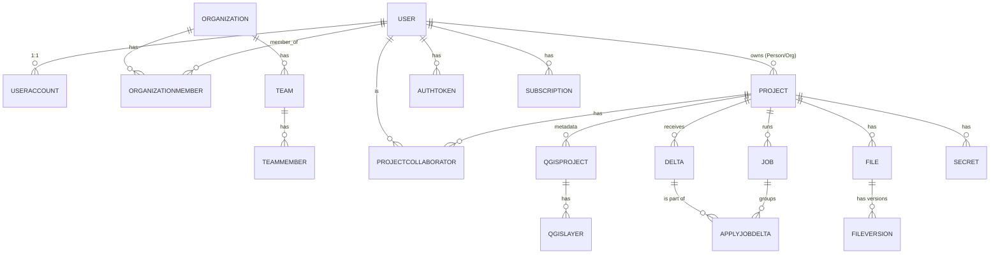

# Modelo de datos y almacenamiento (QFieldCloud)

Motor: **PostgreSQL + PostGIS** (`django.contrib.gis.db.backends.postgis`, `settings.py:216`). Apps con `models.py`: `core`, `project`, `filestorage`, `subscription`, `authentication`.

## 1. Usuarios y organizaciones (`docker-app/qfieldcloud/core/models.py`)

- `User(AbstractUser)` (línea 239) — modelo base con **herencia multi-tabla** (`Type`: PERSON/ORGANIZATION/TEAM). `AUTH_USER_MODEL = "core.User"`.
- `Person(User)` (361) — usuario individual (`remaining_invitations`, `has_accepted_tos`).
- `Organization(User)` (637) — cuenta compartida, dueña de proyectos (`organization_owner`).
- `Team(User)` (897) + `TeamMember` (935) — subgrupos dentro de una organización.
- `UserAccount` (440) — perfil extendido 1:1 (avatar, bio, estadísticas de storage), creado automáticamente en `User.save()` junto con su `Subscription`.
- `OrganizationMember` (777) — membresía user↔organization con rol.
- `OrganizationRolesView` / `ProjectRolesView` (875, 1138) — **vistas SQL no gestionadas** (`managed=False`, `db_table="organizations_with_roles_vw"` / `"projects_with_roles_vw"`) que consolidan roles efectivos (propios + heredados + de equipo) en una sola consulta.

## 2. Proyectos (`docker-app/qfieldcloud/project/models.py`)

- `Project` (188) — entidad central. `owner` puede ser `Person` u `Organization`. Campos notables: `is_public`, `project_type` (REGULAR/SHARED_DATASETS), `file_storage_bytes` (cache), `data_last_updated_at`/`data_last_packaged_at`, `last_package_job`, `overwrite_conflicts`, `has_restricted_projectfiles`, `packaging_offliner` (legado vs. optimizado), `storage_keep_versions`.
- `ProjectCollaborator` (`core/models.py:1038`) — vínculo project↔user con `role` (`ADMIN/MANAGER/EDITOR/REPORTER/READER`) y `is_incognito`.
- `QgisProject`/`QgisLayer` (`project/models.py:1168,1373`) — metadatos extraídos del `.qgs`/`.qgz` (capas, CRS, directorios de adjuntos) tras procesarlo con el worker QGIS.
- `ProjectSeed` (1054) — usado en creación asíncrona de proyectos.

## 3. Sincronización — Delta y Job (`core/models.py`)

- `Delta` (1158) — un cambio individual subido por el cliente. Campos clave:
  - `id` (UUID, generado en el cliente y reutilizado tal cual — garantiza idempotencia en reintentos).
  - `deltafile_id`, `client_id`, `content` (`JSONField` con el delta crudo).
  - `last_status`: `PENDING/STARTED/APPLIED/CONFLICT/NOT_APPLIED/ERROR/IGNORED/UNPERMITTED`.
  - `old_geom`/`new_geom`: `GeometryField(srid=4326, dim=4)` — geometría indexada espacialmente para auditoría ("qué cambió dónde").
- `Job` (1271, con `InheritanceQuerySet`) — clase base de trabajos asíncronos.
  - `Type`: `PACKAGE`, `DELTA_APPLY`, `PROCESS_PROJECTFILE`, `CREATE_PROJECT`.
  - `Status`: `PENDING → QUEUED → STARTED → FINISHED/STOPPED/FAILED`.
  - Subclases con herencia multi-tabla: `PackageJob`, `ProcessProjectfileJob`, `ApplyJob`.
- `ApplyJobDelta` (1485) — tabla intermedia M2M entre `ApplyJob` y `Delta`, con `status`/`feedback` propios por delta (un job agrupa varios deltas y cada uno resuelve individualmente).
- `Secret` (1611) — secretos cifrados (django-fernet) por proyecto/organización, inyectables como variables de entorno en jobs.
- `FaultyDeltaFile` (1740) — preserva deltafiles que fallan el parseo/validación, para debugging.

## 4. Almacenamiento de archivos (`docker-app/qfieldcloud/filestorage/models.py`)

- `File` (46) — metadato de archivo lógico (`file_type`: `PROJECT_FILE`/`PACKAGE_FILE`, `latest_version` FK). Constraint único por `(project, name, file_type, package_job)`.
- `FileVersion` (294) — cada versión física subida (`etag`, `md5sum`, `sha256sum`, `size`, `content` en storage dinámico, `legacy_id`). `FileVersionQueryset.add_version()` es transaccional y crea `File` si no existe.
- Configuración de storage vía variable de entorno `STORAGES` (JSON), soporta **múltiples backends simultáneos** nombrados (p.ej. `default` S3, `webdav` alternativo) — `settings.STORAGES` (`settings.py:299-304`).
- Backends custom en `filestorage/backend.py`: `QfcS3Boto3Storage` (S3/RustFS/MinIO), `QfcWebDavStorage`.
- Cada `Project`/`FileVersion` puede elegir storage distinto (`project.file_storage`, `project.attachments_file_storage`) vía `DynamicStorageFileField` (`core/fields.py`) — p.ej. adjuntos (fotos) en un storage distinto al de archivos QGIS.
- **Rutas S3** (`filestorage/models.py:266-291`, `get_file_version_upload_to`):
  - Archivos de proyecto versionados: `projects/{project_id}/files/{filename}/{display}-{version_id[:8]}` (`display = v{YYYYMMDDHHMMSS}`).
  - Adjuntos sin versión: `projects/{project_id}/files/{filename}`.
  - Archivos de paquete offline: `projects/{project_id}/packages/{package_job_id}/{filename}`.
  - Directorios de adjuntos detectados por prefijo configurable en el `.qgs` (default `["DCIM"]`).

## 5. Autenticación (`docker-app/qfieldcloud/authentication/models.py`)

- `AuthToken` (20) — token propio (no el estándar de DRF), con `expires_at`, `client_type` (`BROWSER/CLI/SDK/QFIELD/QFIELDSYNC/WORKER/UNKNOWN`, detectado por heurística de User-Agent). Los `single_token_clients` invalidan tokens previos al crear uno nuevo (single-session).

## 6. Suscripciones/planes (`docker-app/qfieldcloud/subscription/models.py`)

`Plan`, `Package`/`PackageType`, `Subscription`/`CurrentSubscription` — control de límites de storage, colaboradores y jobs según plan pagado. Solo relevante si VisitaCampo adopta un modelo de planes/tiers.

## 7. Diagrama entidad-relación (simplificado)

## 8. Migraciones

Estándar Django, una carpeta `migrations/` por app (`core`, `project`, `filestorage`, `subscription`, `authentication`). CI valida `makemigrations --check` para evitar migraciones faltantes antes de mergear.

## 9. Patrón a replicar en VisitaCampo

1. **Herencia multi-tabla para variantes de usuario** (`Person`/`Organization`/`Team` sobre un `User` base) evita duplicar campos comunes y permite tratar todos como el mismo FK (`owner`) donde se necesite.
2. **Vistas SQL consolidadas para roles/permisos** (`*_with_roles_vw`) resuelven en una sola consulta lo que de otro modo requeriría joins repetidos o lógica Python dispersa — a cambio de mantener las vistas manualmente (no gestionadas por el ORM, requieren migraciones `RunSQL`).
3. **Separación metadatos (Postgres) vs. contenido binario (storage abstraído)**, con versionado explícito (`File`/`FileVersion`) y checksums (md5/sha256/etag) — buen modelo para adjuntos de visitas de campo (fotos, PDFs, firmas).
4. **Delta con geometría propia indexada** (`old_geom`/`new_geom` en PostGIS) permite auditoría espacial sin reabrir el dato original — trasladable a "dónde ocurrió cada visita" si VisitaCampo maneja ubicación.
5. **UUID generado en cliente como PK del cambio** (no autoincremental del servidor) es lo que habilita idempotencia real ante reintentos de red.
