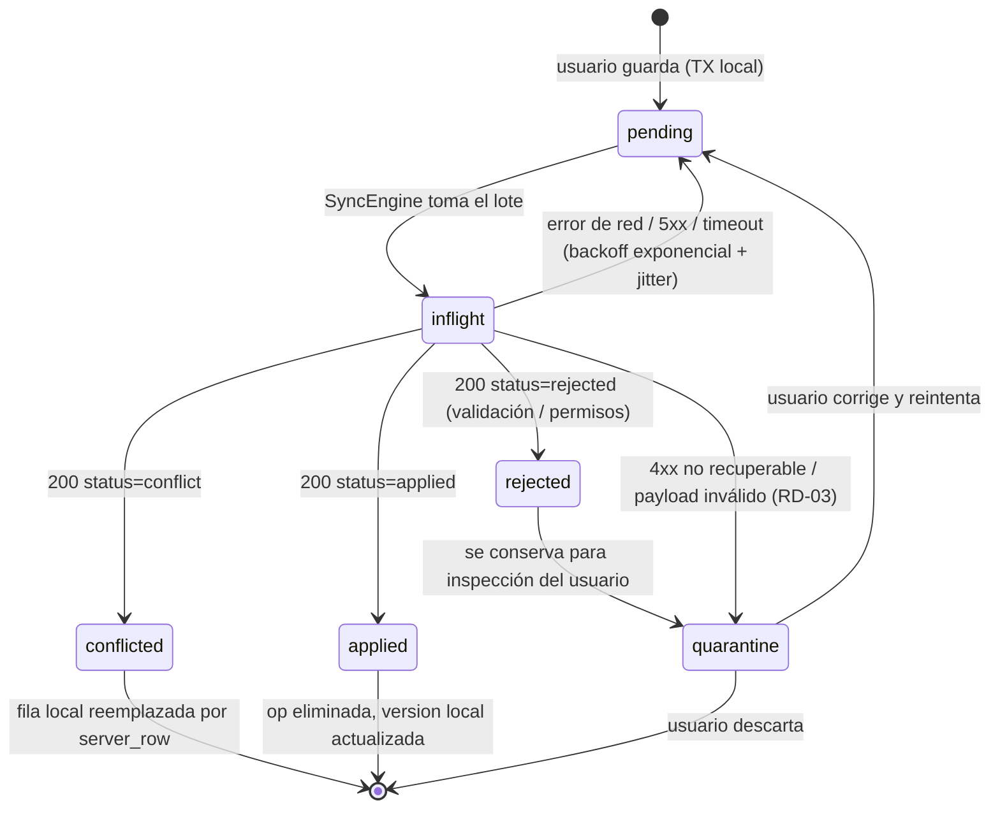
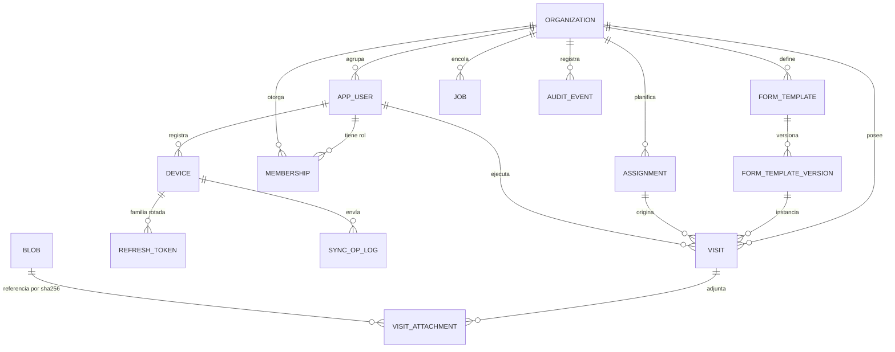

# Arquitectura propuesta — VisitaCampo

**Fecha**: 2026-07-30
**Estado**: Propuesta cerrada (decisiones tomadas, no abiertas)
**Alcance**: cliente móvil Android/iOS offline-first + plataforma/backend propia
**Documentos previos**: [00-indice.md](00-indice.md) … [07-hallazgos-revision-codigo.md](07-hallazgos-revision-codigo.md)

> Este documento **cierra** las cinco decisiones abiertas de [06-recomendaciones-visitacampo.md §6](06-recomendaciones-visitacampo.md#6-decisiones-que-este-análisis-no-puede-resolver-por-ti). Cada decisión queda registrada como ADR con alternativas evaluadas y consecuencias asumidas. Donde en los documentos 01–07 se usaban referencias `archivo:línea` del código de referencia, aquí se usan referencias `ADR-nnn` y `RD-nn` (Restricción de Diseño), porque el código de VisitaCampo aún no existe.

---

## 1. Resumen ejecutivo

VisitaCampo se construye como **un único codebase móvil en Flutter/Dart** (Android + iOS) contra una **plataforma propia en Python/Django + Django Ninja sobre PostgreSQL**, desplegada en **un solo VPS con Docker Compose y Caddy**, con adjuntos en **almacenamiento de objetos S3-compatible (Cloudflare R2)** subidos **directamente desde el dispositivo mediante URLs prefirmadas**. El cliente mantiene toda su información en **SQLite local (Drift + SQLCipher)** y escribe cada cambio en una **outbox transaccional** con UUID generado en el dispositivo; cuando hay red, la outbox se drena contra un endpoint de push idempotente. El patrón conceptual es exactamente el de QField ↔ QFieldCloud descrito en [03-integracion-sincronizacion.md §10](03-integracion-sincronizacion.md#10-patrón-a-replicar-en-visitacampo) — outbox + UUID cliente + resolución **server-authoritative** sin merge de 3 vías en el móvil — pero la implementación es deliberadamente **más simple y más barata**.

La diferencia arquitectónica más importante respecto a la referencia es que **VisitaCampo no encola la aplicación de los cambios**. QFieldCloud debe hacerlo porque aplicar un delta significa abrir un proyecto QGIS con un motor SIG headless dentro de un contenedor efímero ([02 §4](02-arquitectura-backend-qfieldcloud.md#4-procesamiento-asíncrono--jobs-sin-celery)); en VisitaCampo aplicar un cambio es un `INSERT ... ON CONFLICT` sobre Postgres. Por lo tanto el push se resuelve **síncrona y transaccionalmente dentro de la propia request**, devolviendo el estado por operación (`applied` / `conflict` / `rejected` / `duplicate`) **y la fila autoritativa del servidor cuando hay conflicto**. Esto elimina de un plumazo: el job `DELTA_APPLY`, la máquina de estados `PENDING→QUEUED→STARTED`, el polling con backoff del cliente, la re-descarga completa del proyecto tras un conflicto, y toda la clase de bugs de "job atascado en QUEUED" documentada en [07 § jobs stuck QUEUED](07-hallazgos-revision-codigo.md). La cola sobre Postgres (`SELECT ... FOR UPDATE SKIP LOCKED`) **sí** se conserva, pero solo para lo que realmente es asíncrono: generación de PDF/reportes, exportaciones masivas, notificaciones y webhooks.

En seguridad, los 16 hallazgos de [07-hallazgos-revision-codigo.md](07-hallazgos-revision-codigo.md) se tratan como **restricciones de diseño de primera clase** (§3, tabla RD-01…RD-16), no como notas al margen: validación TLS estricta siempre y sin excepción para self-hosted (pinning con consentimiento explícito), tokens de refresco almacenados **hasheados** con patrón selector/verificador, roles resueltos **una vez por request** en lugar de dentro del loop de operaciones, adjuntos **inmutables y direccionados por contenido** (lo que hace estructuralmente imposible el lost-update de `File.latest_version`), jobs con **lease + heartbeat + reaper**, deny-by-default en membresías, y *scrubbing* de secretos antes de persistir cualquier salida de job. El coste objetivo de operación en la fase MVP es del orden de **6–12 USD/mes** en total, y la arquitectura escala a "crecimiento moderado" (cientos de usuarios de campo, decenas de miles de visitas/año) sin cambiar de forma, solo de tamaño de máquina.

---

## 2. Supuestos de alcance y dimensionamiento

Toda decisión de este documento se justifica contra estos supuestos. **Si un supuesto cambia materialmente, hay que revisitar el ADR que lo cita.**

| # | Supuesto | Valor asumido |
|---|---|---|
| S-01 | Usuarios de campo concurrentes | 10–200 (MVP: <20) |
| S-02 | Visitas registradas | 10k–100k / año |
| S-03 | Adjuntos por visita | 3–15 fotos, ~1–3 MB c/u tras compresión en dispositivo |
| S-04 | Volumen de almacenamiento año 1 | 50 GB – 500 GB |
| S-05 | Picos de sync | ráfagas al final de jornada (decenas de dispositivos drenando outbox en ~1h) |
| S-06 | Componente geoespacial | **punto** de ubicación (lat/lon/altitud/precisión) + opcionalmente traza GPS ligera. **Sin edición vectorial, sin topología, sin capas raster, sin reproyección compleja** |
| S-07 | Equipo | 1 desarrollador (el dueño del proyecto), sin equipo de plataforma ni SRE |
| S-08 | Ventana offline máxima | 30 días sin conectar (retención de tombstones: 90 días) |
| S-09 | Multi-tenant real (varias organizaciones clientes) | **No en MVP**; probable en fase 2 |
| S-10 | Disponibilidad objetivo | 99% mensual (no 99.99%); el cliente offline absorbe caídas del backend |

**Corolario clave de S-06**: VisitaCampo **no necesita un motor SIG embebido**. Esto es lo que invalida el stack de QField (Qt6 + QGIS como librería, [01 §1](01-arquitectura-cliente-qfield.md#1-stack-tecnológico)) como referencia de implementación, aunque su *filosofía* siga siendo válida.

**Corolario clave de S-07**: cualquier componente que requiera operación experta continua (Kubernetes, Celery+Redis+beat, malla de microservicios, docker-in-docker) es un pasivo, no un activo. La complejidad operativa se trata como un coste de primera clase igual que el dinero.

---

## 3. Restricciones de diseño derivadas de la auditoría (07)

Estas restricciones son **vinculantes**. Cada ADR declara cuáles satisface. Cualquier PR que las viole debe rechazarse.

| ID | Origen en [07](07-hallazgos-revision-codigo.md) | Sev. | Restricción de diseño en VisitaCampo |
|---|---|---|---|
| **RD-01** | QField: bypass TLS self-hosted | CRITICAL | Prohibido cualquier callback que acepte certificados inválidos de forma incondicional. El único mecanismo de confianza para servidores propios es **pinning de SPKI con consentimiento explícito del usuario** mostrando fingerprint/CN/issuer/validez, persistido por host. Sin excepción por dominio, sin flag de build, sin variable de entorno. Ver ADR-009. |
| **RD-02** | QField: deref nulo antes de validar | HIGH | Todo dato que cruza la frontera de sync se parsea a tipos sellados (`freezed`/`sealed class`) con resultado `Ok/Err` explícito. Prohibido acceder a mapas/listas por índice o clave sin validación previa. Nunca `assert` como validación de datos externos (en Dart `assert` también se elimina en release). |
| **RD-03** | QField: validación solo con `Q_ASSERT` | HIGH | El contrato de sync se define en **OpenAPI 3.1 + JSON Schema** versionado, validado en **ambos** extremos: Pydantic v2 en servidor, parser generado + validación en cliente. Payload que no valida → dead-letter local/remoto + telemetría + opción "re-sincronizar todo", nunca crash. |
| **RD-04** | QField: race condition en deltafiles (`#if 0`) | HIGH | **Un solo escritor** sobre la base local: todas las mutaciones pasan por un único repositorio serializado (executor único de Drift). Prohibido dejar protecciones desactivadas "latentes" en el código; se eliminan o se activan. |
| **RD-05** | QField: leak en multipart upload | HIGH | Recursos de I/O siempre en `try/finally` o `using`; en Dart, streams de archivo cerrados en `finally`. El upload de adjuntos no arma multipart en memoria: es `PUT` directo por streaming a URL prefirmada. |
| **RD-06** | QField: path traversal en plugins | HIGH | **No hay sistema de plugins ejecutables.** Los formularios son **datos declarativos** (JSON Schema versionado), nunca código. Además, todo nombre de archivo recibido del servidor o del usuario se normaliza a un nombre generado localmente (`{uuid}.{ext}` con extensión de allow-list); el nombre original solo se guarda como metadato, jamás se usa para construir rutas. Ver ADR-012. |
| **RD-07** | qfieldcloud: N+1 de permisos en loop | HIGH | Los roles del usuario se resuelven **una sola vez por request** en un `RequestContext` inmutable. La autorización dentro de bucles es **evaluación en memoria pura**, cero queries. Test de regresión con `assertNumQueries` sobre un push de 200 operaciones. |
| **RD-08** | qfieldcloud: lost-update en `File.latest_version` | HIGH | Los adjuntos son **inmutables y direccionados por contenido** (`sha256`): un blob nunca se sobrescribe, no existe puntero `latest_version` mutable → el lost-update es imposible por construcción. Donde sí haya actualización concurrente (fila de negocio), se usa `INSERT ... ON CONFLICT DO UPDATE` con guarda de `version` (CAS), nunca read-modify-write sin lock. |
| **RD-09** | qfieldcloud: tokens en plaintext | MEDIUM | La BD **nunca** almacena un token utilizable. Refresh tokens: patrón `selector.verifier`; se indexa el `selector` (no secreto) y se guarda `sha256(verifier)` con comparación en tiempo constante. Access tokens: JWT firmado, no persistido. Ver ADR-008. |
| **RD-10** | qfieldcloud: race en invalidación single-session | MEDIUM | La rotación de refresh token ocurre dentro de `transaction.atomic()` con `SELECT ... FOR UPDATE` sobre la fila del dispositivo. Reuso de un token ya rotado ⇒ **revocación de toda la familia de tokens del dispositivo** + evento de auditoría. |
| **RD-11** | qfieldcloud: org-membership disclosure | MEDIUM | **Deny-by-default**: toda consulta de listado parte de un queryset ya restringido por el tenant/rol del solicitante (`scoped_qs(ctx)`), no de `objects.all()` filtrado después. Ninguna función de permiso retorna `True` sin comprobar pertenencia. |
| **RD-12** | qfieldcloud: job output expone secrets | MEDIUM | Los workers **no reciben secretos por variables de entorno**. Toda salida de job pasa por un `scrubber` con allow-list de campos antes de persistirse, y `job.output` solo es visible para rol ADMIN. Logging estructurado con redacción de claves conocidas (`password`, `token`, `authorization`, `dsn`, `secret`). |
| **RD-13** | qfieldcloud: jobs atascados en QUEUED | MEDIUM | Los jobs se toman con **lease** (`locked_by`, `locked_until`) y heartbeat; un *reaper* devuelve a `pending` los leases vencidos con incremento de `attempts`; superado `max_attempts` → `dead_letter`. Test obligatorio: matar el worker a mitad de job y verificar recuperación automática. |
| **RD-14** | qfieldcloud: TOCTOU en "un job activo por proyecto" | MEDIUM | Invariantes de concurrencia con **un solo mecanismo**: `pg_advisory_xact_lock` con clave derivada del tenant/entidad, o constraint único parcial en BD. Prohibido el double-bookkeeping en dos módulos. |
| **RD-15** | qfieldcloud: `SECURE_PROXY_SSL_HEADER` no validado | MEDIUM | Caddy **sobrescribe** `X-Forwarded-Proto` incondicionalmente y Django declara `USE_X_FORWARDED_HOST=False` + lista explícita de proxies confiables. El API redirige/rechaza tráfico no-HTTPS y emite HSTS. Test: spoof de `X-Forwarded-Proto` sobre HTTP plano debe fallar. |
| **RD-16** | qfieldcloud: fetches redundantes de `Project` | LOW | Resolución de la entidad de contexto una vez por request y colgada del `RequestContext`; `select_related`/`prefetch_related` obligatorios en listados. |

---

## 4. Arquitectura de alto nivel

### 4.1 Vista de componentes

```mermaid
flowchart TB
    subgraph DISP["Dispositivo de campo (Android / iOS) — Flutter"]
        UI["UI Flutter<br/>(Riverpod, formularios dinámicos)"]
        DOM["Dominio<br/>(casos de uso, validación)"]
        REPO["Repositorios<br/>(único escritor)"]
        DB[("SQLite + SQLCipher<br/>Drift")]
        OUT[["outbox<br/>(ops pendientes)"]]
        ATQ[["attachment_queue<br/>(blobs pendientes)"]]
        GPS["LocationSource<br/>(abstracción GPS)"]
        SEC["SecureStore<br/>Keychain / Keystore"]
        SYNC["SyncEngine<br/>(push / pull / backoff)"]
        BG["Background uploader<br/>WorkManager / BGTask"]
    end

    subgraph EDGE["Borde"]
        CADDY["Caddy<br/>TLS automático, HSTS,<br/>rate limit, X-Forwarded-*"]
    end

    subgraph VPS["VPS único — Docker Compose"]
        API["api: Django 5 + Django Ninja<br/>gunicorn/uvicorn"]
        WRK["worker: dequeue loop<br/>SKIP LOCKED + lease"]
        ADM["Django Admin<br/>(back-office fase 1)"]
        PG[("PostgreSQL 16<br/>datos + cola de jobs<br/>+ log de sync")]
    end

    subgraph OBJ["Almacenamiento de objetos (S3-compatible)"]
        R2[("Cloudflare R2<br/>blobs por sha256")]
        BAK[("bucket de backups<br/>pg_dump cifrado")]
    end

    OBS["Sentry (errores)<br/>+ Uptime check"]

    UI --> DOM --> REPO --> DB
    REPO --> OUT
    REPO --> ATQ
    GPS --> DOM
    SYNC --> OUT
    SYNC --> DB
    SEC -.tokens.-> SYNC
    BG --> ATQ

    SYNC -- "HTTPS · TLS estricto<br/>POST /sync/push · GET /sync/pull" --> CADDY
    BG -- "HTTPS · PUT prefirmado (bytes NO pasan por el API)" --> R2

    CADDY --> API
    API --> PG
    API --> ADM
    API -- "firma URLs, HEAD verificación" --> R2
    WRK --> PG
    WRK --> R2
    PG -. "pg_dump + restic" .-> BAK
    API --> OBS
    WRK --> OBS
```



**Decisión de forma explícita**: los **bytes de los adjuntos nunca atraviesan el API**. El dispositivo sube directo a R2 con una URL prefirmada y luego "confirma" el objeto contra el API, que verifica tamaño/checksum con un `HEAD`. Esto es lo que permite operar con un VPS de 4 GB y ancho de banda modesto bajo el supuesto S-03/S-04.

### 4.2 Flujo de sincronización end-to-end

```mermaid
sequenceDiagram
    autonumber
    participant U as Agente de campo
    participant APP as App (Flutter)
    participant LDB as SQLite local
    participant API as API (Django Ninja)
    participant PG as PostgreSQL
    participant R2 as Object storage

    Note over U,LDB: FASE OFFLINE
    U->>APP: Registra visita + 6 fotos
    APP->>LDB: TX única: INSERT visit + INSERT outbox_op(uuid, base_version=null) + INSERT attachment(sha256, state=local)
    LDB-->>APP: commit (UI optimista: la visita ya se ve)
    Note over APP: La app funciona igual sin red. Cero llamadas bloqueantes.

    Note over APP,R2: FASE ONLINE — carril de adjuntos (independiente)
    APP->>API: POST /v1/attachments/presign  [sha256, size, mime]
    API->>PG: ¿existe blob con ese sha256? (dedup)
    alt Ya existe
        API-->>APP: 200 {already_present: true}
    else No existe
        API-->>APP: 200 {upload_url, expires_in, required_headers}
        APP->>R2: PUT streaming (reanudable, background)
        APP->>API: POST /v1/attachments/{sha256}/commit
        API->>R2: HEAD (verifica size, content-length, checksum)
        API->>PG: INSERT blob(sha256, size, mime) ON CONFLICT DO NOTHING
        API-->>APP: 201 committed
    end

    Note over APP,PG: FASE ONLINE — carril de datos
    APP->>API: POST /v1/sync/push {device_id, batch_uuid, ops[]}
    API->>PG: BEGIN; pg_advisory_xact_lock(tenant)
    loop por operación (roles ya resueltos: 0 queries de permisos)
        API->>PG: ¿op_uuid ya en sync_op_log? → devuelve resultado guardado (idempotencia)
        API->>PG: UPSERT con guarda CAS: WHERE version = base_version
        alt version coincide
            PG-->>API: applied (version+1, change_seq nuevo)
        else version distinta
            PG-->>API: conflict → se adjunta la FILA AUTORITATIVA completa
        end
    end
    API->>PG: COMMIT
    API-->>APP: 200 [{op_uuid, status, server_row?, server_version}]

    alt Alguna op en conflicto
        APP->>LDB: reemplaza fila local por server_row, elimina op de outbox, marca "modificado en servidor"
        Note over APP: SIN merge de 3 vías. SIN re-descarga completa del proyecto.
    else Todas aplicadas
        APP->>LDB: borra ops de outbox, actualiza version local
    end

    APP->>API: GET /v1/sync/pull?cursor=<change_seq>&limit=500
    API->>PG: SELECT ... WHERE change_seq > cursor ORDER BY change_seq LIMIT n
    API-->>APP: {rows[], tombstones[], next_cursor, has_more}
    APP->>LDB: aplica en TX, guarda next_cursor
```

### 4.3 Máquina de estados de una operación de outbox (cliente)



**Nota de diseño**: `rejected` **nunca** se descarta en silencio — es el equivalente al `UNPERMITTED` auditable de QFieldCloud ([03 §4](03-integracion-sincronizacion.md#4-subida-y-aplicación-de-deltas-lado-servidor), punto 3) y al `FaultyDeltaFile` (punto 6), llevado al cliente: el agente de campo ve qué no se sincronizó y por qué, en lugar de perder trabajo.

### 4.4 Modelo de datos (servidor)



Tablas y campos con intención arquitectónica (no exhaustivo):

| Tabla | Campos clave | Razón de diseño |
|---|---|---|
| `visit` | `id UUID PK` (**generado en cliente**), `org_id`, `version INT`, `change_seq BIGINT`, `deleted_at`, `assignment_id`, `template_version_id`, `answers JSONB`, `lat`, `lon`, `accuracy_m`, `altitude_m`, `captured_at`, `device_id`, `created_by` | UUID cliente = idempotencia real ([04 §9.5](04-base-de-datos.md#9-patrón-a-replicar-en-visitacampo)). `version` = CAS optimista. `change_seq` = cursor de pull. `answers` en JSONB validado contra el JSON Schema de `template_version_id` (evita una migración por formulario). Ubicación como **columnas planas**, no geometría (ADR-005). |
| `sync_op_log` | `op_uuid UUID PK`, `device_id`, `batch_uuid`, `received_at`, `result JSONB`, `entity`, `entity_id` | Idempotencia: reenvío del mismo `op_uuid` devuelve el resultado guardado sin re-aplicar. Equivale al `Delta` de QFieldCloud pero **sin máquina de estados asíncrona** (ADR-003). Retención 90 días. |
| `blob` | `sha256 TEXT PK`, `size`, `mime`, `bucket_key`, `created_at` | **Inmutable, direccionado por contenido** ⇒ deduplicación gratis entre dispositivos y **RD-08 satisfecha por construcción** (no existe puntero mutable que perder). |
| `visit_attachment` | `id UUID PK`, `visit_id`, `sha256 FK→blob`, `role` (`foto`/`firma`/`doc`), `caption`, `captured_at`, `order` | Separa "qué archivo" de "dónde se usa". Un mismo blob puede estar en varias visitas sin duplicar bytes. |
| `job` | `id`, `type`, `status`, `payload JSONB`, `attempts`, `max_attempts`, `run_after`, `locked_by`, `locked_until`, `output JSONB (scrubbed)` | Cola sobre Postgres con **lease** (RD-13). Sin Redis, sin Celery. |
| `membership` | `(org_id, user_id) PK`, `role` | Plano y simple. Sin herencia multi-tabla, sin vistas SQL no gestionadas (§7). |
| `audit_event` | `id`, `org_id`, `actor_id`, `action`, `target`, `metadata JSONB`, `created_at`, `ip_hash` | Trazabilidad: quién sincronizó qué, quién revocó qué token, quién exportó datos. |

**Cursor de pull correcto (detalle que suele salir mal)**: `change_seq` se asigna dentro de la transacción de escritura **mientras se sostiene `pg_advisory_xact_lock(org_id)`**. Sin ese lock, una secuencia de Postgres puede commitear fuera de orden (la tx con `seq=9` commitea después que la de `seq=10`) y un cliente que ya avanzó su cursor a 10 **perdería para siempre** la fila 9. El lock serializa la asignación por organización; bajo S-01/S-05 (pushes en lotes, pocos por segundo) el coste es despreciable. *Escape hatch documentado*: si la contención llega a importar, migrar a cursor basado en snapshot (`pg_snapshot_xmin(pg_current_snapshot())`) o particionar el lock. Este mismo lock cubre **RD-14**.

**Tombstones**: los borrados son lógicos (`deleted_at`) y se propagan en el pull. Purga tras 90 días (> S-08). Un dispositivo cuyo cursor sea más viejo que la purga recibe `409 cursor_expired` y ejecuta un **bootstrap completo** — camino de recuperación explícito y probado, no un caso raro no manejado.

---

## 5. Architecture Decision Records

### ADR-001 — Cliente móvil: Flutter (Dart), un solo codebase

**Estado**: Aceptada · **Fecha**: 2026-07-30 · **Cierra**: [06 §6.1](06-recomendaciones-visitacampo.md#6-decisiones-que-este-análisis-no-puede-resolver-por-ti)

**Contexto**
Se requiere Android + iOS, fluidez en gama media/baja, un solo desarrollador (S-07), formularios dinámicos densos, cámara, GPS, trabajo en segundo plano y base de datos local robusta. No hay componente SIG pesado (S-06).

**Decisión**
**Flutter (canal stable, Dart 3) como único codebase para Android e iOS.** Arquitectura interna en tres capas espejo de la de QField ([01 §1](01-arquitectura-cliente-qfield.md#estructura-de-carpetas)): `core/` (dominio + sync, sin UI, testeable sin dispositivo) → `data/` (Drift, HTTP, storage seguro) → `ui/` (widgets + Riverpod). Modelos con `freezed` (clases selladas, `copyWith`, unions) para satisfacer **RD-02/RD-03**.

**Alternativas consideradas**

| Opción | Pros | Contras | Veredicto |
|---|---|---|---|
| **Flutter** | Un solo codebase real (incluida la UI); render propio ⇒ paridad visual y rendimiento predecible en gama baja; Drift/SQLite de primera clase; `background_downloader`, `geolocator`, `camera`, `flutter_secure_storage` maduros; compila AOT a nativo (sin puente JS); tooling de un solo comando | Dart es un lenguaje extra que aprender; tamaño de APK base ~8–15 MB; ecosistema de paquetes con calidad desigual (hay que auditar dependencias) | **Elegida** |
| React Native (+ Expo) | Ecosistema JS enorme; contratación fácil; buen soporte offline (WatermelonDB, op-sqlite) | Puente/JSI añade coste en listas largas y formularios densos en gama baja; el pipeline de actualizaciones OTA y la fragmentación de librerías nativas generan mantenimiento continuo; Expo con módulos nativos personalizados complica builds | Descartada |
| Kotlin Multiplatform + Compose Multiplatform | Kotlin excelente; se puede compartir solo el `core` y dejar UI nativa; SQLDelight muy sólido | Compose Multiplatform en iOS aún es el eslabón menos maduro; el "compartir solo lógica" implica **dos UIs** ⇒ viola el requisito de un solo codebase con S-07; curva de configuración de build alta | Descartada |
| Nativo separado (Kotlin + Swift) | Máxima calidad por plataforma, cero abstracciones | **Dos veces el trabajo** con un solo desarrollador; dos implementaciones del motor de sync ⇒ dos veces los bugs de sync (justo la parte más delicada) | Descartada |
| **Qt6/QML como QField** | Es la referencia; C++ eficiente; ya probado en campo | Sin QGIS embebido, Qt aporta poco y cuesta mucho: toolchain vcpkg/CMake compleja ([01 §1](01-arquitectura-cliente-qfield.md#1-stack-tecnológico)), 8 builds Android por push en CI ([05 §4](05-infraestructura-despliegue.md#4-cicd--qfield-cliente)), gestión manual de memoria (los hallazgos HIGH de [07] son en su mayoría *clases de bug de C++*: deref nulo, leak, downcast inseguro, race — **inexistentes en Dart**), UX móvil de QML por detrás de Material/Cupertino, ecosistema de paquetes móviles pobre | **Descartada explícitamente** |
| PWA / web app | Coste mínimo, sin tiendas | Fotos+GPS+background sync en iOS Safari siguen siendo poco fiables; cuota de almacenamiento evictable; el offline duro de una jornada completa no es defendible | Descartada |

**Por qué descartar Qt/QML es la decisión correcta, en una frase**: QField paga la complejidad de C++/Qt/vcpkg porque necesita *linkear QGIS*; VisitaCampo no linkea nada parecido, así que heredaría todo el coste sin ninguno de los beneficios — y además heredaría la *superficie de bugs de memoria* que la propia auditoría [07](07-hallazgos-revision-codigo.md) documenta (4 de 6 hallazgos HIGH de QField son imposibles de expresar en Dart).

**Consecuencias**
*Positivas*: una sola implementación del motor de sync (el componente de mayor riesgo); tests de dominio en Dart puro sin emulador; hot reload acelera el desarrollo de formularios; `dart analyze` + null-safety cubren estáticamente buena parte de RD-02.
*Negativas*: dependencia de la salud del proyecto Flutter y de paquetes de terceros → mitigación: **presupuesto de dependencias** (toda dependencia nueva requiere justificación; se prefiere plugin oficial de flutter.dev/Google o >1k likes con mantenimiento activo). Rendimiento del mapa base offline será inferior a un motor nativo → mitigación: ver ADR-012 (mapa base es fase 2 y se resuelve con `flutter_map` + PMTiles, suficiente para "ver dónde estoy").

**RD satisfechas**: RD-02, RD-03, RD-05 (parcial), RD-06.

---

### ADR-002 — Almacenamiento local: SQLite con Drift + SQLCipher

**Estado**: Aceptada · **Fecha**: 2026-07-30

**Contexto**
El almacén local debe soportar el patrón outbox: escribir **la fila de negocio y su operación de outbox en la misma transacción atómica**, sobrevivir a cierres abruptos (equivalente al `QgsGpkgFlusher` de QField, [01 §3](01-arquitectura-cliente-qfield.md#3-datos-geoespaciales-y-modo-offline)), soportar consultas de listado/filtro razonables, y cifrarse en reposo (los datos de campo y las coordenadas son sensibles y los teléfonos se pierden).

**Decisión**
**SQLite** vía **Drift** (`drift` + `sqlite3_flutter_libs`), con **SQLCipher** (`sqlcipher_flutter_libs`) y la clave de cifrado en Keychain/Keystore. Modo **WAL**, `synchronous=NORMAL`, **un único executor de escritura** (RD-04). El outbox es una tabla más, así que "guardar visita + encolar operación" es una transacción SQLite, no dos pasos con riesgo de divergencia.

**Alternativas consideradas**

| Opción | Pros | Contras | Veredicto |
|---|---|---|---|
| **Drift sobre SQLite** | SQL real con DSL tipado y migraciones versionadas; streams reactivos (la UI se actualiza sola al cambiar la tabla); transacciones multi-tabla explícitas; SQLCipher soportado; formato de archivo ubicuo (depurable con cualquier herramienta) | Algo de boilerplate/codegen; hay que escribir las migraciones a mano | **Elegida** |
| `sqflite` / SQLite crudo | Cero abstracción, mínimo peso | Sin tipado ni migraciones asistidas; consultas como strings ⇒ superficie de error justo donde no se quiere (RD-02) | Descartada |
| **PowerSync** | Resuelve el sync entero (Postgres ↔ SQLite) y es de altísima calidad | **Acopla la arquitectura a un servicio/licencia de terceros** y su modelo de reglas de sync; el conflicto se maneja según *su* modelo; coste recurrente; y el requisito explícito es una **plataforma propia**. La lógica de negocio de una visita (validación contra plantilla, reglas de asignación) no cabe bien en un replicador genérico | Descartada (reevaluable si el sync propio se volviera el cuello de botella) |
| WatermelonDB | Excelente modelo de sync por lotes | Es del ecosistema React Native; irrelevante tras ADR-001 | Descartada |
| ObjectBox | Muy rápido, API objetual agradable | Su Sync es comercial; formato propietario menos depurable; consultas ad-hoc/reportes locales más limitados que SQL | Descartada |
| Realm / Atlas Device Sync | Fue el referente de offline-first | MongoDB **descontinuó Atlas Device Sync**; adoptar un SDK cuya funcionalidad estrella fue retirada es riesgo de plataforma inaceptable para un proyecto a 5 años | Descartada |
| Isar / Hive | Rápidos y simples | Hive no es transaccional-relacional (mal encaje con outbox atómico); Isar tuvo un periodo de mantenimiento incierto | Descartada |

**Consecuencias**
*Positivas*: atomicidad real dato+outbox; el mismo SQL sirve para pantallas de listado y para el drenaje del outbox; `Stream` de Drift da UI optimista sin store global; migraciones locales versionadas y testeables.
*Negativas*: SQLCipher añade ~5–10% de CPU en I/O y ~2 MB al binario — aceptable y ampliamente compensado por el requisito de confidencialidad; hay que gestionar el ciclo de vida de la clave (rotación al re-loguear, borrado seguro en logout).
*Regla operativa*: el `PRAGMA user_version`/migración de Drift **nunca** se salta; toda migración destructiva pasa por un test de upgrade desde la versión N-1 con datos reales.

**RD satisfechas**: RD-04, RD-02 (tipado), RD-08 (CAS local con `version`).

---

### ADR-003 — Protocolo de sync: outbox + CAS por versión, aplicación **síncrona** y server-authoritative

**Estado**: Aceptada · **Fecha**: 2026-07-30

**Contexto**
[03-integracion-sincronizacion.md](03-integracion-sincronizacion.md) describe el pipeline de QFieldCloud: subir deltafile → crear `ApplyJob` → `dequeue` → contenedor QGIS efímero → aplicar → actualizar `Delta.last_status` → el cliente hace **polling con backoff** → si hay conflicto, el cliente **descarta todo y re-descarga el proyecto empaquetado**. Ese diseño existe porque *aplicar un cambio requiere QGIS*. En VisitaCampo aplicar un cambio es un UPSERT.

**Decisión**
1. **Outbox local** con `op_uuid` UUIDv7 generado en el dispositivo (idempotencia, [04 §9.5](04-base-de-datos.md#9-patrón-a-replicar-en-visitacampo)).
2. **`POST /v1/sync/push` aplica todo dentro de una transacción de Postgres y responde el resultado por operación en la misma request.** Sin job, sin polling, sin máquina de estados distribuida.
3. **Concurrencia optimista con CAS**: cada operación lleva `base_version`; el UPSERT lleva `WHERE version = base_version`. Si no coincide → `conflict`.
4. **Server-authoritative sin merge de 3 vías en el móvil** (se conserva la filosofía de [03 §5](03-integracion-sincronizacion.md#5-resolución-de-conflictos--server-authoritative)), **pero mejorado**: la respuesta de conflicto **incluye la fila autoritativa completa**, así que el cliente reemplaza esa fila y sigue — no re-descarga todo el proyecto.
5. **Pull incremental por cursor** `change_seq`, en lugar de "empaquetar y descargar el proyecto entero" (`PACKAGE` job de QFieldCloud).
6. **Carril de adjuntos independiente** con su propia cola y backoff exponencial (se conserva de [03 §6](03-integracion-sincronizacion.md#6-sincronización-de-adjuntos-fotos-archivos)), y **mejorado**: una visita se acepta aunque sus fotos aún no estén subidas (el adjunto queda `pending_upload`), de modo que un adjunto grande atascado nunca bloquea el dato estructurado.
7. **Contrato versionado** (`/v1/`, `schema_version` en el payload) validado con Pydantic v2 en servidor y parsers tipados en cliente (RD-03).

**Alternativas consideradas**

| Opción | Pros | Contras | Veredicto |
|---|---|---|---|
| **Aplicación síncrona transaccional** | Latencia de confirmación ~100–400 ms; sin estados intermedios; sin jobs atascados (RD-13 no aplica al camino crítico); mucho menos código | Un push muy grande ocupa un worker web; hay que acotar el tamaño del lote (máx. 500 ops / 5 MB, con `413` y paginación del lado cliente) | **Elegida** |
| Cola asíncrona + polling (como QFieldCloud) | Absorbe picos; aísla trabajo pesado | Innecesaria sin QGIS: añade una máquina de estados distribuida, polling con backoff, jobs zombis y latencia de minutos para lo que tarda milisegundos | Descartada |
| CRDTs (Automerge/Yjs) | Merge automático, sin conflictos visibles | Sobredimensionado: no hay edición colaborativa concurrente sobre el mismo registro; una visita tiene **un** autor. Coste de tamaño de metadatos y de razonamiento muy alto para cero beneficio en este dominio | Descartada |
| Last-write-wins por timestamp | Trivial | Depende del reloj del dispositivo (que en campo va mal); pérdida silenciosa de datos. Inaceptable en un sistema de registro | Descartada |
| Merge de 3 vías en el dispositivo | Conserva el trabajo del usuario en conflicto | Es "la parte más costosa y propensa a bugs de cualquier sistema offline-first" ([06 §1.4](06-recomendaciones-visitacampo.md#1-patrón-central-a-adoptar-sync-offline-first-basado-en-deltas)) | Descartada, explícitamente |

**Diseño del conflicto en la práctica**: en este dominio los conflictos son **raros por construcción** (cada visita la crea y edita un solo agente asignado). Cuando ocurren (p. ej. un supervisor cerró la visita desde el back-office mientras el agente la editaba offline), la política es: la fila del servidor gana, la versión local del agente se conserva en `quarantine` visible en la UI ("tu versión no se aplicó: [ver diferencias] [reenviar como corrección]"). **Nunca se descarta trabajo del usuario en silencio** — mejora explícita sobre `mDeltaFileWrapper->reset()` de QField ([03 §5](03-integracion-sincronizacion.md#5-resolución-de-conflictos--server-authoritative)).

**Consecuencias**
*Positivas*: ~60% menos superficie de código que el pipeline de referencia; confirmación inmediata al agente ("sincronizado" real, no "encolado"); depuración trivial (un log de request contiene todo el ciclo); pull incremental ahorra datos móviles.
*Negativas*: el API debe ser resiliente a lotes grandes (timeout de gunicorn ajustado, límite duro de tamaño de lote, `Content-Encoding: gzip`); el advisory lock por organización serializa pushes de una misma org (aceptable bajo S-01/S-05, medido en carga antes de MVP).

**RD satisfechas**: RD-02, RD-03, RD-07, RD-08, RD-13 (por eliminación del job en el camino crítico), RD-14.

---

### ADR-004 — Backend: Python 3.12 + Django 5 + Django Ninja

**Estado**: Aceptada · **Fecha**: 2026-07-30 · **Cierra**: [06 §6.2](06-recomendaciones-visitacampo.md#6-decisiones-que-este-análisis-no-puede-resolver-por-ti)

**Contexto**
Un desarrollador (S-07), presupuesto limitado, volumen moderado (S-01/S-02). El backend necesita: API de sync, validación estricta de payloads, ORM con migraciones, autenticación, **un back-office para supervisar/validar visitas y exportar** (necesidad real que suele olvidarse al presupuestar), y una cola de jobs.

**Decisión**
**Django 5.x LTS + Django Ninja + Pydantic v2 + PostgreSQL**, servido por gunicorn con workers `uvicorn`. **Django Admin como back-office de fase 1** (personalizado, no un CRUD crudo). Sin DRF.

**Por qué Django Ninja y no DRF** (mejora explícita sobre la referencia): DRF empuja hacia serializers + `permission_classes` por vista, que es precisamente el patrón que produjo el **N+1 de permisos** ([07 § N+1](07-hallazgos-revision-codigo.md)) y los **fetches redundantes de `Project`** en QFieldCloud. Ninja usa **Pydantic v2** (mismos esquemas que se exportan a OpenAPI 3.1 y se comparten conceptualmente con el contrato de sync — RD-03), da un OpenAPI correcto sin `drf-spectacular`, permite endpoints `async` cuando conviene, y encaja de forma natural con un **`RequestContext` resuelto una vez por request** (RD-07/RD-16) en lugar de clases de permiso que re-consultan.

**Alternativas consideradas**

| Opción | Pros | Contras | Veredicto |
|---|---|---|---|
| **Django + Ninja** | ORM y migraciones maduras; **Admin gratis** = back-office de fase 1 sin escribir frontend (ahorra semanas, ver §8); `django-axes` para rate limiting de login; ecosistema de auth probado; validación Pydantic; probado en este mismo dominio por QFieldCloud | Python es más lento por request que Go/Node (irrelevante a S-01: el cuello es la BD y la red, no la CPU); consumo de RAM ~120–250 MB por conjunto de workers | **Elegida** |
| Django + DRF | Es lo que usa la referencia; ecosistema enorme | Serializers verbosos; el modelo de permisos por vista invita al N+1 documentado; OpenAPI de segunda | Descartada |
| FastAPI (+ SQLAlchemy + Alembic) | Rápido, async nativo, Pydantic first-class, muy limpio | **Hay que construir a mano**: auth, migraciones, y sobre todo el **back-office completo** (semanas de trabajo o un servicio extra tipo Retool). Con S-07 eso es el factor decisivo | Descartada |
| NestJS / Node | Un solo lenguaje si el front web fuera TS; buen tooling | Mismo problema de back-office que FastAPI; TypeORM/Prisma con migraciones menos cómodas que Django; ecosistema de auth más fragmentado | Descartada |
| Go (chi/echo + sqlc) | Binario único, RAM mínima (~20 MB), concurrencia excelente, despliegue trivial | Sin admin, sin baterías; más código para lo mismo; a S-01 la eficiencia de Go no compra nada que el precio de un VPS más grande no compre por 5 USD | Descartada (candidato natural si algún día se extrae un servicio de ingesta de alto volumen) |
| Supabase / PocketBase como backend | Coste inicial casi nulo, auth+storage+realtime listos | La lógica **server-authoritative** (CAS, validación contra plantilla versionada, asignaciones, cursor con lock) acabaría repartida entre RLS, triggers y edge functions ⇒ difícil de testear y de mover. Acoplamiento fuerte del modelo de auth. Contradice "plataforma propia" | Descartada (ver ADR-010 para su uso como *proveedor de Postgres gestionado*, que sí es válido) |

**Consecuencias**
*Positivas*: el back-office existe desde el día 1 (validar visitas, ver adjuntos, revocar dispositivos, reintentar jobs, auditar) sin proyecto frontend; migraciones y test runner de serie; `manage.py check --deploy` en CI como red de seguridad de configuración (patrón tomado de [05 §3](05-infraestructura-despliegue.md#3-cicd--qfieldcloud)).
*Negativas*: Ninja es un proyecto más pequeño que DRF → mitigación: el uso es conservador (schemas + router + auth propia), migrable a DRF/FastAPI en días si hiciera falta, porque **la lógica vive en la capa de servicios, no en las vistas** (regla de arquitectura: las vistas solo hacen parseo → `service` → serialización).

**RD satisfechas**: RD-03, RD-07, RD-11, RD-16.

---

### ADR-005 — Base de datos: PostgreSQL 16 **sin PostGIS** (lat/lon como columnas), PostGIS diferido

**Estado**: Aceptada · **Fecha**: 2026-07-30 · **Cierra**: [06 §6.3](06-recomendaciones-visitacampo.md#6-decisiones-que-este-análisis-no-puede-resolver-por-ti)

**Contexto**
QFieldCloud usa PostGIS porque almacena geometrías vectoriales arbitrarias de QGIS, incluso en el modelo `Delta` (`old_geom`/`new_geom`, `GeometryField(srid=4326, dim=4)`, [04 §3](04-base-de-datos.md#3-sincronización--delta-y-job-coremodelspy)). VisitaCampo, por S-06, guarda **un punto por visita** y, opcionalmente, una traza.

**Decisión**
**PostgreSQL 16 puro.** La ubicación se modela como `lat double precision`, `lon double precision`, `accuracy_m real`, `altitude_m real`, `location_captured_at timestamptz`, con `CHECK` de rango e índice B-tree compuesto `(org_id, lat, lon)` para *bounding box*. Consultas "visitas a menos de X km" se resuelven con prefiltro por bounding box + Haversine en SQL. **PostGIS se habilita cuando y solo cuando** aparezca al menos uno de estos disparadores documentados: (a) consultas punto-en-polígono contra predios/veredas, (b) clustering espacial en el back-office con >100k puntos, (c) necesidad de exportar GeoPackage/Shapefile con geometrías reales.

**Alternativas consideradas**

| Opción | Pros | Contras | Veredicto |
|---|---|---|---|
| **Postgres puro, lat/lon** | Imagen oficial estándar (cualquier Postgres gestionado sirve: Neon, Supabase, RDS, VPS); menos RAM; sin dependencia de versiones PostGIS↔Postgres en upgrades; nada que aprender | Sin operadores espaciales; el radio se calcula a mano | **Elegida** |
| Postgres + PostGIS desde el día 1 | Índices GiST, `ST_DWithin`, exportación geoespacial nativa | Encadena las actualizaciones de Postgres a la compatibilidad de PostGIS; imagen más pesada; **restringe qué proveedores gestionados puedes usar barato**; cero beneficio bajo S-06 | Descartada (pero **la migración futura es `CREATE EXTENSION postgis` + una columna generada**, sin cambio de motor — coste de opción muy bajo) |
| `cube` + `earthdistance` | Extensiones en `contrib`, dan KNN indexado | Ergonomía pobre, poca gente lo conoce; si vas a instalar una extensión, instala PostGIS | Descartada |
| SQLite/Litestream en servidor | Ultra barato | Concurrencia de escritura insuficiente para el patrón de ráfaga S-05; sin `SKIP LOCKED` real para la cola; pierde `JSONB`/GIN | Descartada |
| MongoDB / Firestore | Esquema flexible para formularios | Sin transacciones multi-documento cómodas para el push atómico; el modelo relacional (asignación→visita→adjunto) es genuinamente relacional; Firestore acopla a Google | Descartada |

**Consecuencias**
*Positivas*: portabilidad total del proveedor de BD (palanca real de coste, ADR-010); `JSONB` + GIN cubre la flexibilidad de formularios sin sacrificar integridad relacional donde importa; una sola tecnología de datos hace también de cola de jobs (ADR-006).
*Negativas*: si el disparador (a) llega antes de lo previsto habrá una migración → mitigación: el acceso a ubicación se encapsula desde el día 1 en un `LocationRepository`, de modo que el cambio a `geography(Point,4326)` toque un archivo, no cien.
*Regla de higiene*: se conserva el patrón de [04 §9.4](04-base-de-datos.md#9-patrón-a-replicar-en-visitacampo) (guardar la ubicación **en el propio registro de auditoría/sync**, no solo en la entidad) para poder responder "dónde ocurrió cada cambio" sin reconstruir historia.

---

### ADR-006 — Cola de trabajos: tabla en Postgres con `SKIP LOCKED` + **lease**; sin Celery, sin Redis, sin docker-in-docker

**Estado**: Aceptada · **Fecha**: 2026-07-30

**Contexto**
Tras ADR-003, **el camino crítico de sync no necesita cola**. Lo que sí es asíncrono: generación de PDF/reportes de visita, exportaciones CSV/Excel masivas, envío de correo, notificaciones push, webhooks a sistemas del cliente, miniaturas de imágenes (si no se generan en el dispositivo) y tareas periódicas (reaper, purga de tombstones, backups, recálculo de métricas).

**Decisión**
Tabla `job` en Postgres, consumida por **un proceso `worker`** (mismo código, `python manage.py run_worker`) con `SELECT ... FOR UPDATE SKIP LOCKED` — el patrón sólido de `dequeue.py` señalado en [07 § Patrones sólidos a emular](07-hallazgos-revision-codigo.md#patrones-sólidos-a-emular) — **corregido con lease**:

- Al tomar un job: `locked_by = <worker_id>`, `locked_until = now() + lease`, `attempts += 1`.
- Heartbeat que extiende `locked_until` en jobs largos.
- **Reaper** periódico: `locked_until < now()` → vuelve a `pending` (**RD-13**).
- `attempts > max_attempts` → `dead_letter` + alerta (equivalente al `FaultyDeltaFile` de [04 §3](04-base-de-datos.md#3-sincronización--delta-y-job-coremodelspy), pero para jobs).
- Unicidad lógica con `idempotency_key` y **constraint único parcial**, no con "check de concurrencia" duplicado en dos módulos (**RD-14**).
- `job.output` pasa por `scrub()` antes de persistir y solo es legible por ADMIN (**RD-12**).
- Periódicos con el mismo mecanismo (`run_after`), **sin Celery Beat ni cron externo tipo `ofelia`**.
- **Sin docker-in-docker.** El worker es un proceso Python normal; no monta `/var/run/docker.sock`. La razón de QFieldCloud para hacerlo (aislar QGIS headless, [05 §5](05-infraestructura-despliegue.md#5-contenedores-efímeros--patrón-docker-in-docker)) no existe aquí, y el riesgo que la propia doc reconoce (el contenedor de jobs puede lanzar cualquier imagen en el host) no se acepta.

**Alternativas consideradas**

| Opción | Pros | Contras | Veredicto |
|---|---|---|---|
| **Cola en Postgres + SKIP LOCKED** | Cero infraestructura extra; transaccional con el dato ("encolar el PDF" es parte del mismo commit); inspeccionable con SQL y desde el Admin | No sirve para decenas de miles de jobs/seg (irrelevante a S-01/S-02); polling añade latencia ~1 s (irrelevante para PDFs) | **Elegida** |
| Celery + Redis | Estándar de facto; retries, chains, beat | +2 servicios que operar y monitorizar, +RAM, +modos de fallo, para un volumen que Postgres absorbe sin despeinarse. [06 §2](06-recomendaciones-visitacampo.md#2-cola-de-trabajos-celery-no-es-obligatorio) ya lo señala | Descartada |
| `django-q2` / `procrastinate` | Ya implementan cola sobre Postgres | `procrastinate` es una buena opción (usa `LISTEN/NOTIFY`); se descarta por control total sobre el lease y por evitar una dependencia en el componente donde la auditoría encontró bugs. **Reevaluar** si el código propio de cola supera ~300 líneas | Descartada (por poco) |
| Serverless (Cloud Run Jobs, Lambda) | Escala a cero | Otro entorno de despliegue que mantener; arranque en frío; complica el acceso a la BD y los secretos; contradice "un solo VPS" | Descartada |

**Consecuencias**
*Positivas*: `docker compose up` levanta **todo** el backend (api + worker + db); operable por una persona; los jobs se ven y se reintentan desde el Django Admin.
*Negativas*: hay que escribir el reaper y probarlo de verdad — **test obligatorio: `kill -9` al worker a mitad de job y verificar que el reaper lo recupera** (exactamente el test que [07](07-hallazgos-revision-codigo.md) recomienda y que la referencia no tiene).

**RD satisfechas**: RD-12, RD-13, RD-14.

---

### ADR-007 — Adjuntos: object storage S3-compatible desde el día 1, direccionado por contenido, subida directa prefirmada

**Estado**: Aceptada · **Fecha**: 2026-07-30

**Contexto**
Bajo S-03/S-04 los adjuntos son el 95%+ de los bytes y el principal riesgo de coste. QFieldCloud abstrae el storage (`django-storages` + backends propios, multi-backend simultáneo, [04 §4](04-base-de-datos.md#4-almacenamiento-de-archivos-docker-appqfieldcloudfilestoragemodelspy)) y **versiona** los archivos (`File`/`FileVersion`), lo que le costó el lost-update documentado en [07](07-hallazgos-revision-codigo.md).

**Decisión**
1. **S3-compatible desde el día 1** (no filesystem local), detrás de un puerto `BlobStore` con dos adaptadores: `S3BlobStore` (producción) y `LocalFsBlobStore` (tests y desarrollo sin red).
2. **Direccionado por contenido**: la clave es `blobs/{sha256[0:2]}/{sha256[2:4]}/{sha256}`. Un blob **es inmutable**; nunca se sobrescribe. ⇒ **RD-08 satisfecha por construcción**, deduplicación gratis (la misma foto reenviada por dos dispositivos ocupa una vez), y reintentos idempotentes.
3. **Subida directa del dispositivo a R2 con URL prefirmada** (`PUT`, expiración 15 min, `Content-Length` y `Content-Type` fijados en la firma). Los bytes **no pasan por el API** → el VPS no paga CPU ni ancho de banda por foto.
4. **Commit verificado**: tras el PUT, el cliente llama a `POST /v1/attachments/{sha256}/commit`; el servidor hace `HEAD` sobre el objeto y **verifica tamaño y checksum** antes de registrar el `blob`. Sin verificación, la subida prefirmada sería una vía para inyectar contenido arbitrario.
5. **Validación de entrada**: allow-list de MIME (`image/jpeg`, `image/png`, `image/webp`, `application/pdf`), tamaño máximo por archivo y por visita, *sniffing* de magic bytes en servidor, y **nombre de archivo generado localmente** — el nombre original solo es metadato (**RD-06**).
6. **Descarga** también por URL prefirmada de corta duración emitida tras comprobar permisos (nunca bucket público).
7. **Sin versionado lógico de archivos**: si el agente reemplaza una foto, es un `blob` nuevo y una fila nueva; la anterior se marca borrada. Se elimina toda la complejidad `File`/`FileVersion`/`latest_version`.

**Alternativas consideradas**

| Opción | Pros | Contras | Veredicto |
|---|---|---|---|
| **R2 / S3-compatible desde el día 1** | **Cloudflare R2: egreso 0 USD** (decisivo: el back-office descarga fotos constantemente); backups y blobs fuera del VPS ⇒ el VPS es desechable; escalable sin tocar código | Una cuenta y unas credenciales más que gestionar | **Elegida (R2)** |
| Filesystem local + abstracción | Cero coste inicial; simplísimo | Ata el estado al VPS: backup, migración y recuperación se vuelven dolorosas justo cuando duelen; a S-04 (cientos de GB) el disco del VPS se vuelve caro; sin subida directa, el API se convierte en cuello de botella | Descartada (el adaptador local se mantiene **solo** para tests/dev) |
| S3 de AWS | Estándar absoluto | **Egreso caro** — el asesino del presupuesto en una app con fotos | Descartada |
| Backblaze B2 / Wasabi / Scaleway | Muy baratos por GB | B2 tiene egreso gratis solo vía Cloudflare; Wasabi tiene mínimos mensuales y política de retención; R2 es más simple | Alternativas válidas, documentadas |
| Multi-backend simultáneo (como QFieldCloud) | Flexibilidad por proyecto | Complejidad sin caso de uso a este alcance | Descartada |

**Consecuencias**
*Positivas*: coste de almacenamiento predecible y bajo; VPS sin estado pesado; deduplicación real entre dispositivos (grande cuando varios agentes fotografían el mismo documento); el lost-update de la referencia es imposible.
*Negativas*: se depende de que el reloj del dispositivo no esté muy desviado para las URLs prefirmadas → mitigación: el servidor devuelve `server_time` en cada respuesta y el cliente usa *offset* corregido; y una URL vencida solo implica pedir otra. Hay que ejecutar un **job de recolección de basura** para blobs subidos pero nunca confirmados (>24 h).

**RD satisfechas**: RD-05, RD-06, RD-08, RD-11.

---

### ADR-008 — Autenticación: Argon2id + JWT de acceso corto + refresh opaco **hasheado** por dispositivo, con rotación y detección de reuso

**Estado**: Aceptada · **Fecha**: 2026-07-30

**Contexto**
Corrección directa de tres hallazgos: **tokens en plaintext** (RD-09), **race en invalidación single-session** (RD-10) y ausencia de límites de intentos. Además, el dispositivo pasa semanas offline: no puede depender de re-loguearse con frecuencia, pero un teléfono perdido debe poder revocarse.

**Decisión**

| Aspecto | Decisión |
|---|---|
| Contraseñas | **Argon2id** (`django[argon2]`), parámetros calibrados a ~100 ms en el VPS objetivo |
| Token de acceso | **JWT firmado (EdDSA/Ed25519)**, TTL **15 min**, claims mínimos (`sub`, `org`, `device`, `roles`, `jti`, `exp`). **No se persiste** ⇒ nada que filtrar en un backup |
| Token de refresco | **Opaco, 256 bits, patrón `selector.verifier`**: se indexa el `selector` (no secreto) y se almacena `sha256(verifier)`; comparación en **tiempo constante**. **La BD nunca contiene un token utilizable** (**RD-09**) |
| Rotación | Cada refresh **rota** el token. **Detección de reuso**: si llega un `verifier` ya rotado ⇒ se revoca **toda la familia del dispositivo**, se fuerza re-login y se emite `AuditEvent` + notificación. Todo dentro de `transaction.atomic()` + `SELECT FOR UPDATE` sobre la fila del dispositivo (**RD-10**) |
| Vida del refresh | 60 días con uso; revocación inmediata desde el back-office ("cerrar sesión en dispositivo X"); al superar S-08 sin conectar, re-login |
| Ámbito | **Un refresh por dispositivo** (no por usuario) ⇒ el agente puede tener tablet y teléfono; se revoca el aparato perdido sin echar al usuario. Mejora sobre el `single_token_clients` global de la referencia |
| Almacenamiento en el móvil | `flutter_secure_storage` → **Android Keystore** (`EncryptedSharedPreferences`) e **iOS Keychain** con `kSecAttrAccessibleAfterFirstUnlockThisDeviceOnly` (accesible tras el primer desbloqueo, **no** exportable en backup). Filosofía heredada de QField ([01 §4](01-arquitectura-cliente-qfield.md#4-autenticación)) sin su punto débil (master password fija en Linux) |
| Rate limiting | `django-axes` (backend BD, sin Redis): límite **por IP y por cuenta** con backoff exponencial + bloqueo temporal; endpoints `/auth/login`, `/auth/refresh` y `/attachments/presign` protegidos; respuesta genérica (sin revelar si el usuario existe) |
| Enumeración/temporización | Respuestas y tiempos uniformes en login fallido (hash "dummy" si el usuario no existe) |
| 401 | El cliente invalida el access token e intenta **un** refresh; si el refresh también falla → `Disconnected` y re-login, **sin borrar la outbox** (el trabajo del agente se conserva). Mejora sobre el "401 ⇒ logout duro" de [03 §2](03-integracion-sincronizacion.md#2-autenticación-en-el-flujo-de-sync) |
| MFA / SSO | **Fase 3**, y solo para roles administrativos vía OIDC. No en MVP |

**Alternativas consideradas**

| Opción | Pros | Contras | Veredicto |
|---|---|---|---|
| **JWT corto + refresh opaco hasheado** | Sin lookup de BD en cada request (la app sincroniza en ráfagas); revocación real vía refresh; nada utilizable en la BD | Un access token robado vale 15 min; hay que gestionar claves de firma y su rotación | **Elegida** |
| Solo tokens opacos en BD (como QFieldCloud) | Revocación instantánea, modelo simple | Un lookup de BD por request; y si se guarda mal, es el hallazgo RD-09. Con hashing es aceptable, pero pierde el ahorro de lookups | Descartada (por poco) |
| Solo JWT de larga vida | Simplísimo | **Irrevocable** — inaceptable con teléfonos que se pierden | Descartada |
| Auth gestionada (Auth0/Clerk/Firebase) | Menos código | Coste por MAU; dependencia externa en el camino crítico de una app **offline-first**; datos de identidad fuera de la plataforma propia | Descartada |

**Consecuencias**
*Positivas*: un volcado de la BD no entrega ninguna sesión activa; el reuso de refresh delata un robo de token; el back-office puede revocar por dispositivo.
*Negativas*: hay que gestionar la clave de firma Ed25519 (montada como secreto de archivo, rotable con periodo de gracia de dos claves); la detección de reuso puede disparar falsos positivos con reintentos concurrentes → mitigación: ventana de gracia de 30 s en la que el token recién rotado sigue aceptando **una** repetición del mismo `verifier` desde el mismo dispositivo.

**RD satisfechas**: RD-09, RD-10, RD-11, RD-12 (redacción en logs de auth).

---

### ADR-009 — TLS estricto siempre; confianza en servidores auto-hospedados **solo** por pinning con consentimiento explícito

**Estado**: Aceptada · **Fecha**: 2026-07-30 · **Corrige el hallazgo CRITICAL de [07](07-hallazgos-revision-codigo.md)**

**Contexto**
QField ignora **todos** los errores SSL para cualquier host que no termine en `.qfield.cloud` (`networkreply.cpp:102-110`), lo que hace trivial un MITM contra instancias auto-hospedadas: cosecha de credenciales en `POST /auth/token/` e inyección de respuestas de sync arbitrarias. Es silencioso: al usuario "le funciona". VisitaCampo previsiblemente tendrá instalaciones auto-hospedadas.

**Decisión**

1. **Prohibido** cualquier bypass de validación de certificado. En Dart, `badCertificateCallback` **retorna siempre `false`** salvo que exista un pin aprobado por el usuario para ese host exacto. No existe flag de build, `--insecure`, ni variable de entorno que lo cambie. **Regla de CI: la build falla si aparece `badCertificateCallback`, `allowBadCertificates` o similar fuera del módulo `TrustStore` auditado.**
2. **Instancia SaaS oficial**: **pinning de SPKI** (clave pública, no certificado) con **dos pines** (actual + siguiente) para permitir rotación sin romper clientes, y fecha de caducidad del pin con *fail-open a validación de CA estándar* si el pin caduca (evita el clásico "app bloqueada por pin vencido").
3. **Servidores auto-hospedados con certificado no confiable por la cadena de CA**: única vía = **TOFU explícito**. Diálogo modal a pantalla completa que muestre **fingerprint SHA-256, CN, SAN, issuer, validez y una advertencia de riesgo redactada sin jerga**, con confirmación deliberada (no un "OK" por defecto). El pin se guarda por host en almacenamiento seguro. Si el certificado del host cambia después → **se bloquea la conexión** y se exige nueva aprobación explícita.
4. **Camino recomendado y por defecto en la documentación**: no usar autofirmados. Caddy obtiene un certificado Let's Encrypt automáticamente con solo un nombre DNS (ADR-010), así que el caso "certificado inválido" debería ser **excepcional**, no la norma como en la referencia.
5. **Endurecimiento de plataforma**: Android `network_security_config.xml` con `cleartextTrafficPermitted="false"` y sin CAs de usuario para el dominio de la app; iOS ATS sin excepciones. HSTS (`max-age` ≥ 1 año) emitido por Caddy.
6. **Servidor**: TLS 1.2+ (preferido 1.3), redirección HTTP→HTTPS, `X-Forwarded-Proto` sobrescrito incondicionalmente y proxies confiables declarados (**RD-15**).

**Alternativas consideradas**

| Opción | Pros | Contras | Veredicto |
|---|---|---|---|
| **TLS estricto + pinning con TOFU explícito** | Cierra el MITM; el usuario decide informado y una sola vez | Requiere una pantalla de UI y gestión del almacén de pines | **Elegida** |
| Bypass para hosts no oficiales (como QField) | "Simplemente funciona" | **Vulnerabilidad CRITICAL**. No negociable | **Prohibida** |
| Solo CAs públicas, sin self-hosted con autofirmado | Máxima simplicidad | Excluye despliegues en redes cerradas sin DNS público | Descartada como única opción; es el **camino por defecto** documentado |
| mTLS (certificado de cliente por dispositivo) | Autenticación mutua fortísima | Distribución y rotación de certificados en cientos de teléfonos con S-07 es inviable | Descartada (fase 3 para clientes de alta exigencia) |

**Consecuencias**
*Positivas*: se elimina la clase de ataque que la auditoría marcó como CRITICAL; el pinning del SaaS añade defensa contra CAs comprometidas o interceptación corporativa.
*Negativas*: soporte deberá acompañar al primer cliente auto-hospedado en el TOFU; la rotación de pines exige un procedimiento escrito (documentado en el runbook, con pin de respaldo obligatorio).

**RD satisfechas**: RD-01, RD-15.

---

### ADR-010 — Hosting: VPS único con Docker Compose + Caddy; R2 para blobs y backups

**Estado**: Aceptada · **Fecha**: 2026-07-30 · **Cierra**: [06 §6.5](06-recomendaciones-visitacampo.md#6-decisiones-que-este-análisis-no-puede-resolver-por-tu)

**Contexto**
S-07 (una persona), S-10 (99%, el cliente offline absorbe caídas) y presupuesto limitado. QFieldCloud usa nginx + certbot + mkcert + memcached + ofelia + múltiples overrides ([05 §1](05-infraestructura-despliegue.md#1-qfieldcloud--entornos-vía-compose_file)); mucho de eso resuelve problemas que VisitaCampo no tiene.

**Decisión**
**Un VPS (Hetzner CX22 o equivalente: 2 vCPU / 4 GB / 40 GB, ~4–6 EUR/mes)** con Docker Compose y cuatro servicios: `caddy`, `api`, `worker`, `db`. Blobs y backups en **Cloudflare R2**.

- **Caddy en lugar de nginx+certbot+mkcert**: TLS automático (ACME) con una línea de configuración, HTTP/2 y HTTP/3, HSTS por defecto, gestión de `X-Forwarded-*` correcta (RD-15). Elimina tres servicios de la referencia.
- **Sin memcached**: cache local en proceso (`LocMemCache`) — con S-01 no hay nada que compartir entre pocos workers. Si algún día hace falta, se añade.
- **Sin ofelia/cron externo**: los periódicos van por la propia cola (ADR-006).
- **Un `docker-compose.yml` base + overrides seleccionados por `COMPOSE_FILE`**, patrón adoptado de [05 §6.1](05-infraestructura-despliegue.md#6-patrón-a-replicar-en-visitacampo): `override.dev.yml` (hot reload, MinIO local, MailHog), `override.selfhosted.yml` (incluye `db`), `override.managed.yml` (`db` externo). Así el salto a Postgres gestionado no reescribe nada.
- **`.env.example` exhaustivo + `scripts/check_envvars.sh` en CI** — patrón adoptado de [05 §6.2](05-infraestructura-despliegue.md#6-patrón-a-replicar-en-visitacampo).
- **Backups**: `pg_dump` diario cifrado (age/gpg) → R2 con retención 7/4/12 (diarios/semanales/mensuales) + snapshot del VPS del proveedor. **Restauración probada trimestralmente** con procedimiento escrito. Un backup no probado no es un backup.
- **Despliegue**: GitHub Actions construye la imagen → GHCR → `ssh` + `docker compose pull && up -d` + `migrate`. Sin blue/green en MVP; ventana de segundos que el cliente offline no percibe.
- **Observabilidad de bajo coste**: Sentry (plan gratuito), logs JSON con redacción (RD-12), `/healthz` (liveness) y `/readyz` (BD+storage), monitor de uptime externo gratuito, y `docker compose logs` con rotación. Sin Prometheus/Grafana en MVP. *(Enmendado por ADR-014: monitoreo interno opcional con Prometheus + Grafana.)*

**Alternativas consideradas**

| Opción | MVP (<20 usuarios) | Crecimiento moderado (100–200) | Complejidad operativa | Veredicto |
|---|---|---|---|---|
| **VPS + Compose + R2** | **~6–12 USD/mes** (VPS 5 + R2 1–5 + dominio) | ~25–60 USD/mes (VPS 8 vCPU/16 GB + R2) | **Media**: hay que parchear el SO, vigilar disco y probar backups | **Elegida** |
| Fly.io / Railway / Render | 15–35 USD/mes (app + Postgres gestionado con backups) | 80–200 USD/mes | **Baja**: `git push` y listo | **Plan B documentado**. Descartada en MVP por coste ×3 con S-07 disponible para operar |
| Supabase / Neon **solo como Postgres** + VPS para el API | +0–25 USD/mes | +25–70 USD/mes | Baja-media | **Ruta de evolución recomendada**: cuando la operación de la BD (backups, PITR, upgrades) canse, mover **solo** la BD. `override.managed.yml` ya está previsto para eso |
| Supabase como backend completo | ~0–25 USD/mes | 25–100 USD/mes | Baja | Descartada por ADR-004 (lógica server-authoritative dispersa en RLS/edge functions) |
| Kubernetes (GKE/EKS/k3s) | 70+ USD/mes | 150+ USD/mes | **Alta** | Descartada: sobre-ingeniería explícita según el requisito del usuario |
| AWS "bien hecho" (ECS+RDS+S3+ALB) | 80–150 USD/mes | 200–400 USD/mes | Alta | Descartada |

**Consecuencias**
*Positivas*: coste de infraestructura casi despreciable frente al valor entregado; todo el entorno reproducible con `docker compose up`; **cero lock-in** (Postgres estándar + S3 estándar + contenedores estándar ⇒ migrable a cualquier PaaS en una tarde).
*Negativas*: un único punto de fallo — mitigado, no eliminado, por: (a) el cliente es offline-first y una caída de horas no detiene el trabajo de campo (S-10), (b) blobs y backups viven fuera del VPS, (c) el runbook de recuperación permite reconstruir en <1 h desde una imagen limpia. Actualizaciones del SO y parcheo son responsabilidad propia → `unattended-upgrades`, SSH solo por clave, sin acceso público a Postgres, firewall por defecto cerrado.
*Disparador de migración documentado*: cuando el p95 de `/sync/push` supere 2 s de forma sostenida, o la operación consuma >4 h/mes, mover la BD a gestionada; si aun así persiste, mover el API a un PaaS.

**RD satisfechas**: RD-12, RD-15.

---

### ADR-011 — Multi-tenant: esquema compartido con `org_id` desde el día 1; organizaciones/equipos en fase 2

**Estado**: Aceptada · **Fecha**: 2026-07-30 · **Cierra**: [06 §6.4](06-recomendaciones-visitacampo.md#6-decisiones-que-este-análisis-no-puede-resolver-por-ti)

**Contexto**
QFieldCloud implementa `User`→`Person`/`Organization`/`Team` con **herencia multi-tabla** + `OrganizationMember` + `ProjectCollaborator` + **vistas SQL no gestionadas** (`*_with_roles_vw`) ([04 §1](04-base-de-datos.md#1-usuarios-y-organizaciones-docker-appqfieldcloudcoremodelspy)). Es potente y también la fuente del N+1 de permisos y del *disclosure* de membresías. El usuario inicial (S-09) no necesita eso.

**Decisión**
**Shared-schema multi-tenant con `org_id NOT NULL` en toda tabla de negocio desde la primera migración**, aunque en el MVP solo exista **una** organización.

- Modelo de identidad **plano**: `app_user` + `membership(org_id, user_id, role)`. **Sin herencia multi-tabla.**
- Roles fase 1: `OWNER`, `ADMIN`, `SUPERVISOR`, `FIELD_AGENT`, `VIEWER`. Fase 2 añade `TEAM` como agrupación **opcional** que solo afecta a la asignación de visitas, no a la resolución de permisos.
- **Sin vistas SQL de roles** en fase 1: la membresía se resuelve con **una** query al inicio de la request hacia el `RequestContext` (**RD-07**). Si la jerarquía creciera (equipos anidados, delegaciones), se introduce una **tabla desnormalizada de permisos efectivos mantenida por trigger** — preferible a la vista no gestionada, porque es indexable y migrable con el ORM.
- **Aislamiento**: todo acceso a datos pasa por `scoped_qs(ctx, Model)` que aplica `org_id = ctx.org_id`. Test de arquitectura que **falla la build** si un módulo de servicios usa `Model.objects` directamente sin scoping (**RD-11**). Un `CHECK`/FK compuesta refuerza que un `visit_attachment` no pueda cruzar organizaciones.
- **Deny-by-default en listados**: nada de `return True` sin comprobar pertenencia (**RD-11**, corrigiendo `can_read_members`).

**Alternativas consideradas**

| Opción | Pros | Contras | Veredicto |
|---|---|---|---|
| **Esquema compartido + `org_id` desde el día 1** | Coste ~0 hoy, migración a multi-tenant casi gratis mañana; una sola BD que respaldar | Requiere disciplina de scoping (se automatiza con test de arquitectura) | **Elegida** |
| Sin tenant hasta que haga falta | Menos columnas hoy | Añadir `org_id` a 15 tablas con datos en producción y auditar cada query es de las migraciones más caras y arriesgadas que existen | Descartada |
| Un esquema/BD por tenant | Aislamiento fuerte, útil para clientes regulados | Migraciones ×N, backups ×N, coste operativo ×N con S-07 | Descartada (reevaluar solo ante requisito contractual de aislamiento) |
| Herencia multi-tabla como la referencia | Elegante para `owner` polimórfico | JOIN extra en cada consulta y complejidad conceptual sin beneficio a este alcance | Descartada |

**Consecuencias**
*Positivas*: activar organizaciones en fase 2 es "insertar filas + habilitar pantallas", no rediseñar; el aislamiento se prueba automáticamente.
*Negativas*: un bug de scoping sería una fuga entre tenants → mitigación: test de arquitectura + suite de seguridad que, por cada endpoint, verifica que un usuario de la org A recibe `404` (no `403`, para no revelar existencia) sobre recursos de la org B.

**RD satisfechas**: RD-07, RD-11, RD-16.

---

### ADR-012 — Formularios como **datos declarativos versionados**, no como plugins ejecutables

**Estado**: Aceptada · **Fecha**: 2026-07-30

**Contexto**
QField permite plugins **QML dinámicos** con permisos por plugin ([01 §5](01-arquitectura-cliente-qfield.md#5-pluginsextensibilidad)) — potente, y la puerta del **path traversal ⇒ RCE** de [07](07-hallazgos-revision-codigo.md) (agravado por el bypass TLS: un MITM podía servir el "plugin"). VisitaCampo necesita cambiar formularios sin publicar en las tiendas, pero **no** necesita ejecutar código remoto.

**Decisión**
**`form_template` + `form_template_version`, con definición en JSON declarativo** (campos, tipos, etiquetas i18n, obligatoriedad, rangos, expresiones de visibilidad condicional de un **DSL restringido y sin efectos secundarios**, y reglas de validación). El renderizador de Flutter interpreta esa definición; **nunca** evalúa código remoto (`eval` prohibido, sin JS embebido, sin QML/Dart dinámico).

- Cada `visit` referencia la **versión exacta** de plantilla usada ⇒ las visitas históricas siguen siendo interpretables tras cambios de formulario (problema real que suele descubrirse tarde).
- **Doble validación**: en el dispositivo (UX inmediata) y en el servidor contra el mismo JSON Schema (autoridad). El cliente no es fuente de verdad (**RD-03**).
- Las plantillas viajan por el pull de sync como cualquier otro dato, firmadas implícitamente por venir del canal TLS autenticado; se cachean localmente y se validan estructuralmente antes de usarse.
- **Mapa base**: fuera del MVP. Fase 2, `flutter_map` + teselas **PMTiles** locales descargadas por área — datos, no código, y sin motor SIG (coherente con S-06).

**Consecuencias**
*Positivas*: se elimina por completo la clase RCE/path traversal (**RD-06**); formularios nuevos sin release de app ni revisión de tienda; retrocompatibilidad histórica garantizada.
*Negativas*: hay lógica de formulario que un DSL declarativo no puede expresar → mitigación: catálogo de tipos de campo extensible **en el binario** (cálculos y validaciones complejas se implementan en Dart y se referencian por nombre desde la plantilla). Si un cliente exige lógica arbitraria, la respuesta es una release, no un intérprete.

**RD satisfechas**: RD-03, RD-06.

---

### ADR-013 — Autorización: funciones de política puras sobre un `RequestContext` resuelto una vez

**Estado**: Aceptada · **Fecha**: 2026-07-30

**Contexto**
`permissions_utils.py` de QFieldCloud es un patrón sólido (funciones `can_*`/`check_*` puras, fáciles de auditar — reconocido en [07 § Patrones sólidos](07-hallazgos-revision-codigo.md#patrones-sólidos-a-emular)), pero su **invocación** dentro del loop de deltas produjo el N+1, y `can_read_members` retornaba `True` sin comprobar nada.

**Decisión**
- Se **conserva** el estilo: `can_x(ctx, recurso) -> bool` **puras**, sin I/O, en un módulo único auditable, con `check_x` que lanza la excepción HTTP correspondiente.
- Se **corrige** la invocación: un middleware/dependencia construye un `RequestContext` **inmutable** (`user_id`, `org_id`, `roles`, `device_id`, `entidad de contexto`) con **una sola query**, antes de cualquier bucle (**RD-07**, **RD-16**).
- **Deny-by-default**: la firma exige `ctx`; no existe una política que devuelva `True` incondicionalmente. Revisión obligatoria de cualquier PR que toque este módulo.
- **Test de presupuesto de queries**: `assertNumQueries` sobre un push de 200 operaciones — un número constante, independiente del tamaño del lote. Es el test que la referencia no tenía.
- Denegación por inexistencia: `404` en lugar de `403` para recursos de otro tenant (**RD-11**).

**Consecuencias**
*Positivas*: autorización testeable en aislamiento (funciones puras, sin BD); rendimiento de push independiente del tamaño del lote; toda la política en un archivo.
*Negativas*: hay que recordar refrescar el `ctx` si los roles cambian a mitad de request (caso inexistente en la práctica; los cambios de rol invalidan el access token en el siguiente refresh, ≤15 min).

**RD satisfechas**: RD-07, RD-11, RD-16.

---

### ADR-014 — Monitoreo de salud del servidor: Prometheus + Alertmanager + Grafana opcionales, y vigilancia externa

**Estado**: Aceptado (2026-10-17). **Enmienda** a ADR-010 en el punto "Sin Prometheus/Grafana en MVP".

**Contexto**: El equipo necesita saber si el servidor está sano y recibir un aviso cuando no lo está, con evidencia para ISO 27001 A.8.16. ADR-010 preveía solo un monitor de uptime externo y Sentry. Eso detecta "la API no responde", pero no avisa de que el disco se está llenando, el certificado no se renueva, los backups dejaron de hacerse o PostgreSQL está saturado, que son justo los fallos que en un VPS único terminan en pérdida de datos.

**Decisión**:
- **Capa interna opcional** en `infra/docker-compose.monitoring.yml`: Prometheus, Alertmanager (avisos por correo con el SMTP de la app), node-exporter, blackbox-exporter (sondas HTTPS a `/v1/healthz` y `/v1/readyz` por el dominio a través de Caddy, con verificación TLS real), postgres-exporter y Grafana con dashboard provisionado. Las interfaces solo escuchan en `127.0.0.1` y se usan por túnel SSH.
- **Capa externa**: `.github/workflows/uptime.yml`, cada 15 min, desde fuera del servidor. Abre y cierra un issue `incidente` automáticamente.
- Reglas de alerta con **pruebas unitarias** (`promtool test rules`) y una prueba de integración en CI que detiene la API y exige que la alerta llegue a Alertmanager.

**Alternativas consideradas**:

| Opción | Pros | Contras | Veredicto |
|---|---|---|---|
| Solo uptime externo + Sentry (ADR-010 original) | Cero RAM en el servidor | Ciego a disco, certificado, backups, saturación de BD | Insuficiente como única capa |
| Netdata / Beszel | Muy poca configuración | Reglas y paneles menos portables y menos fáciles de versionar y probar | Descartada |
| SaaS (Grafana Cloud, Better Stack) | Sin operar nada | Coste, datos de infraestructura en un tercero (A.5.23), dependencia de cuenta externa | Descartada para MVP |
| **Prometheus + Alertmanager + Grafana, opcionales** | Estándar, configuración como código, reglas probables, sin coste de licencias | ~400–500 MB de RAM: exige VPS ≥ 2 GB | **Elegida** |
| Añadir cAdvisor | Métricas por contenedor | Necesita el socket de Docker (equivale a root en el host) | Descartada |

**Consecuencias**: El VPS mínimo pasa a 2 GB si se activa el monitoreo. La salud de cada servicio se infiere por sus efectos (sondas, `pg_up`, métrica del backup) y no por métricas de contenedor. Sentry sigue siendo el complemento para errores de aplicación cuando se integre.

**RD satisfechas**: RD-12 (sin secretos en la configuración renderizada: la contraseña SMTP va a un archivo efímero).

---

## 6. Contrato de API (v1) — superficie mínima

| Método | Ruta | Propósito | Notas |
|---|---|---|---|
| `POST` | `/v1/auth/login` | usuario+password+`device_info` → `access` + `refresh` | Rate-limited por IP y cuenta (ADR-008) |
| `POST` | `/v1/auth/refresh` | rota el refresh | Detección de reuso ⇒ revoca familia |
| `POST` | `/v1/auth/logout` | revoca el refresh del dispositivo | No borra la outbox local |
| `GET` | `/v1/server/info` | versión de API, `schema_version`, `server_time`, capacidades | Permite negociar compatibilidad antes de sincronizar |
| `GET` | `/v1/sync/bootstrap` | estado inicial completo + `cursor` | Tras instalar o `cursor_expired` |
| `GET` | `/v1/sync/pull?cursor=&limit=` | filas cambiadas + tombstones + `next_cursor` | Paginado, orden estricto por `change_seq` |
| `POST` | `/v1/sync/push` | lote de operaciones idempotentes | **Aplicación síncrona transaccional** (ADR-003); máx. 500 ops / 5 MB |
| `POST` | `/v1/attachments/presign` | URL prefirmada de subida | Responde `already_present` si el `sha256` ya existe (dedup) |
| `POST` | `/v1/attachments/{sha256}/commit` | confirma y **verifica** el objeto | `HEAD` + validación de tamaño/MIME |
| `GET` | `/v1/attachments/{sha256}/url` | URL prefirmada de descarga | Solo tras comprobar permisos |
| `GET` | `/v1/jobs/{id}` | estado de un job asíncrono (reportes) | `output` scrubbed y solo ADMIN (RD-12) |
| `GET` | `/healthz` · `/readyz` | liveness / readiness | Sin autenticación, sin filtrar información |

**Errores**: cuerpo uniforme `{code, message, details?}` con `code` estable y legible por máquina (`conflict`, `cursor_expired`, `payload_too_large`, `schema_unsupported`, `rate_limited`, `attachment_checksum_mismatch`). El cliente mapea `code` a mensajes traducidos — patrón `CloudError` de [03 §8](03-integracion-sincronizacion.md#8-errores-de-red), que evita mostrar errores crudos del backend al agente de campo.

---

## 7. Qué se copia de QField/QFieldCloud y qué NO

### 7.1 Lo que SÍ se copia (patrones probados)

| # | Patrón | Origen | Cómo se aplica en VisitaCampo |
|---|---|---|---|
| C-01 | **Outbox/delta local con UUID generado en cliente** | [03 §10](03-integracion-sincronizacion.md#10-patrón-a-replicar-en-visitacampo), [04 §9.5](04-base-de-datos.md#9-patrón-a-replicar-en-visitacampo) | `outbox_op.op_uuid` (UUIDv7) es PK también en el servidor ⇒ idempotencia real (ADR-003) |
| C-02 | **UI optimista**: se aplica local y se sincroniza después | [06 §1.2](06-recomendaciones-visitacampo.md#1-patrón-central-a-adoptar-sync-offline-first-basado-en-deltas) | Dato + operación en la **misma** transacción SQLite (ADR-002) |
| C-03 | **Resolución server-authoritative, sin merge de 3 vías en el móvil** | [03 §5](03-integracion-sincronizacion.md#5-resolución-de-conflictos--server-authoritative) | CAS por `version`; el servidor decide (ADR-003) |
| C-04 | **Adjuntos en carril separado con reintento exponencial** | [03 §6](03-integracion-sincronizacion.md#6-sincronización-de-adjuntos-fotos-archivos) | Cola propia + backoff con jitter; una foto atascada no bloquea el dato (ADR-007) |
| C-05 | **Referencia de adjuntos por checksum** | [03 §6](03-integracion-sincronizacion.md#6-sincronización-de-adjuntos-fotos-archivos), [04 §4](04-base-de-datos.md#4-almacenamiento-de-archivos-docker-appqfieldcloudfilestoragemodelspy) | Direccionamiento por contenido `sha256` (ADR-007) |
| C-06 | **Subida en segundo plano con la app minimizada** | [01 §8.3](01-arquitectura-cliente-qfield.md#8-patrones-reutilizables-para-visitacampo), [03 §6](03-integracion-sincronizacion.md#6-sincronización-de-adjuntos-fotos-archivos) | `background_downloader` (WorkManager / URLSession background) |
| C-07 | **Abstracción de la fuente de posición** | [01 §3](01-arquitectura-cliente-qfield.md#3-datos-geoespaciales-y-modo-offline), `AbstractGnssReceiver` | Interfaz `LocationSource` con `DeviceGnss` y `MockGnss` (tests sin hardware); receptores externos posibles a futuro |
| C-08 | **Máquinas de estado explícitas** (no banderas booleanas) | [01 §2](01-arquitectura-cliente-qfield.md#2-arquitectura-general) | `SyncStatus`, `OutboxOpState`, `AttachmentState` como enums/sealed classes (§4.3) |
| C-09 | **Credenciales nunca en preferencias planas** | [01 §4](01-arquitectura-cliente-qfield.md#4-autenticación) | Keychain/Keystore vía `flutter_secure_storage` (ADR-008), **sin** la debilidad de master password fija |
| C-10 | **Reintento de push encolado al recuperar red** | [03 §7](03-integracion-sincronizacion.md#7-descarga--empaquetado-de-proyecto-lado-cliente) | `connectivity_plus` + backoff + sync periódico configurable (equivalente a `autoPushIntervalMins`) |
| C-11 | **Cola de jobs sobre Postgres con `SKIP LOCKED`** | [02 §4](02-arquitectura-backend-qfieldcloud.md#4-procesamiento-asíncrono--jobs-sin-celery) | Solo para reportes/exportes/notificaciones, **con lease y reaper** (ADR-006) |
| C-12 | **Funciones de política puras `can_*`/`check_*`** | [07 § Patrones sólidos](07-hallazgos-revision-codigo.md#patrones-sólidos-a-emular) | Conservadas, pero invocadas sobre un `RequestContext` (ADR-013) |
| C-13 | **Separación metadatos (Postgres) / binarios (storage abstraído)** | [04 §9.3](04-base-de-datos.md#9-patrón-a-replicar-en-visitacampo) | Puerto `BlobStore` con adaptadores S3 y local (ADR-007) |
| C-14 | **Preservar payloads corruptos en vez de descartarlos** | `FaultyDeltaFile`, [03 §4.6](03-integracion-sincronizacion.md#4-subida-y-aplicación-de-deltas-lado-servidor) | Dead-letter en servidor **y** `quarantine` visible en el cliente (§4.3) |
| C-15 | **Contrato de sync formal y compartido** | JSON Schema `deltafile_01.json`, [03 §3](03-integracion-sincronizacion.md#3-formato-del-delta) | OpenAPI 3.1 + Pydantic v2, versionado, validado en ambos extremos (RD-03) |
| C-16 | **Compose base + overrides por `COMPOSE_FILE`** y **`.env.example` validado en CI** | [05 §6.1–6.2](05-infraestructura-despliegue.md#6-patrón-a-replicar-en-visitacampo) | Idéntico (ADR-010) |
| C-17 | **`manage.py check --deploy` y `makemigrations --check` en CI** | [05 §3](05-infraestructura-despliegue.md#3-cicd--qfieldcloud) | Idéntico |
| C-18 | **Migraciones reversibles, nunca `RunSQL` crudo** | [07 § Patrones sólidos](07-hallazgos-revision-codigo.md#patrones-sólidos-a-emular) | Idéntico |
| C-19 | **Separar "preparación de datos" de "consumo en campo"** | QFieldSync desktop vs QField, [01 §3](01-arquitectura-cliente-qfield.md#3-datos-geoespaciales-y-modo-offline) | Back-office define plantillas y asignaciones; la app **solo consume y captura** |
| C-20 | **Rate limiting de login desde el día 1** | `django-axes`, [02 §5](02-arquitectura-backend-qfieldcloud.md#5-seguridad-y-autenticación) | Idéntico, por IP **y** por cuenta (ADR-008) |

### 7.2 Lo que NO se copia (y por qué)

| # | Se descarta | Origen | Motivo |
|---|---|---|---|
| N-01 | **Qt6/QML + QGIS embebido** | [01 §1](01-arquitectura-cliente-qfield.md#1-stack-tecnológico) | Sin necesidad SIG (S-06) es puro coste: toolchain vcpkg/CMake, 8 builds Android por push, UX móvil inferior, y una superficie de bugs de memoria (4 de 6 HIGH de [07]) que Dart no tiene. ADR-001 |
| N-02 | **Docker-in-docker / contenedores efímeros por job** | [02 §2](02-arquitectura-backend-qfieldcloud.md#2-arquitectura-de-servicios-docker-compose), [05 §5](05-infraestructura-despliegue.md#5-contenedores-efímeros--patrón-docker-in-docker) | Existe para aislar QGIS headless. Sin QGIS, montar `docker.sock` es solo un riesgo de escalada (reconocido en la propia doc de referencia). ADR-006 |
| N-03 | **Aplicación asíncrona de deltas + polling de estado** | [03 §1](03-integracion-sincronizacion.md#1-visión-general-del-flujo), [02 §4](02-arquitectura-backend-qfieldcloud.md#4-procesamiento-asíncrono--jobs-sin-celery) | Un UPSERT no necesita una máquina de estados distribuida. Se sustituye por aplicación transaccional síncrona ⇒ elimina polling, jobs zombis y latencia. **ADR-003, la mejora estructural más importante** |
| N-04 | **Re-descarga completa del proyecto ante conflicto (`packageAndDownload`)** | [03 §5](03-integracion-sincronizacion.md#5-resolución-de-conflictos--server-authoritative) | Malgasta datos móviles caros en campo. Se sustituye por **pull incremental por cursor** + fila autoritativa devuelta en la propia respuesta de conflicto |
| N-05 | **Descartar los deltas locales del usuario en conflicto (`reset()`)** | [03 §5](03-integracion-sincronizacion.md#5-resolución-de-conflictos--server-authoritative) | Pérdida silenciosa de trabajo del agente. Se sustituye por `quarantine` visible con opción de reenviar como corrección |
| N-06 | **Job `PACKAGE` / empaquetado por proyecto** | [02 §4](02-arquitectura-backend-qfieldcloud.md#4-procesamiento-asíncrono--jobs-sin-celery) | Existe para exportar proyectos QGIS a formato offline. Sin equivalente aquí |
| N-07 | **Formato deltafile con `old`/`new` completos, WKT y JSON-merge-patch** | [03 §3](03-integracion-sincronizacion.md#3-formato-del-delta) | Genérico porque QGIS tiene esquemas arbitrarios. VisitaCampo tiene entidades conocidas ⇒ operaciones tipadas + `base_version`: menos bytes, validación estática, menos ambigüedad |
| N-08 | **PostGIS y geometrías en el log de cambios** | [04 §3](04-base-de-datos.md#3-sincronización--delta-y-job-coremodelspy) | Un punto por visita no justifica la extensión ni las restricciones de upgrade/proveedor que impone. ADR-005 |
| N-09 | **Herencia multi-tabla `User`→`Person`/`Organization`/`Team`** | [04 §1](04-base-de-datos.md#1-usuarios-y-organizaciones-docker-appqfieldcloudcoremodelspy) | JOIN extra y complejidad conceptual sin beneficio. Modelo plano + `membership`. ADR-011 |
| N-10 | **Vistas SQL no gestionadas para roles (`*_with_roles_vw`)** | [04 §1](04-base-de-datos.md#1-usuarios-y-organizaciones-docker-appqfieldcloudcoremodelspy) | Fuera del ORM, migraciones manuales, y aun así no evitó el N+1. Se sustituye por `RequestContext` (ADR-013); si crece, tabla desnormalizada por trigger, no vista |
| N-11 | **Versionado lógico de archivos (`File`/`FileVersion`/`latest_version`)** | [04 §4](04-base-de-datos.md#4-almacenamiento-de-archivos-docker-appqfieldcloudfilestoragemodelspy) | Es la causa del **lost-update HIGH** de [07]. Blobs inmutables direccionados por contenido ⇒ el bug es inexpresable. **RD-08** |
| N-12 | **Múltiples backends de storage simultáneos + WebDAV** | [04 §4](04-base-de-datos.md#4-almacenamiento-de-archivos-docker-appqfieldcloudfilestoragemodelspy) | Flexibilidad sin caso de uso. Un `BlobStore`, dos adaptadores |
| N-13 | **Tokens de autenticación en plaintext y single-session global** | [07 § tokens plaintext](07-hallazgos-revision-codigo.md), [04 §5](04-base-de-datos.md#5-autenticación-docker-appqfieldcloudauthenticationmodelspy) | Hash selector/verifier, por dispositivo, con rotación y detección de reuso. **RD-09/RD-10**, ADR-008 |
| N-14 | **Bypass de TLS para hosts self-hosted** | [07 CRITICAL](07-hallazgos-revision-codigo.md) | Prohibido a nivel de CI. Solo pinning con consentimiento explícito. **RD-01**, ADR-009 |
| N-15 | **Plugins QML dinámicos (código remoto ejecutable)** | [01 §5](01-arquitectura-cliente-qfield.md#5-pluginsextensibilidad) | Vector de RCE vía path traversal + MITM. Formularios = **datos**, no código. **RD-06**, ADR-012 |
| N-16 | **Secretos inyectados como variables de entorno del job** | [07 § job output expone secrets](07-hallazgos-revision-codigo.md) | Los workers leen secretos del gestor de configuración del proceso, nunca del payload; `output` scrubbed y solo ADMIN. **RD-12** |
| N-17 | **nginx + certbot + mkcert** | [02 §2](02-arquitectura-backend-qfieldcloud.md#2-arquitectura-de-servicios-docker-compose) | Caddy hace lo mismo con una línea, incluye HSTS y HTTP/3, y elimina 2 servicios. ADR-010 |
| N-18 | **memcached, `ofelia`, `django-constance`, Stripe/planes, `mirror_transformation_grids`** | [02 §2](02-arquitectura-backend-qfieldcloud.md#2-arquitectura-de-servicios-docker-compose), [02 §1](02-arquitectura-backend-qfieldcloud.md#1-stack-tecnológico) | Cache en proceso; periódicos en la propia cola; config en entorno + Admin; sin facturación en MVP; sin grids PROJ porque no hay reproyección | 
| N-19 | **Matriz de 8 builds Android por push** | [05 §4](05-infraestructura-despliegue.md#4-cicd--qfield-cliente) | Flutter genera un App Bundle único con splits; el CI hace 1 build por plataforma |
| N-20 | **DRF (serializers + `permission_classes` por vista)** | [02 §3](02-arquitectura-backend-qfieldcloud.md#3-api-rest) | Patrón que facilitó el N+1 y los fetches redundantes. Django Ninja + `RequestContext`. ADR-004, **RD-07/RD-16** |

---

## 8. Plan de evolución por fases

### Fase 0 — Cimientos (2–3 semanas)

Contratos y esqueleto antes que funcionalidad.

- Repositorio monorepo: `app/` (Flutter), `server/` (Django), `docs/`, `infra/`.
- Contrato OpenAPI 3.1 de `/v1/sync/*` y `/v1/auth/*` **escrito primero**, con esquemas Pydantic; generación de modelos Dart desde el contrato.
- Migración inicial con `org_id` en todas las tablas (ADR-011) y `version`/`change_seq`/`deleted_at`.
- Esqueleto de `SyncEngine` con outbox y **tests de dominio en Dart puro** (sin emulador): idempotencia, backoff, conflicto, cursor expirado.
- CI: `dart analyze` + `flutter test`, `ruff` + `mypy` + `pytest`, `check --deploy`, `makemigrations --check`, `check_envvars.sh`, y el **lint que prohíbe `badCertificateCallback`** (RD-01).
- `docker compose up` funcional de punta a punta en local.

**Criterio de salida**: una visita creada offline en un emulador aparece en el Django Admin tras reconectar.

### Fase 1 — MVP (8–12 semanas)

Objetivo: un equipo real trabajando en campo.

| Incluido | Diferido y por qué |
|---|---|
| Login + registro de dispositivo + rotación de tokens (ADR-008) | **SSO/OIDC y MFA** — ningún usuario inicial lo pide; añade flujo y superficie |
| Captura de visita: formulario dinámico, punto GPS con precisión, fotos, firma | **Mapa base offline** — coordenadas + mapa online cuando hay red bastan para validar; PMTiles es fase 2 |
| Outbox + push/pull + adjuntos con subida en segundo plano | **Traza GPS continua** — consume batería y no está en el alcance mínimo (fase 3) |
| Conflictos con `quarantine` y reenvío | **Notificaciones push** — el pull periódico cubre la necesidad inicial (fase 2) |
| Back-office = **Django Admin personalizado**: listar/filtrar visitas, ver adjuntos, validar/rechazar, gestionar plantillas y asignaciones, revocar dispositivos, ver jobs y dead-letters | **SPA web propia** — semanas de trabajo que el Admin ahorra; se construye cuando el Admin estorbe, no antes (ADR-004) |
| Exportación CSV/Excel síncrona con límite de filas | **Reportes PDF** — se pueden generar desde el Admin manualmente al principio |
| Cola de jobs con lease + reaper (ADR-006), aunque con pocos tipos | **Escalado de workers** — uno basta |
| Backups a R2 + **restauración probada** + runbook | **Alta disponibilidad / réplica** — S-10 no lo exige |
| Sentry, `/healthz`, `/readyz`, logs con redacción | **Prometheus/Grafana** — sobredimensionado |
| **Suite de seguridad**: aislamiento entre orgs, presupuesto de queries, `kill -9` al worker, traversal de nombres de archivo, spoof de `X-Forwarded-Proto`, checksum de adjunto no coincidente, reuso de refresh token | — |

**Criterios de aceptación medibles**:
- Jornada completa (8 h) sin red: ≥50 visitas con 10 fotos c/u sin degradación perceptible.
- Drenaje de esa outbox en <5 min con 4G decente.
- p95 de `/sync/push` con 100 operaciones < 1.5 s.
- Arranque en frío en dispositivo de gama baja (2 GB RAM, Android 10) < 3 s.
- Cero pérdida de datos en 3 escenarios de fallo forzado: app matada a mitad de guardado, red cortada a mitad de push, servidor caído durante la subida.
- `assertNumQueries` constante en push independientemente del tamaño del lote.

### Fase 2 — Crecimiento moderado (según demanda)

Cada elemento se activa por un **disparador observable**, no por calendario.

| Elemento | Disparador |
|---|---|
| **Organizaciones/equipos multi-tenant** (ADR-011 activado) | Segundo cliente/organización real |
| **Reportes PDF por job** + plantillas | Petición recurrente de informes formales |
| **Notificaciones push** (FCM/APNs) para asignaciones nuevas | Los agentes preguntan "¿hay trabajo nuevo?" más de lo tolerable |
| **Mapa base offline** (`flutter_map` + PMTiles) | Los agentes se pierden o necesitan contexto espacial |
| **SPA de back-office** (React/Vue o Flutter Web) | El Admin limita el flujo de supervisión |
| **Postgres gestionado** (`override.managed.yml`) | La operación de la BD supera 4 h/mes o hace falta PITR |
| **Webhooks/integración** con el ERP del cliente | Primera petición de integración |
| **Miniaturas y derivados de imagen** por job | El back-office se vuelve lento cargando fotos |
| **PostGIS** | Cualquiera de los disparadores (a)/(b)/(c) del ADR-005 |

### Fase 3 — Escala y madurez

Réplica de lectura para el back-office; CDN delante de R2; métricas Prometheus + alertas; despliegue blue/green; SSO/OIDC y MFA para roles administrativos; auditoría exportable y retención configurable por cliente; tracking GPS opcional con muestreo adaptativo; mTLS para clientes de alta exigencia; y —solo si el volumen lo justifica de verdad— extracción del endpoint de ingesta a un servicio dedicado (candidato natural: Go, ADR-004).

---

## 9. Riesgos abiertos y cómo se vigilan

| Riesgo | Impacto | Mitigación / señal de alarma |
|---|---|---|
| Restricciones de ejecución en segundo plano de iOS limitan la subida de adjuntos con la app cerrada | Fotos que tardan más de lo esperado | `background_downloader` sobre URLSession background; UX que anima a dejar la app abierta al sincronizar; **medir** tiempo real de drenaje en iOS antes del MVP |
| El advisory lock por organización serializa los pushes | Latencia en el pico de fin de jornada (S-05) | Prueba de carga con 50 dispositivos simultáneos antes del MVP; escape hatch a cursor por snapshot documentado en ADR-005/§4.4 |
| Fuga entre tenants por un query sin scoping | Grave (confidencialidad) | Test de arquitectura que falla la build + suite de aislamiento por endpoint (ADR-011) |
| VPS único: fallo de host | Horas de indisponibilidad | Cliente offline-first absorbe (S-10); blobs y backups fuera del VPS; runbook de reconstrucción <1 h **probado** |
| Deriva de calidad en paquetes de Flutter | Mantenimiento | Presupuesto de dependencias; `flutter pub outdated` en CI; toda dependencia con envoltorio propio para poder sustituirla |
| Crecimiento de almacenamiento por encima de S-04 | Coste | Compresión en dispositivo + deduplicación por `sha256` + política de retención de adjuntos configurable; alerta al superar el 70% del presupuesto mensual |
| Un `op_uuid` colisiona o el reloj del dispositivo va mal | Datos mal ordenados | UUIDv7 con componente aleatorio suficiente; el orden autoritativo es `change_seq` del **servidor**, nunca el timestamp del cliente |

---

## 10. Tabla resumen de decisiones (referencia rápida)

| Dominio | Decisión | ADR |
|---|---|---|
| Cliente móvil | **Flutter (Dart 3), un solo codebase Android + iOS** | ADR-001 |
| Almacén local | **SQLite + Drift + SQLCipher**, escritor único, outbox transaccional | ADR-002 |
| Protocolo de sync | **Outbox + CAS por `version`, push síncrono transaccional, pull incremental por cursor, server-authoritative** | ADR-003 |
| Backend | **Python 3.12 + Django 5 + Django Ninja + Pydantic v2** (sin DRF), Admin como back-office | ADR-004 |
| Base de datos | **PostgreSQL 16 sin PostGIS**; lat/lon en columnas; PostGIS diferido con disparadores explícitos | ADR-005 |
| Cola de trabajos | **Tabla Postgres + `SKIP LOCKED` + lease + reaper**; sin Celery, Redis ni docker-in-docker; solo para reportes/exportes/notificaciones | ADR-006 |
| Adjuntos | **S3-compatible (Cloudflare R2) desde el día 1**, direccionado por contenido, `PUT` prefirmado directo + commit verificado | ADR-007 |
| Autenticación | **Argon2id + JWT Ed25519 de 15 min + refresh opaco hasheado (selector/verifier) por dispositivo**, rotación con detección de reuso, rate limiting | ADR-008 |
| TLS / self-hosted | **Validación estricta siempre**; pinning SPKI para el SaaS; TOFU explícito con fingerprint para self-hosted; bypass prohibido por CI | ADR-009 |
| Hosting | **VPS único + Docker Compose + Caddy**, R2 para blobs y backups; ~6–12 USD/mes en MVP; escape hatch a Postgres gestionado / PaaS | ADR-010 |
| Multi-tenant | **Esquema compartido con `org_id` desde el día 1**; organizaciones/equipos activados en fase 2 | ADR-011 |
| Formularios | **Plantillas declarativas versionadas (JSON Schema)**; sin plugins ejecutables | ADR-012 |
| Autorización | **Funciones de política puras sobre `RequestContext` resuelto una vez**; deny-by-default; `404` entre tenants | ADR-013 |

---

**Trazabilidad**: los 16 hallazgos de [07-hallazgos-revision-codigo.md](07-hallazgos-revision-codigo.md) están mapeados 1:1 a las restricciones RD-01…RD-16 (§3), y cada ADR declara cuáles satisface. Ninguna decisión de este documento queda abierta: las cinco preguntas de [06 §6](06-recomendaciones-visitacampo.md#6-decisiones-que-este-análisis-no-puede-resolver-por-ti) se responden en ADR-001 (framework móvil), ADR-004 (backend), ADR-005 (PostGIS), ADR-011 (multi-tenant) y ADR-010 (despliegue).

---

## Notas de alcance

- **La desviación mayor respecto a la referencia** es ADR-003 (aplicar el push de forma síncrona y transaccional en vez de encolarlo). Es lo que elimina el polling, la máquina de estados distribuida y los jobs zombis. El precio es que hay que acotar el tamaño de lote y medir el pico de fin de jornada; está anotado como riesgo con prueba de carga previa al MVP.
- **Las estimaciones de coste (§ADR-010) son cualitativas**, basadas en órdenes de magnitud de precios de VPS y almacenamiento de objetos, no en cotizaciones verificadas hoy. Conviene confirmarlas contra los precios vigentes de Hetzner y Cloudflare R2 antes de comprometerlas en un presupuesto.