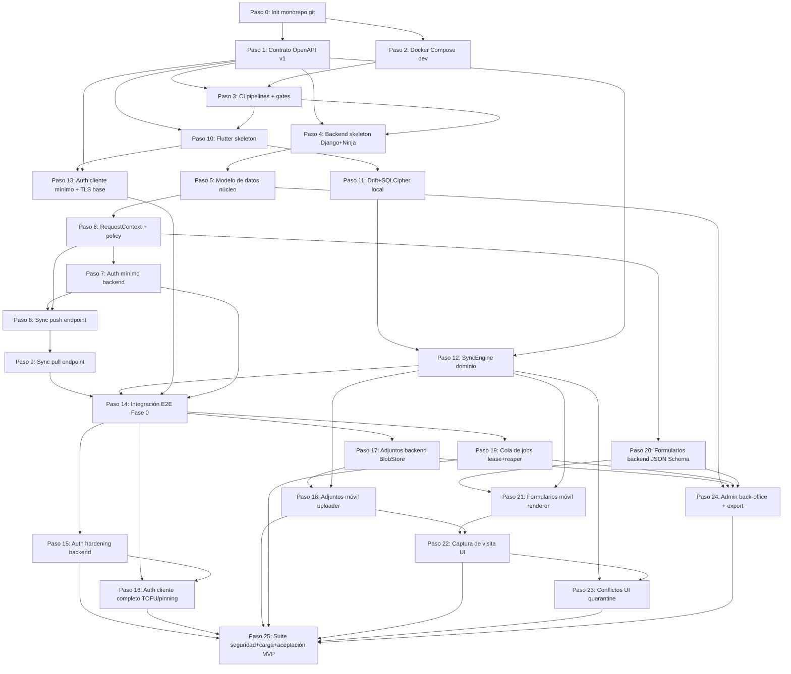

# Plan de construcción — VisitaCampo

**Generado**: 2026-07-30
**Modo**: directo (sin git/gh preexistente en el proyecto — este plan crea el control de versiones en el Paso 0 y a partir de ahí asume que existe)
**Alcance**: Fase 0 (Cimientos) y Fase 1 (MVP) del [documento 08 §8](../docs/08-arquitectura-propuesta-visitacampo.md#8-plan-de-evolución-por-fases), desglosadas en pasos de tamaño "un PR". Fase 2/3 se resumen como roadmap de alto nivel al final, sin desglose (para no sobre-planificar trabajo que aún no se va a ejecutar).
**Fuente de verdad arquitectónica**: [docs/08-arquitectura-propuesta-visitacampo.md](../docs/08-arquitectura-propuesta-visitacampo.md) (13 ADRs, estado "Propuesta cerrada" — ninguna decisión ahí se reabre en este plan).
**Fuente de restricciones de seguridad/calidad**: [docs/07-hallazgos-revision-codigo.md](../docs/07-hallazgos-revision-codigo.md) (21 hallazgos QField/QFieldCloud → RD-01…RD-16 en doc 08 §3).
**Protocolo de sync de referencia**: [docs/03-integracion-sincronizacion.md](../docs/03-integracion-sincronizacion.md).

---

## 0. Resumen ejecutivo

- **26 pasos** (Paso 0 a Paso 25), organizados en 4 tracks: Backend (Django), Móvil (Flutter), Infraestructura (Docker/CI/hosting), Integración (pasos seriales que unen ambos codebases o cierran una fase).
- **Duración estimada total**: ~11–15 semanas-persona con un solo desarrollador (S-07 del doc 08), consistente con el rango del doc 08 §8 (Fase 0: 2–3 semanas, Fase 1: 8–12 semanas). No es una suma lineal de "1 paso = 1 día": varios pasos son paralelizables entre el track Backend y el track Móvil una vez fijado el contrato de API (Paso 1).
- **Más de la mitad de los pasos tienen al menos un compañero paralelizable directo** (ver tabla de grupos en §1). Además, los dos tracks completos — Backend (Pasos 4–9) y Móvil (Pasos 10–13) — avanzan en paralelo en tiempo de calendario una vez fijado el contrato (Paso 1), aunque cada track sea internamente serial dentro de sí mismo. El mismo patrón se repite en Fase 1: los Pasos 15/17/19/20 (backend) y 16/18/21 (móvil) son grupos paralelos entre sí tras el cierre de Fase 0 (Paso 14). El paralelismo real depende de tener más de un agente/sesión trabajando simultáneamente; si se ejecuta con un solo agente secuencial, el orden topológico del grafo (§1) sigue siendo válido, solo que sin la ganancia de tiempo de calendario.
- **Fuera de alcance de este plan**: todo lo que el doc 08 §8 asigna a **Fase 2** (organizaciones/equipos multi-tenant reales, reportes PDF, notificaciones push, mapa base offline, SPA de back-office, Postgres gestionado, webhooks, miniaturas de imagen, PostGIS) y **Fase 3** (réplica de lectura, CDN, Prometheus/Grafana, blue/green, SSO/OIDC/MFA, auditoría exportable, tracking GPS continuo, mTLS, extracción de servicio de ingesta). Estas se resumen en §4 como roadmap, sin desglosar en pasos — desglosarlas ahora sería planificación especulativa sobre disparadores que aún no han ocurrido (doc 08 §8 Fase 2 dice explícitamente "cada elemento se activa por un disparador observable, no por calendario").
- **Modo de control de versiones**: el Paso 0 inicializa **un monorepo git único** (`app/`, `server/`, `docs/`, `infra/`, `plans/`), tal como especifica el doc 08 §8 Fase 0 ("Repositorio monorepo"). No se crean dos repos separados porque el propio documento de arquitectura ya cerró esa decisión; un monorepo también simplifica mantener sincronizados el contrato de API y su implementación en ambos lados bajo S-07 (un solo desarrollador). Sin `gh`/GitHub configurado, el plan opera en **modo directo**: cada paso se implementa y se commitea directamente sobre la rama de trabajo (se recomienda `main` protegida solo por disciplina personal, o una rama `dev` si el desarrollador prefiere, pero el plan no asume PRs/CI de GitHub — los "comandos de verificación" de cada paso son ejecutables localmente).

---

## 1. Vista de dependencias y paralelismo

**Tabla rápida de paralelismo** (pasos que pueden ejecutarse simultáneamente porque no comparten archivos ni dependen de outputs mutuos, una vez cumplidas sus dependencias):

| Grupo paralelo | Pasos | Condición |
|---|---|---|
| A | Paso 2 (Docker Compose) ‖ Paso 1 (Contrato OpenAPI) | Ambos solo dependen de Paso 0 |
| B | Paso 4–9 (Backend) ‖ Paso 10–13 (Móvil) | Ambos solo dependen de Paso 1 (contrato) + Paso 3 (CI) |
| C | Paso 15 (Auth hardening backend) ‖ Paso 17 (Adjuntos backend) ‖ Paso 19 (Cola de jobs) ‖ Paso 20 (Formularios backend) | Todos dependen solo de Paso 14, tocan módulos backend distintos (auth/, attachments/, jobs/, forms/) |
| D | Paso 16 (Auth cliente completo) ‖ Paso 18 (Adjuntos móvil, tras Paso 17) ‖ Paso 21 (Formularios móvil, tras Paso 20) | Tocan subárboles Flutter distintos (`core/auth/`, `core/attachments/`, `ui/forms/`) |
| E | Paso 23 (Conflictos UI) puede empezar en paralelo con Paso 24 (Admin+export, backend) | Codebases distintos |

---

## 2. Pasos — Track Infraestructura

### Paso 0 — Inicialización del monorepo y control de versiones

**Dependencias**: ninguna (usa solo lo que ya existe hoy en `docs/`).
**Paralelizable**: no (es el primer paso, todo lo demás depende de él).
**Tier de modelo**: estándar.

**Contexto**: El proyecto `C:\Users\USUARIO\Documents\- Desarrollos\SeguimientoCampo\VisitaCampo` no tiene `.git`. El doc 08 §8 (Fase 0) especifica explícitamente "Repositorio monorepo: `app/` (Flutter), `server/` (Django), `docs/`, `infra/`". Este paso crea esa estructura y el repositorio git que todos los pasos posteriores asumen que existe.

**Tareas**:
1. En la raíz del proyecto, ejecutar `git init`.
2. Crear la estructura de directorios: `app/` (contendrá el proyecto Flutter, creado en Paso 10), `server/` (contendrá el proyecto Django, creado en Paso 4), `infra/` (Docker Compose, Caddy, scripts — Paso 2), `plans/` (ya existe, contiene este plan), `docs/` (ya existe).
3. Crear `.gitignore` raíz cubriendo: artefactos Flutter (`app/build/`, `.dart_tool/`, `*.g.dart` generado si se decide no versionarlo — decidir y documentar), artefactos Python (`server/**/__pycache__`, `*.pyc`, `.venv/`), secretos (`.env`, `*.pem`, `*.key`), artefactos Docker locales.
4. Crear `README.md` raíz con: qué es VisitaCampo (una frase), enlace a `docs/08-arquitectura-propuesta-visitacampo.md` como fuente de verdad, cómo levantar el entorno local (referencia adelantada a Paso 2).
5. Commit inicial: `git add` + commit con mensaje descriptivo (p.ej. "Inicializa monorepo VisitaCampo: estructura app/server/infra/docs").
6. Documentar en el README la convención de commits que se seguirá el resto del plan (mensajes descriptivos, un commit por paso del plan como mínimo, sin exigir Conventional Commits salvo que el desarrollador lo prefiera).

**Comandos de verificación**:
- `git status` → árbol de trabajo limpio tras el commit.
- `git log --oneline` → al menos un commit.
- Verificar que `app/`, `server/`, `infra/` existen como directorios (pueden estar vacíos con un `.gitkeep` si es necesario, o poblarse ya en pasos posteriores).

**Criterios de salida/aceptación**:
- Repositorio git inicializado y con al menos un commit.
- Estructura de carpetas de nivel superior coincide con doc 08 §8 Fase 0.
- Ningún hallazgo de doc 07 aplica directamente a este paso (es puramente organizativo), pero sienta la base para RD-01 (Paso 3 añadirá el lint de CI que prohíbe `badCertificateCallback`).

**Estrategia de rollback**: si la estructura elegida resulta incorrecta, es un `git rm -r` + recrear — no hay datos de producción ni dependencias externas todavía. Bajo riesgo por definición.

---

### Paso 1 — Contrato de API v1 (OpenAPI 3.1 + esquemas Pydantic)

**Dependencias**: Paso 0.
**Paralelizable**: sí, con Paso 2 (Docker Compose) — no comparten archivos.
**Tier de modelo**: **fuerte** (esta es una decisión de diseño delicada: el contrato fija la superficie de acoplamiento entre dos codebases completos; errores aquí se propagan a todo el resto del plan).

**Contexto**: El doc 08 §8 Fase 0 exige "Contrato OpenAPI 3.1 de `/v1/sync/*` y `/v1/auth/*` escrito primero, con esquemas Pydantic; generación de modelos Dart desde el contrato." Esto es RD-03 aplicado desde el día 1: el contrato de sync se define formal y versionado, validado en ambos extremos. La superficie mínima ya está enumerada en [doc 08 §6](../docs/08-arquitectura-propuesta-visitacampo.md#6-contrato-de-api-v1--superficie-mínima) — este paso la transcribe a un archivo OpenAPI real, no la reinventa.

**Tareas**:
1. Crear `server/openapi/v1.yaml` (o `.json`) con especificación OpenAPI 3.1 cubriendo, como mínimo, los endpoints de doc 08 §6: `POST /v1/auth/login`, `POST /v1/auth/refresh`, `POST /v1/auth/logout`, `GET /v1/server/info`, `GET /v1/sync/bootstrap`, `GET /v1/sync/pull`, `POST /v1/sync/push`, `POST /v1/attachments/presign`, `POST /v1/attachments/{sha256}/commit`, `GET /v1/attachments/{sha256}/url`, `GET /v1/jobs/{id}`, `GET /healthz`, `GET /readyz`.
2. Para cada endpoint, definir request/response schemas incluyendo los campos de doc 08 §4.4 relevantes: `visit` (con `id` UUID, `org_id`, `version`, `change_seq`, `deleted_at`, `answers` JSONB, `lat`/`lon`/`accuracy_m`/`altitude_m`, etc.), estructura de operación de sync push (`op_uuid`, `base_version`, `entity`, `payload`), y el cuerpo de error uniforme `{code, message, details?}` con los códigos ya enumerados (`conflict`, `cursor_expired`, `payload_too_large`, `schema_unsupported`, `rate_limited`, `attachment_checksum_mismatch`).
3. Anotar explícitamente en el schema de `POST /v1/sync/push` los límites de lote (máx. 500 ops / 5 MB, doc 08 ADR-003) como restricciones documentadas (`maxItems`, descripción de límite de tamaño — OpenAPI no valida bytes totales, así que se documenta como nota y se aplica en Paso 8).
4. Versionar el contrato: incluir `schema_version` en el payload de sync, tal como exige RD-03.
5. Decidir y documentar (en un `server/openapi/README.md`) la estrategia de generación de código: Pydantic v2 desde el YAML en servidor (o Pydantic v2 escrito a mano siguiendo el YAML como fuente de verdad — decisión operativa simple, documentarla) y generación de modelos Dart (`freezed`/`json_serializable`) desde el mismo contrato, o al menos modelos Dart escritos a mano que se validan contra el contrato en un test de contrato (ver Paso 12).
6. Añadir un validador de sintaxis OpenAPI al conjunto de comandos de verificación (herramienta CLI standalone, p.ej. `openapi-spec-validator` vía `pip` temporal, o el propio validador que se instalará como parte de Paso 4).

**Comandos de verificación**:
- Validación de sintaxis OpenAPI 3.1 (`openapi-spec-validator server/openapi/v1.yaml` o equivalente) → sin errores.
- Revisión manual: cada endpoint de doc 08 §6 tiene una entrada correspondiente en el YAML.

**Criterios de salida/aceptación**:
- El archivo de contrato existe, es válido sintácticamente, y cubre el 100% de los endpoints de doc 08 §6.
- **RD-03** (validación con OpenAPI 3.1 + JSON Schema, ambos extremos) queda satisfecha en su parte de definición de contrato (la validación en runtime se implementa en Pasos 4–9 y 10–13).
- El cuerpo de error uniforme está definido una sola vez y reutilizado en todos los endpoints (evita duplicación / inconsistencia entre pasos posteriores).

**Estrategia de rollback**: el contrato es un artefacto versionado en git; si un endpoint se diseñó mal, se corrige con un nuevo commit y se propaga como cambio de contrato a los pasos que ya lo consumieron (Pasos 4–13) — por eso este paso usa tier "fuerte": un error aquí es caro de corregir después.

---

### Paso 2 — Docker Compose de desarrollo (Caddy, Postgres, esqueleto de servicios)

**Dependencias**: Paso 0.
**Paralelizable**: sí, con Paso 1.
**Tier de modelo**: estándar.

**Contexto**: Doc 08 ADR-010 especifica cuatro servicios (`caddy`, `api`, `worker`, `db`) con un patrón de `docker-compose.yml` base + overrides por `COMPOSE_FILE` (`override.dev.yml`, `override.selfhosted.yml`, `override.managed.yml`), heredado de [05 §6.1](../docs/05-infraestructura-despliegue.md) según cita del doc 08. Este paso crea el compose de **desarrollo** únicamente; `api` y `worker` apuntarán a código que aún no existe hasta Pasos 4 y 19, así que este paso los deja como placeholders funcionales (imagen base + comando de espera) o los deja comentados con instrucciones claras de cuándo activarlos.

**Tareas**:
1. Crear `infra/docker-compose.yml` con servicios `db` (Postgres 16 oficial) y `caddy` (Caddy oficial) mínimamente funcionales.
2. Crear `infra/docker-compose.override.dev.yml` con configuración de desarrollo: puertos expuestos, hot-reload placeholder para `api` (se completa en Paso 4), `MinIO` o adaptador local de storage para simular S3 sin red (anticipa ADR-007 / Paso 17), `MailHog` si se decide para pruebas de correo futuras (opcional, documentar si se omite).
3. Crear `infra/Caddyfile` con TLS automático para el dominio de producción (parametrizado por variable de entorno) y, para desarrollo local, modo HTTP simple o certificados internos de Caddy — documentar la diferencia.
4. Crear `.env.example` en la raíz o en `infra/`, exhaustivo, cubriendo como mínimo: `POSTGRES_*`, `DJANGO_SECRET_KEY`, `DJANGO_DEBUG`, credenciales R2/S3 (placeholders), `JWT_SIGNING_KEY` (placeholder), dominio de Caddy — patrón C-16 del doc 08 §7.1.
5. Crear `infra/scripts/check_envvars.sh` que compare `.env` real contra `.env.example` y falle si faltan variables — patrón explícito del doc 08 ADR-010 (adoptado de [05 §6.2]).
6. Documentar en `infra/README.md` cómo se selecciona el override vía `COMPOSE_FILE` (aunque `override.selfhosted.yml`/`override.managed.yml` se completen en pasos posteriores de infraestructura de producción, fuera del alcance estricto de Fase 0/1 salvo lo mínimo para desplegar el MVP — ver Paso 24/25 si aplica desliegue real).

**Comandos de verificación**:
- `docker compose -f infra/docker-compose.yml -f infra/docker-compose.override.dev.yml config` → YAML válido, sin errores de interpolación.
- `docker compose ... up db` → Postgres arranca y acepta conexiones (`pg_isready`).
- `bash infra/scripts/check_envvars.sh` contra un `.env` de prueba con una variable faltante → falla con mensaje claro; contra uno completo → pasa.

**Criterios de salida/aceptación**:
- `docker compose up db caddy` levanta sin errores (aunque `api`/`worker` aún no tengan código real).
- `.env.example` existe y `check_envvars.sh` es ejecutable y correcto.
- Caddy está configurado para sobrescribir `X-Forwarded-Proto` incondicionalmente cuando actúe de proxy (preparación para **RD-15**, verificado funcionalmente en Paso 25).

**Estrategia de rollback**: los archivos de compose son declarativos y no tienen estado persistente propio (el volumen de `db` sí, pero es descartable en desarrollo). Revertir es `git revert` del commit + `docker compose down -v` para limpiar volúmenes de prueba.

---

### Paso 3 — Pipelines de CI y gates de seguridad/calidad

**Dependencias**: Paso 1 (para saber qué validar), Paso 2 (para saber qué levantar en CI).
**Paralelizable**: no con Paso 4/Paso 10 (los CI de este paso son el gate que ambos pasos deben pasar, así que conceptualmente debe existir antes o a la par, pero puede iterarse después de que exista código real que lintar — ejecutarlo con anticipación es válido aunque los primeros runs no tengan mucho que verificar).
**Tier de modelo**: estándar (mecánico una vez que se sabe qué comandos hay que encadenar; las reglas de qué prohibir sí vienen de doc 07/08 pero no requieren diseño nuevo).

**Contexto**: Doc 08 §8 Fase 0 exige explícitamente: `dart analyze` + `flutter test`, `ruff` + `mypy` + `pytest`, `check --deploy`, `makemigrations --check`, `check_envvars.sh`, y **"el lint que prohíbe `badCertificateCallback`"** (RD-01, ADR-009: "Regla de CI: la build falla si aparece `badCertificateCallback`, `allowBadCertificates` o similar fuera del módulo `TrustStore` auditado"). Este paso configura el pipeline aunque el código que se está lintando todavía no exista en su totalidad — CI se completa incrementalmente en los pasos siguientes, pero el **gate** existe desde ahora para que ningún paso posterior lo omita.

**Tareas**:
1. Elegir el runner de CI (GitHub Actions es el default natural del doc 08 ADR-010 — "GitHub Actions construye la imagen → GHCR" — pero sin `gh` configurado en este entorno, documentar que los workflows se escriben ahora y se activan cuando el repo tenga remoto en GitHub; mientras tanto, los mismos comandos deben poder ejecutarse **localmente** vía un script, p.ej. `infra/scripts/ci_local.sh`, para que el plan no dependa de tener GitHub conectado).
2. Crear `.github/workflows/backend.yml` (o el script local equivalente) con jobs: `ruff check server/`, `mypy server/`, `pytest server/`, `python manage.py check --deploy`, `python manage.py makemigrations --check --dry-run`.
3. Crear `.github/workflows/mobile.yml` (o script local) con jobs: `dart analyze app/`, `flutter test app/`.
4. Implementar el **lint anti-TLS-bypass (RD-01)**: un script (`infra/scripts/lint_no_tls_bypass.sh` o regla de `dart analyze` personalizada / `grep` estructurado) que falla si aparece `badCertificateCallback`, `allowBadCertificates`, `ignoreSslErrors` (o equivalentes) en cualquier archivo Dart **fuera de** un módulo explícitamente nombrado `TrustStore` (que se creará en Paso 16). Documentar la regla y su justificación citando el hallazgo CRITICAL de doc 07.
5. Añadir `bash infra/scripts/check_envvars.sh` como job de CI.
6. Documentar en `CONTRIBUTING.md` o `infra/README.md` que **ningún paso posterior de este plan se considera completo si su propio job de CI no pasa**.

**Comandos de verificación**:
- Ejecutar el pipeline completo (local o vía Actions) contra el estado actual del repo (mayormente vacío) → los jobs de lint/test deben **pasar vacíos** (0 archivos que lintar no es un fallo) y el job `check_envvars.sh` debe pasar contra el `.env.example` de Paso 2.
- Probar el lint anti-TLS-bypass con un archivo Dart de prueba temporal que contenga `badCertificateCallback = (cert, host, port) => true;` fuera de `TrustStore` → el job debe **fallar**; borrar el archivo de prueba después.

**Criterios de salida/aceptación**:
- Los 4 workflows/scripts existen y son ejecutables.
- El lint RD-01 detecta correctamente el patrón prohibido (verificado con el archivo de prueba del paso anterior).
- **Hallazgo mitigado**: H-01 (bypass TLS QField, CRITICAL) queda con un gate automatizado desde este paso, reforzado funcionalmente en Paso 16.

**Estrategia de rollback**: los workflows son archivos de configuración sin efectos secundarios sobre datos; revertir es un `git revert`. Si el lint anti-TLS-bypass produce falsos positivos bloqueantes, se ajusta su regex/regla en un commit de seguimiento — nunca se debe eliminar el gate como solución al falso positivo.

---

## 3. Pasos — Track Backend (Django)

### Paso 4 — Esqueleto del backend: Django 5 + Django Ninja + settings + Argon2

**Dependencias**: Paso 1 (contrato), Paso 3 (CI debe poder correr contra este código).
**Paralelizable**: sí, con Paso 10 (Flutter skeleton) — codebases distintos, ambos solo dependen del contrato.
**Tier de modelo**: estándar (decisiones de stack ya cerradas en ADR-004; esto es scaffolding siguiendo un patrón conocido de Django).

**Contexto**: Doc 08 ADR-004 cierra la decisión: Django 5.x + Django Ninja + Pydantic v2 + PostgreSQL, gunicorn con workers uvicorn, sin DRF. Este paso crea el proyecto Django real dentro de `server/`, con la separación de settings (base/dev/prod) y el hasher de contraseñas Argon2id que exige ADR-008.

**Tareas**:
1. `django-admin startproject` (o estructura equivalente manual) dentro de `server/`, con app principal `visitacampo` y settings divididos: `server/config/settings/base.py`, `dev.py`, `prod.py`.
2. Instalar y configurar Django Ninja; crear el router raíz `server/config/api.py` montado en `/v1/` que reflejará el contrato de Paso 1 (los endpoints concretos se implementan en Pasos 7–10, 17, 19–20; este paso solo monta la infraestructura del router y un endpoint trivial `GET /healthz` que responda 200 sin autenticación, para verificar que el montaje funciona).
3. Configurar `PASSWORD_HASHERS` con `Argon2PasswordHasher` primero en la lista (ADR-008).
4. Configurar conexión a PostgreSQL vía variables de entorno (usando el `.env.example` de Paso 2 como referencia).
5. Añadir `ruff` y `mypy` con configuración base (`pyproject.toml`), consistente con lo que Paso 3 ya invoca.
6. Implementar `GET /healthz` (liveness, sin auth, sin filtrar información — doc 08 §6) y dejar `GET /readyz` como placeholder que se completa cuando exista conexión real a BD/storage que verificar (Paso 5 en adelante).
7. Verificar que `python manage.py check --deploy` corre (puede tener warnings esperables en dev, pero el comando debe ejecutarse sin excepciones).

**Comandos de verificación**:
- `python manage.py check --deploy` → ejecuta sin traceback (warnings de dev-settings son aceptables si están documentados).
- `python manage.py runserver` (o `docker compose up api` si ya se conecta al compose de Paso 2) → `GET /healthz` responde 200.
- `ruff check server/` y `mypy server/` → pasan sobre el código recién creado (aunque sea mínimo).
- Job de CI de Paso 3 (`backend.yml`) pasa en verde contra este commit.

**Criterios de salida/aceptación**:
- Proyecto Django arranca y sirve `/healthz`.
- Argon2id configurado como hasher primario (verificable inspeccionando `PASSWORD_HASHERS[0]`).
- Ningún hallazgo de doc 07 se cierra completamente aquí (es scaffolding), pero **sienta la base para RD-09** (Argon2id es la mitad "hashing de contraseñas" de ADR-008; el hashing de refresh tokens llega en Paso 7/15).

**Estrategia de rollback**: proyecto nuevo sin datos; revertir el commit elimina el scaffolding sin efectos colaterales.

---

### Paso 5 — Modelo de datos núcleo y migración inicial

**Dependencias**: Paso 4.
**Paralelizable**: no con Paso 6 (Paso 6 depende directamente de los modelos que este paso crea), pero sí es independiente de todo el track Móvil.
**Tier de modelo**: **fuerte** (modelo de datos es una decisión de diseño delicada explícitamente señalada en las instrucciones de esta skill; errores de esquema son costosos de revertir una vez hay datos).

**Contexto**: Doc 08 §4.4 define el modelo de datos completo con intención arquitectónica explicada campo por campo. Este paso lo traduce a modelos Django y a la primera migración, incluyendo **`org_id` en toda tabla de negocio desde el día 1** (ADR-011, aunque solo exista una organización en el MVP), `version`/`change_seq`/`deleted_at` (ADR-003, ADR-005), y las tablas núcleo: `organization`, `app_user`, `membership`, `device`, `visit`, `sync_op_log`, `blob`, `visit_attachment`, `job` (esqueleto de columnas; el comportamiento de cola llega en Paso 19), `audit_event`. `form_template`/`form_template_version` se modelan aquí como tablas pero su contenido/validación JSON Schema se implementa en Paso 20.

**Tareas**:
1. Crear la app Django `core` (o `tenancy`) con el modelo `Organization` y `Membership(org_id, user_id, role)` — modelo plano, **sin herencia multi-tabla** (ADR-011 descarta explícitamente el patrón `User→Person/Organization/Team` de la referencia).
2. Crear `AppUser` (puede extender `AbstractUser` de Django o ser un modelo propio con FK a `auth.User` — decidir y documentar la elección en un comentario del modelo, priorizando simplicidad sobre reutilizar `django.contrib.auth` si complica el modelo plano).
3. Crear `Device` y dejar el modelo de `RefreshToken` (selector/verifier) para Paso 7, pero reservar la FK `Device.owner`.
4. Crear `Visit` con exactamente los campos de doc 08 §4.4: `id UUID PK` (aceptado desde cliente, no autogenerado en servidor), `org_id`, `version INT`, `change_seq BIGINT`, `deleted_at`, `assignment_id` (FK, `Assignment` puede ser un modelo mínimo placeholder si `Assignment`/planificación completa no es parte del MVP estricto — documentar el alcance), `template_version_id`, `answers JSONB`, `lat`, `lon`, `accuracy_m`, `altitude_m`, `captured_at`, `device_id`, `created_by`. Añadir `CHECK` de rango para `lat`/`lon` (ADR-005) e índice B-tree compuesto `(org_id, lat, lon)`.
5. Crear `SyncOpLog(op_uuid PK, device_id, batch_uuid, received_at, result JSONB, entity, entity_id)` con retención documentada de 90 días (la purga automática se implementa como job en Paso 19, aquí solo se modela la tabla).
6. Crear `Blob(sha256 PK, size, mime, bucket_key, created_at)` — inmutable por diseño (sin campo `latest_version`, ver **RD-08**).
7. Crear `VisitAttachment(id UUID PK, visit_id, sha256 FK→Blob, role, caption, captured_at, order)`.
8. Crear `Job` con columnas mínimas (`id`, `type`, `status`, `payload JSONB`, `attempts`, `max_attempts`, `run_after`, `locked_by`, `locked_until`, `output JSONB`) — sin lógica de cola todavía (Paso 19).
9. Crear `AuditEvent(id, org_id, actor_id, action, target, metadata JSONB, created_at, ip_hash)`.
10. Crear `FormTemplate`/`FormTemplateVersion` como tablas mínimas (definición JSON completa en Paso 20).
11. Generar la migración inicial con `python manage.py makemigrations` y revisarla a mano (verificar que los índices, `CHECK` constraints y FKs compuestas de aislamiento multi-tenant estén presentes).
12. Añadir un `CHECK`/FK compuesta que impida que un `VisitAttachment` cruce organizaciones (p.ej. `visit.org_id` debe coincidir implícitamente — documentar cómo se aplica, ya sea a nivel de constraint SQL o de invariante de aplicación reforzada en Paso 6).

**Comandos de verificación**:
- `python manage.py makemigrations --check --dry-run` → sin migraciones pendientes tras aplicar este paso (regla de CI de Paso 3).
- `python manage.py migrate` contra la BD de `docker compose` de Paso 2 → aplica sin error.
- Test de modelo: crear una `Organization`, un `AppUser`, una `Visit` con `org_id` válido → se persiste; intentar crear una `Visit` con `lat`/`lon` fuera de rango → falla por `CHECK`.
- `pytest server/core/tests/test_models.py` (nuevo archivo de tests de este paso) → verde.

**Criterios de salida/aceptación**:
- Todas las tablas de doc 08 §4.4 existen con los campos especificados.
- `org_id NOT NULL` en toda tabla de negocio (ADR-011) — verificado por inspección de la migración.
- `Blob` no tiene ningún campo mutable tipo `latest_version` (**RD-08 satisfecha por construcción**, hallazgo H-08 mitigado a nivel de esquema).
- Migración es reversible (Django lo garantiza por defecto salvo `RunSQL` crudo — si se usa `RunSQL` en algún punto, debe tener su contraparte reversa, patrón C-18 doc 08 §7.1).

**Estrategia de rollback**: si el esquema resulta incorrecto **antes** de tener datos reales de producción, se revierte la migración (`python manage.py migrate core zero` o migración de reversión explícita) y se corrige el modelo. Si ya hay datos de prueba en la BD de desarrollo, es descartable (`docker compose down -v` en el entorno de dev). Este paso no debe ejecutarse nunca directamente contra una BD de producción sin pasar primero por Paso 3 (CI) y una migración de prueba en staging — pero eso es fuera de alcance de Fase 0/1 (no hay producción aún).

---

### Paso 6 — RequestContext, funciones de política puras y `scoped_qs`

**Dependencias**: Paso 5.
**Paralelizable**: no con Paso 7 (Paso 7 usa el `RequestContext` de este paso para resolver el usuario autenticado), pero independiente del track Móvil.
**Tier de modelo**: **fuerte** (es la corrección directa de dos hallazgos HIGH/MEDIUM de doc 07 — errar aquí reintroduce exactamente los bugs que el diseño evita).

**Contexto**: Doc 08 ADR-013 (ver también ADR-004, ADR-011) define el patrón central de autorización: un middleware/dependencia construye un `RequestContext` **inmutable** con una sola query antes de cualquier bucle, y las funciones `can_x(ctx, recurso) -> bool` son puras. Esto corrige directamente **H-07** (N+1 de permisos en loop, RD-07) y **H-16** (org-membership disclosure por `return True` sin comprobar, RD-11), y reduce **H-20** (fetches redundantes de `Project`, RD-16).

**Tareas**:
1. Crear `server/core/context.py` con la clase `RequestContext` (inmutable — usar `dataclass(frozen=True)` o similar) con campos: `user_id`, `org_id`, `roles` (lista resuelta), `device_id`, y un slot genérico para "entidad de contexto" cacheada por request.
2. Implementar el middleware/dependencia de Django Ninja que construye el `RequestContext` con **una sola query** (`select_related`/`prefetch_related` sobre `Membership` para resolver roles) antes de que la vista ejecute cualquier lógica.
3. Crear `server/core/policies.py` con funciones `can_*`/`check_*` puras (sin I/O, reciben `ctx` y el recurso, retornan bool o lanzan la excepción HTTP correspondiente). Implementar al menos: `can_read_visit`, `can_write_visit`, `can_read_members` (**corrigiendo explícitamente** el patrón `return True` sin verificar membresía de doc 07 — este debe verificar `user_has_organization_roles`), `can_manage_device`.
4. Implementar `scoped_qs(ctx, Model)` que aplica `org_id = ctx.org_id` automáticamente a cualquier queryset — **deny-by-default**: ningún código de servicio debe poder consultar `Model.objects.all()` sin pasar por `scoped_qs`.
5. Escribir un **test de arquitectura** (puede usar `ast`/inspección de imports, o una convención de linting con `ruff` custom rule, o un test que recorra los módulos de `server/*/services.py` buscando `.objects.all()`/`.objects.filter(` sin `scoped_qs`) que **falle la build** si algún módulo de servicios accede a un modelo tenant-scoped sin pasar por `scoped_qs`.
6. Escribir el test de **presupuesto de queries** con `assertNumQueries`: simular una operación con roles resueltos y verificar que el número de queries es constante (este test se completa de forma más realista en Paso 8 cuando exista el loop de sync push real, pero aquí se establece el patrón con un caso sintético de N recursos).

**Comandos de verificación**:
- `pytest server/core/tests/test_context.py` → `RequestContext` se construye con **1 query** verificado por `assertNumQueries(1)`.
- `pytest server/core/tests/test_policies.py` → `can_read_members` retorna `False` para un usuario no-miembro (regresión explícita del hallazgo H-16) y `True` para un miembro.
- Test de arquitectura (`pytest server/core/tests/test_architecture.py` o similar) → falla intencionalmente si se introduce una línea con `Model.objects.all()` sin scoping en un archivo de prueba temporal; pasa en el estado limpio del repo.

**Criterios de salida/aceptación**:
- **H-07 mitigado**: `RequestContext` resuelve roles una sola vez por request (RD-07).
- **H-16 mitigado**: `can_read_members` (y toda política equivalente) verifica membresía explícitamente, nunca retorna `True` incondicional (RD-11).
- **H-20 mitigado**: la entidad de contexto se resuelve y cachea en el `RequestContext`, no se re-consulta (RD-16).
- Test de arquitectura activo y demostrado (con el caso negativo probado y revertido).

**Estrategia de rollback**: si el patrón de `RequestContext` resulta demasiado rígido para un caso real descubierto en pasos posteriores, se extiende (nunca se bypasea) — cualquier PR que toque `policies.py` requiere revisión explícita según el propio ADR-013. Revertir el commit es seguro porque no hay endpoints reales todavía consumiéndolo en producción.

---

### Paso 7 — Autenticación mínima: login + JWT + registro de dispositivo

**Dependencias**: Paso 6.
**Paralelizable**: no con Paso 8 (Sync push necesita autenticación funcionando para poder probarse end-to-end), pero independiente del track Móvil hasta que Paso 13 lo consuma.
**Tier de modelo**: **fuerte** (seguridad de autenticación es una de las categorías explícitamente marcadas como "decisión delicada").

**Contexto**: Doc 08 ADR-008 define el esquema completo (Argon2id + JWT Ed25519 de 15 min + refresh opaco hasheado selector/verifier + rotación + detección de reuso + rate limiting). Este paso implementa el **subconjunto mínimo** necesario para que el Paso 14 (integración E2E de cierre de Fase 0) funcione: login, emisión de JWT, registro de dispositivo y refresh básico **sin** todavía rotación con detección de reuso completa ni `django-axes` (eso se completa en Paso 15, Fase 1, siguiendo la distinción del propio doc 08 §8 que separa "Login + registro de dispositivo + rotación de tokens" como ítem de Fase 1). Aun así, el patrón `selector.verifier` hasheado para refresh tokens se implementa **desde este paso**, porque diferirlo significaría introducir primero la versión insegura (texto plano) que doc 07 señala como hallazgo — eso violaría RD-09 incluso temporalmente.

**Tareas**:
1. Crear `server/auth/models.py` con `RefreshToken(selector, verifier_hash, device_id, family_id, created_at, expires_at, rotated_at, revoked_at)` — **el `verifier` nunca se persigue en claro**, solo `sha256(verifier)` (o hash equivalente), y se indexa por `selector` (**RD-09**, corrige H-14 directamente).
2. Implementar `POST /v1/auth/login`: valida usuario+password (Argon2id ya configurado en Paso 4), crea/actualiza `Device` a partir de `device_info` del payload, emite JWT de acceso (Ed25519, TTL 15 min, claims `sub`/`org`/`device`/`roles`/`jti`/`exp`) y un refresh token nuevo (selector+verifier, se devuelve el verifier en claro **solo en esta respuesta**, nunca más).
3. Implementar `POST /v1/auth/refresh`: valida `selector.verifier` contra el hash almacenado, emite nuevo JWT de acceso. (La rotación con detección de reuso y revocación de familia se construye en Paso 15 — aquí basta con validar y reemitir; documentar explícitamente en el código que este es el comportamiento mínimo de Fase 0 y que Paso 15 lo endurece).
4. Implementar `POST /v1/auth/logout`: revoca el refresh token del dispositivo (marca `revoked_at`), **sin borrar la outbox del cliente** (eso es responsabilidad del cliente, doc 08 ADR-008 — documentarlo en la respuesta o en un comentario para que Paso 13 lo respete).
5. Gestionar la clave de firma Ed25519 como secreto de archivo/variable de entorno (no hardcodeada), consistente con `.env.example` de Paso 2.
6. Implementar `GET /v1/server/info` (versión de API, `schema_version`, `server_time`, capacidades) — necesario para que el cliente negocie compatibilidad antes de sincronizar (doc 08 §6).

**Comandos de verificación**:
- `pytest server/auth/tests/test_login.py` → login con credenciales válidas devuelve JWT + refresh; con credenciales inválidas devuelve error genérico (sin revelar si el usuario existe — verificar mensaje).
- Test explícito: **la tabla `RefreshToken` nunca contiene el verifier en claro** — query directa a la BD tras un login, assert de que el valor persistido no coincide con el verifier devuelto en la respuesta (regresión directa de H-14/RD-09).
- `pytest server/auth/tests/test_refresh.py` → refresh válido emite nuevo JWT; refresh con verifier incorrecto es rechazado.

**Criterios de salida/aceptación**:
- **H-14 mitigado** (parcialmente completado en Paso 15): tokens de refresco nunca en texto plano en BD, patrón selector/verifier activo desde este paso.
- Login, refresh y logout funcionales y cubiertos por tests.
- `GET /v1/server/info` responde con los campos mínimos que el cliente necesitará en Paso 13.

**Estrategia de rollback**: si el esquema de tokens requiere cambios, es una migración adicional sobre la tabla `RefreshToken` (aún sin usuarios reales en Fase 0) — bajo riesgo. Si se descubre un fallo de seguridad tras este paso, se revoca manualmente cualquier token emitido en pruebas (entorno de desarrollo, sin impacto real).

---

### Paso 8 — Endpoint `POST /v1/sync/push` (aplicación transaccional síncrona)

**Dependencias**: Paso 6 (RequestContext/policies), Paso 7 (autenticación para poder probar el endpoint con un usuario real).
**Paralelizable**: no (es el corazón del protocolo de sync, altamente acoplado a Paso 9).
**Tier de modelo**: **fuerte** (motor de sync — explícitamente la categoría de mayor riesgo del proyecto según doc 08 §1: "la desviación mayor respecto a la referencia").

**Contexto**: Doc 08 ADR-003 es la decisión arquitectónica central del proyecto: el push se aplica **síncrona y transaccionalmente dentro de la misma request**, con CAS por `version`, idempotencia vía `sync_op_log`, y `pg_advisory_xact_lock(org_id)` tanto para asignar `change_seq` en orden correcto como para servir de mecanismo único de invariante de concurrencia (cubre también **RD-14**). El detalle exacto del algoritmo está en doc 08 §4.2 (diagrama de secuencia) y §4.4 ("Cursor de pull correcto").

**Tareas**:
1. Implementar `POST /v1/sync/push` en Django Ninja, autenticado (JWT de Paso 7), body validado contra el esquema Pydantic del contrato de Paso 1 (`device_id`, `batch_uuid`, `ops[]`).
2. Dentro de una única transacción Postgres por request: `BEGIN; SELECT pg_advisory_xact_lock(org_id);` antes de procesar el lote.
3. Por cada operación del lote: comprobar primero en `sync_op_log` si `op_uuid` ya fue procesado (idempotencia) → si sí, devolver el resultado guardado sin reaplicar; si no, aplicar `UPSERT ... WHERE version = base_version` sobre la tabla correspondiente (`Visit` en el MVP). Si `version` coincide → `applied` (incrementa `version`, asigna `change_seq` nuevo dentro del lock). Si no coincide → `conflict`, adjuntando **la fila autoritativa completa** del servidor en la respuesta.
4. **Autorización resuelta antes del loop** (no dentro): usar el `RequestContext`/`scoped_qs` de Paso 6 — cero queries de permisos por operación dentro del loop (**RD-07**, corrige directamente H-07).
5. Registrar cada operación en `SyncOpLog` con su resultado.
6. Aplicar límites de lote: rechazar con `413 payload_too_large` lotes de más de 500 operaciones o 5 MB (doc 08 ADR-003), usando el código de error uniforme del contrato de Paso 1.
7. Validar cada operación con el esquema Pydantic estricto (RD-03): payload que no valida → no crashea, se marca como `rejected` con detalle, nunca se descarta en silencio (doc 08 §4.3 — "rejected nunca se descarta en silencio").
8. `COMMIT` al final del lote; responder `200` con el array `[{op_uuid, status, server_row?, server_version}]`.

**Comandos de verificación**:
- `pytest server/sync/tests/test_push.py`, casos: (a) operación nueva con `base_version` correcto → `applied`; (b) reenvío del mismo `op_uuid` → devuelve el resultado guardado sin reaplicar (verificar con un contador de escrituras que no se duplica); (c) `base_version` desactualizado → `conflict` con `server_row` completo adjunto; (d) payload que no valida el schema → `rejected`, nunca excepción 500; (e) lote de 501 operaciones → `413`.
- **`assertNumQueries` sobre un push de 200 operaciones**: el número de queries de permisos debe ser **constante** (idealmente 0 dentro del loop, tras el `RequestContext` inicial) — test explícito citado literalmente en doc 08 ADR-013 como "el test que la referencia no tenía". Regresión directa de H-07.
- Test de concurrencia: dos requests simultáneas al mismo `org_id` → el `pg_advisory_xact_lock` serializa correctamente, ninguna pierde una operación (test con hilos/procesos o `pytest-django` + conexiones concurrentes simuladas).

**Criterios de salida/aceptación**:
- **H-07 mitigado y verificado con test de presupuesto de queries** (RD-07).
- **RD-02/RD-03 mitigados**: todo dato que cruza la frontera de sync se valida con tipos sellados/Pydantic antes de usarse; ningún acceso sin validar (corrige la clase de bug H-02/H-03 de deref nulo y validación solo-assert, trasladada al equivalente Python/servidor).
- **RD-14 mitigado**: un solo mecanismo de invariante de concurrencia (`pg_advisory_xact_lock`), sin double-bookkeeping (corrige H-13).
- Idempotencia demostrada por test (reenvío no duplica efectos).
- `rejected` nunca es un 500 sin manejar — siempre una respuesta estructurada.

**Estrategia de rollback**: dado que este es el paso de mayor riesgo, se recomienda implementarlo con TDD estricto (tests de los 5 casos del punto anterior escritos antes o junto con la implementación). Si se descubre un defecto tras integrar con el cliente (Paso 14), el endpoint es versionado (`/v1/`) — un defecto de lógica se corrige con un nuevo commit sin romper compatibilidad de contrato, siempre que no cambie la forma de los mensajes ya consumidos por Paso 12.

---

### Paso 9 — Endpoint `GET /v1/sync/pull` (cursor incremental, tombstones, bootstrap)

**Dependencias**: Paso 8 (comparten el mismo mecanismo de `change_seq`).
**Paralelizable**: no con Paso 8 (secuencial por diseño: pull depende de que push ya asigne `change_seq` correctamente), pero paralelizable con el track Móvil completo salvo Paso 12/14.
**Tier de modelo**: **fuerte** (mismo motor de sync que Paso 8; el detalle del cursor "que suele salir mal" está documentado explícitamente en doc 08 §4.4 como un error común).

**Contexto**: Doc 08 §4.4 explica el detalle crítico: `change_seq` se asigna **mientras se sostiene el `pg_advisory_xact_lock(org_id)`** para evitar que una transacción con `seq=9` commitee después que una con `seq=10}`, lo que causaría pérdida silenciosa de la fila 9 para un cliente que ya avanzó su cursor a 10. Este paso implementa el pull que consume ese cursor, más el manejo de tombstones (borrados lógicos) y el camino de recuperación `cursor_expired` → bootstrap completo.

**Tareas**:
1. Implementar `GET /v1/sync/pull?cursor=&limit=`: `SELECT ... WHERE org_id = ctx.org_id AND change_seq > cursor ORDER BY change_seq LIMIT n` (usando `scoped_qs` de Paso 6 — **RD-11**).
2. Incluir tombstones (`deleted_at IS NOT NULL`) en el mismo flujo de resultados, con un campo que distinga fila-viva de tombstone.
3. Responder `{rows[], tombstones[], next_cursor, has_more}` según contrato de Paso 1.
4. Implementar `GET /v1/sync/bootstrap`: estado inicial completo (todas las filas vivas del `org_id` del contexto) + `cursor` inicial — usado tras instalar la app o cuando el cursor expiró.
5. Implementar la purga de tombstones tras 90 días **como función invocable** (el job periódico real que la ejecuta se conecta en Paso 19; aquí se implementa la lógica pura y se deja preparada).
6. Implementar `409 cursor_expired`: si el cursor solicitado es más antiguo que la ventana de retención de tombstones, responder ese código en vez de datos parciales incorrectos — camino de recuperación **explícito y probado**, no un caso no manejado (doc 08 §4.4).

**Comandos de verificación**:
- `pytest server/sync/tests/test_pull.py`: (a) pull con cursor=0 tras varias operaciones de push → devuelve filas en orden estricto de `change_seq`; (b) pull tras un borrado lógico → el tombstone aparece en `tombstones[]`; (c) pull con cursor anterior a la ventana de retención simulada → `409 cursor_expired`; (d) bootstrap tras "cursor expirado" → devuelve estado completo y un cursor válido.
- Test de orden bajo concurrencia: dos pushes concurrentes a la misma organización seguidos de un pull → el pull nunca "salta" una fila (regresión directa del bug documentado en doc 08 §4.4 sobre el lock).

**Criterios de salida/aceptación**:
- Orden estricto de `change_seq` garantizado incluso bajo pushes concurrentes (verificado por test).
- `cursor_expired` es un camino probado, no un caso no manejado.
- **RD-11 verificado**: el pull nunca devuelve filas de otra organización (test de aislamiento — puede anticiparse aquí y completarse con la suite completa en Paso 25).

**Criterio de salida de Fase 0 relacionado**: con Pasos 5–9 completos en el backend y Pasos 10–13 completos en el móvil, el sistema está listo para el Paso 14 (integración E2E que cierra Fase 0).

**Estrategia de rollback**: igual que Paso 8 — versionado por `/v1/`, corrección incremental. Si el mecanismo de cursor resultara insuficiente bajo carga real, doc 08 §4.4 ya documenta el *escape hatch* (`pg_snapshot_xmin`), que sería un paso adicional fuera de este plan si el riesgo de doc 08 §9 se materializa.

---

## 4. Pasos — Track Móvil (Flutter)

### Paso 10 — Esqueleto Flutter: arquitectura en capas, freezed, Riverpod, CI

**Dependencias**: Paso 1 (contrato), Paso 3 (CI).
**Paralelizable**: sí, con Paso 4 (Backend skeleton) — codebases distintos.
**Tier de modelo**: estándar (scaffolding siguiendo un patrón ya cerrado en ADR-001).

**Contexto**: Doc 08 ADR-001 cierra Flutter/Dart como único codebase, con arquitectura en tres capas espejo de QField: `core/` (dominio + sync, sin UI, testeable sin dispositivo) → `data/` (Drift, HTTP, storage seguro) → `ui/` (widgets + Riverpod). Modelos con `freezed` para satisfacer RD-02/RD-03 (tipos sellados, sin acceso no validado a datos externos).

**Tareas**:
1. `flutter create` dentro de `app/`, configurar `analysis_options.yaml` con reglas estrictas (`avoid_dynamic_calls`, null-safety estricta, etc.) consistentes con lo que Paso 3 ejecutará.
2. Crear la estructura de carpetas `app/lib/core/` (dominio, sync, sin dependencia de Flutter widgets), `app/lib/data/` (Drift, HTTP client, secure storage), `app/lib/ui/` (widgets, Riverpod providers).
3. Añadir dependencias base: `freezed` + `freezed_annotation` + `build_runner`, `riverpod`/`flutter_riverpod`, `dio` o `http` para el cliente HTTP (decidir y documentar), `uuid` (para UUIDv7 del lado cliente).
4. Definir el **presupuesto de dependencias** como documento vivo (`app/DEPENDENCIES.md`): toda dependencia nueva requiere justificación (plugin oficial de flutter.dev/Google, o >1k likes con mantenimiento activo) — política citada explícitamente en doc 08 ADR-001 consecuencias negativas.
5. Crear un modelo `freezed` de ejemplo (p.ej. `Visit` mínimo, reflejando el contrato de Paso 1) para validar que el pipeline de codegen funciona.
6. Verificar que el job `mobile.yml` de Paso 3 corre `dart analyze` y `flutter test` contra este esqueleto correctamente.

**Comandos de verificación**:
- `flutter analyze` → sin errores.
- `flutter test` → pasa (aunque sea un test trivial de humo).
- `dart run build_runner build --delete-conflicting-outputs` → genera el código `freezed` sin error.
- Job de CI `mobile.yml` pasa en verde.

**Criterios de salida/aceptación**:
- Estructura de carpetas `core/`/`data`/`ui` presente y documentada.
- Pipeline de codegen (`freezed`) funcional.
- **RD-02 (parcial)**: el patrón de tipos sellados está establecido desde este paso, listo para usarse en Paso 12.

**Estrategia de rollback**: proyecto nuevo, revertir es descartar el commit sin efectos colaterales.

---

### Paso 11 — Almacén local: Drift + SQLCipher, escritor único, migraciones

**Dependencias**: Paso 10.
**Paralelizable**: no con Paso 12 (Paso 12 construye directamente sobre este esquema), pero independiente del track Backend.
**Tier de modelo**: estándar (el patrón está cerrado en ADR-002; la ejecución es mecánica, aunque cuidadosa).

**Contexto**: Doc 08 ADR-002 cierra SQLite vía Drift + SQLCipher, modo WAL, `synchronous=NORMAL`, **un único executor de escritura** (satisface **RD-04**, corrige directamente el hallazgo H-04 de QField: la protección de concurrencia desactivada con `#if 0`). El outbox es una tabla más del mismo esquema, de modo que "guardar visita + encolar operación" es una única transacción SQLite.

**Tareas**:
1. Definir el esquema Drift (`app/lib/data/local/database.dart` o equivalente) reflejando el modelo de servidor de Paso 5 en lo relevante al cliente: tabla `visits` (espejo de columnas de `Visit`), tabla `outbox_op` (operaciones pendientes: `op_uuid`, `entity`, `entity_id`, `payload`, `base_version`, `state`), tabla `attachment_queue` (blobs pendientes: `sha256`, `local_path`, `state`).
2. Configurar SQLCipher (`sqlcipher_flutter_libs`) con la clave de cifrado obtenida de `flutter_secure_storage` (el almacenamiento seguro completo de tokens llega en Paso 13/16, pero la clave de cifrado de la BD se gestiona desde este paso porque la BD la necesita para abrir).
3. Configurar modo WAL y `synchronous=NORMAL`.
4. Implementar el **único executor de escritura**: todas las mutaciones pasan por un repositorio serializado (un solo `DatabaseConnection`/isolate de escritura Drift) — documentar explícitamente en el código por qué (cita a RD-04 / hallazgo H-04).
5. Escribir la migración inicial de Drift (`schemaVersion = 1`) y establecer la **regla operativa**: ninguna migración destructiva se permite sin un test de upgrade desde la versión N-1 con datos de ejemplo (doc 08 ADR-002 "regla operativa").
6. Implementar un test que **guarda una fila de negocio y su operación de outbox en la misma transacción** y simula un cierre abrupto (p.ej. cancelar el `Future` a mitad, o forzar excepción tras el primer `insert`) para verificar atomicidad real (ni la visita ni la op de outbox quedan huérfanas).

**Comandos de verificación**:
- `flutter test app/test/data/local/` → incluye el test de atomicidad transaccional descrito arriba, y un test de migración N-1→N con datos de ejemplo.
- Verificar manualmente (o con test) que la BD en disco está cifrada: abrir el archivo `.sqlite` con una herramienta estándar sin la clave debe fallar/mostrar contenido ilegible.

**Criterios de salida/aceptación**:
- **RD-04 mitigada**: un único executor de escritura, sin protecciones de concurrencia "latentes" o desactivadas (corrige H-04 explícitamente — el código no debe tener ningún equivalente a `#if 0` alrededor de un lock).
- Atomicidad dato+outbox verificada por test.
- Migración de esquema versionada y con test de upgrade.
- BD cifrada en reposo (SQLCipher activo).

**Estrategia de rollback**: es almacenamiento local sin datos de usuarios reales todavía (Fase 0/1 en desarrollo); revertir el commit y recrear la BD de desarrollo no tiene coste. La regla de "nunca saltar una migración destructiva sin test" es la mitigación permanente para cuando sí haya datos reales en Fase 1 avanzada.

---

### Paso 12 — `SyncEngine`: dominio puro del protocolo de sync (outbox, CAS, cursor)

**Dependencias**: Paso 11, Paso 1 (contrato).
**Paralelizable**: no con Paso 13 en términos de orden lógico razonable (13 puede empezar en paralelo si se coordina bien, pero comparten el mismo directorio `core/` — tratarlo como serial reduce riesgo de conflicto de archivos), pero **sí paralelizable con todo el track Backend** salvo el Paso 14 de integración.
**Tier de modelo**: **fuerte** (motor de sync, la contraparte cliente del Paso 8 — mismo nivel de riesgo).

**Contexto**: Este es el equivalente cliente del ADR-003. Doc 08 §4.3 define la máquina de estados de una operación de outbox (`pending → inflight → applied/conflicted/rejected/quarantine`) y exige explícitamente que sea "**tests de dominio en Dart puro** (sin emulador): idempotencia, backoff, conflicto, cursor expirado" (doc 08 §8 Fase 0).

**Tareas**:
1. Implementar la máquina de estados de doc 08 §4.3 como un `sealed class`/enum `OutboxOpState` (freezed) con las transiciones exactas: `pending → inflight` (SyncEngine toma el lote), `inflight → pending` (error de red/5xx/timeout, backoff exponencial + jitter), `inflight → applied`, `inflight → conflicted`, `inflight → rejected`, `conflicted → [*]` (fila local reemplazada por `server_row`), `rejected → quarantine`, `quarantine → pending` (reintento tras corrección del usuario) o `quarantine → [*]` (descarte explícito del usuario).
2. Implementar generación de `op_uuid` **UUIDv7** en el dispositivo al guardar (idempotencia real).
3. Implementar el drenaje del outbox: toma un lote (respetando el límite de 500 ops/5 MB del contrato de Paso 1), llama a `POST /v1/sync/push`, procesa la respuesta por operación según el código de estado devuelto.
4. Implementar el manejo de `conflict`: reemplaza la fila local por `server_row`, elimina la op de la outbox, marca "modificado en servidor" — **sin merge de 3 vías** (doc 08 ADR-003, decisión explícita).
5. Implementar el manejo de `rejected`: mueve la operación a `quarantine`, **nunca la descarta en silencio** — expone en el dominio un método para que la UI (Paso 23) pueda listar y reintentar/descartar.
6. Implementar el pull incremental: consume `GET /v1/sync/pull`, aplica filas y tombstones en una transacción local (reutilizando el executor único de Paso 11), guarda `next_cursor`.
7. Implementar el manejo de `409 cursor_expired`: dispara bootstrap completo automáticamente.
8. Parseo estricto de toda respuesta del servidor a tipos `freezed` sellados con resultado `Ok/Err` explícito — **prohibido `assert` como validación de datos externos** (RD-02, `assert` se elimina en release en Dart también). Corrige directamente H-02.

**Comandos de verificación**:
- `flutter test app/test/core/sync/` (sin emulador, Dart puro): casos obligatorios explícitos por doc 08 §8 — **idempotencia** (reenviar la misma op no duplica estado local), **backoff** (verificar la progresión exponencial + jitter con un reloj simulado/fake), **conflicto** (server_row reemplaza la fila local, sin intento de merge), **cursor expirado** (dispara bootstrap).
- Test de parseo: payload de servidor malformado/con campo inesperado → produce un `Err` tipado, **nunca una excepción no capturada ni un crash** (regresión directa de H-02/H-03 en el lado cliente).

**Criterios de salida/aceptación**:
- Máquina de estados de doc 08 §4.3 implementada exactamente (todas las transiciones, incluyendo `quarantine`).
- **RD-02/RD-03 mitigadas en cliente**: parseo tipado con `Ok/Err`, cero acceso no validado a datos de red, cero uso de `assert` sobre datos externos (corrige H-02/H-03).
- Suite de tests de dominio puro (sin emulador) verde, cubriendo los 4 casos obligatorios de doc 08 §8.
- `rejected`/`quarantine` nunca pierde trabajo del usuario en silencio (verificado por test — es la mejora explícita sobre `mDeltaFileWrapper->reset()` de QField citada en doc 08 §4.3).

**Estrategia de rollback**: TDD estricto recomendado dado el tier "fuerte". Si se descubre un defecto de la máquina de estados tras Paso 14, se corrige en un commit de seguimiento; como el `SyncEngine` es dominio puro sin efectos de red reales hasta que se integra, los tests de este paso deben poder ejecutarse y depurarse sin necesidad de un backend real (usan un cliente HTTP fake/mock).

---

### Paso 13 — Autenticación cliente mínima + base de TLS estricto

**Dependencias**: Paso 10, Paso 1 (contrato de `/v1/auth/*`).
**Paralelizable**: sí, con Paso 4–9 (Backend) una vez el contrato está fijo; idealmente después o junto a Paso 12 para evitar tocar los mismos archivos de `core/` simultáneamente.
**Tier de modelo**: **fuerte** (seguridad — corrige directamente el hallazgo CRITICAL de doc 07).

**Contexto**: Este paso implementa el consumo cliente de `POST /v1/auth/login`/`refresh`/`logout` de Paso 7, y establece la base de TLS estricto que exige ADR-009. El endurecimiento completo (TOFU con UI de fingerprint, pinning SPKI con dos pines, `TrustStore` auditado) se completa en Paso 16 (Fase 1); aquí se establece **la regla no negociable desde el primer commit**: nunca `badCertificateCallback` retorna `true` de forma incondicional.

**Tareas**:
1. Implementar el cliente HTTP (`app/lib/data/http/api_client.dart`) que consume `/v1/auth/login`, `/v1/auth/refresh`, `/v1/auth/logout`, `/v1/server/info`, usando los modelos `freezed` generados/escritos según el contrato de Paso 1.
2. Configurar `badCertificateCallback` para que **siempre retorne `false`** salvo que exista un pin aprobado — en este paso, sin `TrustStore` todavía implementado (llega en Paso 16), la política mínima es: **nunca aceptar certificados inválidos**, punto. Esto ya satisface el gate de CI de Paso 3 (el código vive fuera del módulo `TrustStore` porque ese módulo aún no existe, así que no debe haber ninguna excepción todavía).
3. Almacenar el JWT de acceso en memoria (no persistente) y el refresh token reutilizando el paquete `flutter_secure_storage` ya añadido en Paso 11 (para la clave de cifrado de SQLCipher), pero **sin** todavía las flags de accesibilidad específicas (`kSecAttrAccessibleAfterFirstUnlockThisDeviceOnly` en iOS) ni la integración con `TrustStore` — eso llega en Paso 16. Documentar esta simplificación explícitamente como deuda técnica intencional de Fase 0, con el paso que la cierra referenciado.
4. Implementar el flujo de refresco automático: al recibir `401`, invalidar el access token e intentar **un** refresh; si también falla → estado `Disconnected` y solicitar re-login, **sin borrar la outbox local** (doc 08 ADR-008 — mejora explícita sobre el "401 ⇒ logout duro" de la referencia, doc 03 §2).
5. Consumir `GET /v1/server/info` al iniciar sesión para negociar `schema_version` y ajustar `server_time` (offset corregido, preparación para las URLs prefirmadas de Paso 18).

**Comandos de verificación**:
- `flutter test app/test/core/auth/` → login exitoso guarda tokens; login fallido no persiste nada; `401` dispara exactamente un intento de refresh, no un loop.
- Verificación del lint anti-TLS-bypass de Paso 3 contra este código → pasa (no debe haber ninguna ocurrencia de `badCertificateCallback` retornando `true` incondicionalmente).
- Test explícito: simular un certificado inválido en el cliente HTTP de pruebas → la conexión se rechaza (no hay bypass).

**Criterios de salida/aceptación**:
- **H-01 mitigado (parcial, completado en Paso 16)**: ninguna ruta de código acepta certificados inválidos incondicionalmente desde este primer commit (RD-01).
- `401` maneja exactamente un reintento de refresh, sin logout destructivo de la outbox.
- Login/logout/refresh funcionales contra el backend de Paso 7 (probado con backend real levantado localmente, no solo mocks, como preparación para Paso 14).

**Estrategia de rollback**: si el almacenamiento temporal simplificado de este paso resulta insuficiente antes de llegar a Paso 16, se puede adelantar `flutter_secure_storage` sin romper el contrato interno (la interfaz de "dónde se guarda el token" ya debería estar abstraída desde este paso para facilitar ese reemplazo — tarea explícita: definir una interfaz `TokenStore` desde ya, aunque su implementación inicial sea simple).

---

### Paso 14 — Integración end-to-end: cierre de Fase 0

> **Actualización 2026-08-03**: la sección de Tareas de este paso se reescribió como checkpoints ejecutables (14a–14e) por una restricción de entorno real (RAM insuficiente para Docker + emulador + Flutter a la vez). Ver [§12](#12-ajuste-post-diagnóstico-2026-08-03--restricción-de-entorno-resecuenciación-y-metas-intermedias) — usar esa versión, no la lista de tareas original de abajo.

**Dependencias**: Paso 9, Paso 12, Paso 13, Paso 7 (todo lo mínimo de ambos tracks).
**Paralelizable**: no (es un paso de integración serial por definición — necesita ambos codebases funcionando juntos).
**Tier de modelo**: **fuerte** (es la primera verificación real de que el contrato de Paso 1 y las dos implementaciones independientes encajan; los defectos de integración son los más caros de diagnosticar a ciegas).

**Contexto**: Doc 08 §8 Fase 0 define el criterio de salida de la fase, literalmente: **"una visita creada offline en un emulador aparece en el Django Admin tras reconectar."** Este paso implementa exactamente ese camino, usando **Django Admin sin personalizar** (la personalización completa del back-office es Paso 24, Fase 1) — para Fase 0 basta con que el modelo `Visit` sea visible en `/admin/` por defecto (`admin.site.register(Visit)`), que es trivial de añadir y no debe bloquear el cierre de fase.

**Tareas**:
1. Registrar `Visit` (y `VisitAttachment`, `SyncOpLog`) en `server/core/admin.py` con `admin.site.register(...)` mínimo (sin personalización todavía).
2. Levantar el stack completo con `docker compose -f infra/docker-compose.yml -f infra/docker-compose.override.dev.yml up` (Paso 2) — `api` ahora sirve código real (Pasos 4–9).
3. Ejecutar la app Flutter en un emulador Android (o simulador iOS) **en modo avión** (sin red): crear una visita con datos de ejemplo (usar valores dummy para GPS/foto si los flujos de captura de UI de Paso 20–22 aún no existen — este paso puede insertar directamente en la BD local vía un botón de debug/test harness temporal si la UI de captura todavía no está lista, documentando explícitamente que esto es una simplificación de Fase 0 y que el flujo real de UI se prueba de nuevo en Paso 22).
4. Verificar que la visita se guardó localmente (Drift) y generó una operación de outbox (Paso 11/12).
5. Reactivar la red del emulador: verificar que `SyncEngine` (Paso 12) drena la outbox contra `POST /v1/sync/push` (Paso 8) exitosamente.
6. Abrir `http://localhost:<puerto>/admin/` y verificar que la visita aparece con los datos correctos.
7. Documentar el procedimiento completo como un test de integración reproducible (script o documento paso a paso en `docs/testing/e2e-fase0.md`), de modo que no dependa de ejecutarse manualmente para siempre — idealmente automatizado con `integration_test` de Flutter contra un backend de pruebas, si el tiempo lo permite; si no, al menos el procedimiento manual queda documentado y repetible.

**Comandos de verificación**:
- Ejecución manual (o automatizada) del procedimiento del punto 7 → la visita aparece en Django Admin con todos los campos esperados y el `version`/`change_seq` asignados correctamente.
- `pytest`/`flutter test` de ambos lados (Pasos 4–13) siguen en verde tras cualquier ajuste de integración que este paso revele como necesario.

**Criterios de salida/aceptación (= criterio de salida de Fase 0 completa, doc 08 §8)**:
- Una visita creada offline en un emulador aparece en el Django Admin tras reconectar.
- El procedimiento es reproducible y está documentado.
- Cualquier defecto de contrato descubierto durante esta integración (discrepancias entre el YAML de Paso 1 y las implementaciones reales) se corrige aquí y se registra como una nota en `server/openapi/README.md` o `docs/testing/e2e-fase0.md` para que quede trazado.

**Estrategia de rollback**: si la integración revela un defecto de diseño en el contrato (no solo un bug de implementación), es la señal para reabrir puntualmente Paso 1 con un commit de corrección — documentar el motivo citando este paso. Si el defecto es de implementación en Backend o Móvil, se corrige en el track correspondiente sin tocar el contrato. Este paso no debe "parchear" incompatibilidades con hacks locales que diverjan del contrato — cualquier divergencia se resuelve actualizando el contrato formalmente.

---

## 5. Pasos — Fase 1 (MVP): Backend

### Paso 15 — Endurecimiento de autenticación: rotación, detección de reuso, rate limiting

**Dependencias**: Paso 14.
**Paralelizable**: sí, con Paso 17, 19, 20 (todos dependen solo de Paso 14, tocan módulos backend distintos: `auth/` vs `attachments/` vs `jobs/` vs `forms/`).
**Tier de modelo**: **fuerte** (corrige directamente dos hallazgos MEDIUM de seguridad).

**Contexto**: Completa ADR-008 más allá del mínimo de Paso 7: rotación de refresh token en cada uso, **detección de reuso** (si llega un `verifier` ya rotado ⇒ revoca **toda la familia** del dispositivo + `AuditEvent`), y `django-axes` para rate limiting de login. Corrige **H-14** (ya parcialmente cubierto en Paso 7) y completamente **H-15** (race condition en invalidación single-session, RD-10).

**Tareas**:
1. Implementar rotación: cada llamada exitosa a `/v1/auth/refresh` invalida el token usado y emite uno nuevo, ambos dentro de la misma familia (`family_id`).
2. Implementar detección de reuso: si llega un `verifier` que ya fue rotado (existe pero `rotated_at IS NOT NULL`), revocar **toda la familia** del dispositivo, forzar re-login, emitir `AuditEvent`.
3. Envolver la rotación en `transaction.atomic()` con `SELECT ... FOR UPDATE` sobre la fila del dispositivo/token (**RD-10**, corrige H-15 directamente — cita literal del hallazgo: "Envolver en `transaction.atomic()` con `select_for_update()`").
4. Implementar la **ventana de gracia de 30 s**: el token recién rotado sigue aceptando una repetición del mismo `verifier` desde el mismo dispositivo, para absorber reintentos concurrentes legítimos sin falsos positivos de "reuso" (doc 08 ADR-008 consecuencias).
5. Instalar y configurar `django-axes` (backend BD, sin Redis): límite por IP y por cuenta con backoff exponencial + bloqueo temporal, aplicado a `/auth/login`, `/auth/refresh`, `/attachments/presign`.
6. Verificar respuestas y tiempos uniformes en login fallido (hash "dummy" si el usuario no existe, para evitar enumeración por temporización).
7. Redacción de logs de auth: ningún log de este módulo debe contener el `verifier` en claro ni contraseñas (preparación funcional para RD-12, que se generaliza en Paso 19).

**Comandos de verificación**:
- `pytest server/auth/tests/test_rotation.py`: reuso de un verifier ya rotado → revoca toda la familia (verificar que **todos** los refresh tokens del dispositivo quedan `revoked_at` no nulo) + se crea un `AuditEvent`.
- Test de concurrencia: dos requests de refresh simultáneas con el mismo verifier (dentro de la ventana de gracia) → ambas exitosas, sin disparar falsa detección de reuso; una tercera fuera de la ventana → si el token ya fue rotado, se trata como reuso.
- `pytest server/auth/tests/test_rate_limit.py`: N intentos fallidos de login desde la misma IP/cuenta → bloqueo temporal activado.
- Test de temporización: comparar tiempo de respuesta de login con usuario inexistente vs. password incorrecta → diferencia no significativa (dentro de un margen razonable).

**Criterios de salida/aceptación**:
- **H-15 mitigado**: rotación bajo `transaction.atomic()` + `SELECT FOR UPDATE`, verificado por test de concurrencia (RD-10).
- **H-14 completamente mitigado**: además del hash selector/verifier de Paso 7, ahora la detección de reuso y revocación de familia están activas.
- Rate limiting activo en los 3 endpoints sensibles listados en doc 08 ADR-008.

**Estrategia de rollback**: si `django-axes` produce falsos positivos agresivos en pruebas reales, se ajustan sus umbrales en configuración (no se desactiva el mecanismo). Si la detección de reuso tuviera falsos positivos no cubiertos por la ventana de gracia, se amplía la ventana con justificación documentada, nunca se elimina la detección.

---

### Paso 16 — Autenticación cliente completa: `TrustStore`, TOFU explícito, pinning SPKI

**Dependencias**: Paso 15, Paso 13.
**Paralelizable**: sí, con Paso 18, 21 (módulos Flutter distintos: `core/auth/` vs `core/attachments/` vs `ui/forms/`).
**Tier de modelo**: **fuerte** (corrige por completo el hallazgo CRITICAL — máxima prioridad de seguridad del proyecto).

**Contexto**: Completa ADR-009: el módulo `TrustStore` auditado (único lugar del código donde puede haber lógica de confianza de certificados, y el único exento del lint anti-bypass de Paso 3), pinning de SPKI con dos pines (actual + siguiente) para el SaaS oficial, y TOFU explícito con diálogo modal a pantalla completa (fingerprint SHA-256, CN, SAN, issuer, validez) para servidores auto-hospedados con certificado no confiable por CA. También completa el almacenamiento seguro real de tokens (`flutter_secure_storage`, Keychain/Keystore) que Paso 13 dejó simplificado.

**Tareas**:
1. Crear el módulo `app/lib/core/security/trust_store.dart` — **único módulo exento del lint anti-`badCertificateCallback`** de Paso 3 (actualizar la regla del lint para reconocer explícitamente esta ruta como la excepción auditada).
2. Implementar pinning SPKI para el host oficial del SaaS: dos pines (actual + siguiente), con fecha de caducidad y *fail-open a validación de CA estándar* si el pin caduca (evita bloquear la app por un pin vencido, doc 08 ADR-009).
3. Implementar el flujo TOFU para hosts auto-hospedados: diálogo modal a pantalla completa con fingerprint SHA-256, CN, SAN, issuer, validez, advertencia de riesgo en lenguaje claro, confirmación deliberada (no un botón "OK" por defecto). El pin aceptado se guarda por host en almacenamiento seguro. Si el certificado del host cambia después, la conexión se **bloquea** hasta nueva aprobación explícita.
4. Configurar Android `network_security_config.xml` con `cleartextTrafficPermitted="false"` y sin CAs de usuario para el dominio de la app.
5. Configurar iOS ATS sin excepciones.
6. Completar el almacenamiento de tokens de Paso 13 (que ya usaba `flutter_secure_storage` sin flags específicas) con la configuración completa: Android Keystore (`EncryptedSharedPreferences`), iOS Keychain con `kSecAttrAccessibleAfterFirstUnlockThisDeviceOnly`. Verificar además que el almacenamiento de **pines por host** (uno por cada servidor auto-hospedado aprobado vía TOFU) usa una clave compuesta `pin:{host}` y no una clave fija compartida — el hallazgo H-10 de doc 07 (QField: bug de format-string que sobrescribe cookies porque `settings.setValue("/QFieldCloud/cookies/%1")` nunca interpola `%1`, así que cada cookie nueva sobrescribe la anterior) es exactamente esta clase de error: una clave de almacenamiento no parametrizada correctamente que colisiona entre entradas distintas.
7. Consumir la rotación/detección de reuso de Paso 15 desde el cliente: si el servidor responde que la familia fue revocada, forzar re-login limpio (sin borrar outbox).

**Comandos de verificación**:
- `flutter test app/test/core/security/trust_store_test.dart`: conexión a host con certificado inválido y sin pin aprobado → rechazada; conexión a host con pin SPKI correcto (actual o siguiente) → aceptada; pin caducado → fail-open a validación CA estándar, verificado explícitamente.
- Test de UI (widget test) del diálogo TOFU: se muestra la información completa (fingerprint, CN, SAN, issuer, validez); no hay ningún botón de "aceptar" pre-seleccionado o accesible sin interacción deliberada.
- **Test explícito de persistencia por host (regresión de H-10)**: aprobar pines TOFU para 3 hosts auto-hospedados distintos en la misma sesión, reiniciar el almacenamiento seguro (simular reinicio de app), verificar que **los 3 pines persisten independientemente** y ninguno sobrescribió a otro (equivalente directo al test "guardar 3 cookies, reiniciar, verificar que todas persisten" que doc 07 recomienda para el bug de QField).
- Verificación del lint de Paso 3 actualizado: **cero** ocurrencias de bypass de certificado fuera de `trust_store.dart`.
- Test de almacenamiento seguro: los tokens no aparecen en ningún log ni en `SharedPreferences` plano (grep del build de debug).

**Criterios de salida/aceptación**:
- **H-01 mitigado por completo (CRITICAL cerrado)**: cero bypass incondicional de TLS; toda excepción pasa por consentimiento explícito del usuario, documentado y auditado en un único módulo (RD-01).
- Pinning SPKI activo para el SaaS oficial con rotación de dos pines.
- TOFU explícito operativo para auto-hospedados, con bloqueo ante cambio de certificado no re-aprobado.
- Almacenamiento seguro de tokens verificado (Keychain/Keystore, no exportable en backup para iOS).

**Estrategia de rollback**: el `TrustStore` es el módulo de mayor sensibilidad del cliente — cualquier cambio posterior requiere el mismo nivel de revisión que este paso. Si se detecta un defecto tras release, la mitigación es una actualización de app forzada (fuera de alcance de este plan, pero documentar el procedimiento de emergencia en el runbook es una tarea recomendada, no bloqueante para el MVP).

---

### Paso 17 — Adjuntos backend: `BlobStore`, presign/commit, verificación

**Dependencias**: Paso 14.
**Paralelizable**: sí, con Paso 15, 19, 20.
**Tier de modelo**: **fuerte** (diseño de puerto/adaptador + corrección directa de un hallazgo HIGH de lost-update).

**Contexto**: Doc 08 ADR-007: adjuntos S3-compatible desde el día 1, direccionados por contenido (`sha256`), subida directa del dispositivo con URL prefirmada (los bytes nunca pasan por el API), commit verificado con `HEAD`. Blobs **inmutables** — corrige **H-08** (lost-update de `File.latest_version`) por construcción, ya que el modelo `Blob` de Paso 5 no tiene puntero mutable.

**Tareas**:
1. Definir el puerto `BlobStore` (interfaz Python: `presign_upload`, `head`, `presign_download`) con dos adaptadores: `S3BlobStore` (Cloudflare R2 vía API compatible S3) y `LocalFsBlobStore` (tests/desarrollo sin red, ya anticipado en el compose de Paso 2).
2. Implementar `POST /v1/attachments/presign`: recibe `sha256`, `size`, `mime`; comprueba si el blob ya existe (`Blob.objects.filter(sha256=...)`) → si sí, responde `{already_present: true}` (dedup gratis); si no, genera URL prefirmada de `PUT` (expiración 15 min, `Content-Length`/`Content-Type` fijados en la firma).
3. Implementar `POST /v1/attachments/{sha256}/commit`: hace `HEAD` sobre el objeto subido, **verifica tamaño y checksum** antes de registrar el `Blob` (`INSERT ... ON CONFLICT DO NOTHING` — la clave `sha256` hace este insert naturalmente idempotente y libre de la clase de bug de lost-update, sin necesitar `select_for_update` porque no hay campo mutable que actualizar).
4. Implementar `GET /v1/attachments/{sha256}/url`: URL prefirmada de descarga de corta duración, **solo tras comprobar permisos** (usa `scoped_qs`/policies de Paso 6 — nunca bucket público).
5. Validación de entrada: allow-list de MIME (`image/jpeg`, `image/png`, `image/webp`, `application/pdf`), tamaño máximo por archivo y por visita, *sniffing* de magic bytes en servidor (no confiar solo en el `Content-Type` declarado por el cliente).
6. **Nombre de archivo generado localmente** (`{uuid}.{ext}` con extensión de allow-list); el nombre original del cliente, si existe, se guarda solo como metadato, **nunca se usa para construir rutas** (RD-06, corrige directamente H-06 y refuerza H-21/el patrón sólido ya validado en la referencia — mantener el mismo estándar).
7. Implementar el job de recolección de basura (lógica pura, invocación real vía cola en Paso 19) para blobs subidos pero nunca confirmados tras 24 h.

**Comandos de verificación**:
- `pytest server/attachments/tests/test_presign_commit.py`: (a) presign de un `sha256` ya existente → `already_present: true`, sin URL nueva; (b) commit con checksum que no coincide con el `HEAD` real → rechazado con `attachment_checksum_mismatch` (código de error del contrato de Paso 1), **el `Blob` no se registra**; (c) commit válido → `Blob` creado, idempotente ante doble commit del mismo `sha256`.
- **Test de traversal explícito** (recomendación literal de H-21 del doc 07: "mantener test unitario explícito de rechazo de traversal como documentación de intent"): intentar un nombre de archivo con `../`, rutas absolutas, o caracteres prohibidos → rechazado, nunca llega a construir una ruta con ese valor.
- Test de concurrencia: dos dispositivos suben el mismo `sha256` casi simultáneamente → ambos commits resuelven sin error de constraint sin recuperación (a diferencia del bug documentado en H-08), gracias al `ON CONFLICT DO NOTHING` sobre una clave inmutable.

**Criterios de salida/aceptación**:
- **H-08 mitigado por construcción**: no existe ningún campo `latest_version` mutable; el test de concurrencia de subida simultánea confirma que no hay lost-update (RD-08).
- **H-06/H-21 mitigados**: nombres de archivo siempre generados localmente, test de traversal explícito pasando (RD-06).
- **H-05 mitigada en el diseño del lado servidor**: no se arma multipart en memoria; el upload es `PUT` directo a URL prefirmada, el servidor solo hace `HEAD` de verificación (evita la clase de leak de recursos de H-05, que era del lado cliente QField — aquí se documenta que el patrón elegido evita reproducir esa clase de bug en absoluto).

**Estrategia de rollback**: los blobs son inmutables y direccionados por contenido, así que un defecto de implementación no corrompe datos existentes (a lo sumo, blobs huérfanos que el GC de Paso 19 limpia). Revertir el endpoint es seguro mientras no haya adjuntos reales de producción.

---

### Paso 18 — Adjuntos móvil: subida en segundo plano con reintento

**Dependencias**: Paso 17, Paso 12.
**Paralelizable**: sí, con Paso 16, 21.
**Tier de modelo**: estándar (una vez el contrato de presign/commit está fijo en Paso 17, la implementación cliente es mecánica — streaming a una URL, sin decisiones de diseño nuevas).

**Contexto**: Doc 08 ADR-007 punto 6/consecuencias: subida en segundo plano (`background_downloader` sobre WorkManager/BGTask/URLSession background), reintento exponencial con jitter, cola independiente del carril de datos (una foto atascada no bloquea el push de la visita — doc 08 §4.2). Corrige **H-05** en el lado cliente (resource leak en multipart): aquí no se arma multipart en memoria en absoluto, es streaming directo por `PUT`.

**Tareas**:
1. Implementar `AttachmentQueue` sobre la tabla `attachment_queue` de Paso 11: estados (`pending_upload`, `uploading`, `uploaded`, `failed`).
2. Implementar el flujo: al capturar una foto (o cualquier adjunto), calcular `sha256` localmente, llamar a `POST /v1/attachments/presign`, si `already_present` marcar como `uploaded` de inmediato (dedup); si no, subir por `PUT` **streaming** (recursos de I/O siempre en `try/finally`, streams de archivo cerrados en `finally` — RD-05, corrige H-05 explícitamente) usando `background_downloader` para que la subida sobreviva a que la app se minimice.
3. Tras el `PUT`, llamar a `POST /v1/attachments/{sha256}/commit`.
4. Implementar reintento exponencial con jitter para fallos de red, cola **independiente** del carril de datos: una visita se acepta en el push aunque sus fotos aún no estén subidas (el adjunto queda `pending_upload`), doc 08 ADR-003 punto 6.
5. Exponer al dominio (para que la UI de Paso 22/23 lo consuma) el estado de subida de cada adjunto, de modo que el agente de campo pueda ver qué fotos aún no se han sincronizado.

**Comandos de verificación**:
- `flutter test app/test/core/attachments/`: (a) subida exitosa marca `uploaded`; (b) fallo de red simulado → reintento con backoff, sin bloquear el resto de la cola; (c) `already_present: true` del servidor → marca `uploaded` sin subir bytes.
- Test de recursos: verificar (con un mock de filesystem que cuenta aperturas/cierres) que todo stream de archivo abierto se cierra, incluso en el camino de error (regresión directa de H-05).
- Prueba manual en dispositivo real (Android e iOS si es posible) de subida con la app minimizada — documentar el resultado, ya que doc 08 §9 señala explícitamente el riesgo de restricciones de iOS en background y pide "medir tiempo real de drenaje en iOS antes del MVP".

**Criterios de salida/aceptación**:
- **H-05 mitigado en cliente**: streams siempre cerrados en `finally`, verificado por test.
- Una visita con fotos pendientes de subir no bloquea su propio push de datos estructurados (verificado por test de integración entre `SyncEngine` y `AttachmentQueue`).
- Medición real (aunque sea preliminar) de comportamiento en background de iOS documentada, alimentando el riesgo de doc 08 §9.

**Estrategia de rollback**: la cola de adjuntos es local y reintentable; un defecto no pierde el archivo original (queda en `pending_upload` hasta corregirse). Revertir el commit y reintentar es seguro.

---

### Paso 19 — Cola de trabajos: `SKIP LOCKED` + lease + heartbeat + reaper

**Dependencias**: Paso 14.
**Paralelizable**: sí, con Paso 15, 17, 20.
**Tier de modelo**: **fuerte** (corrige dos hallazgos MEDIUM de concurrencia/recuperación, y el patrón de lease+reaper es el elemento más delicado de ADR-006).

**Contexto**: Doc 08 ADR-006: tabla `job` en Postgres consumida por un proceso `worker` con `SELECT ... FOR UPDATE SKIP LOCKED` (patrón sólido ya identificado en doc 07 como digno de emular) **corregido con lease**: `locked_by`/`locked_until`, heartbeat, reaper periódico, `dead_letter` tras `max_attempts`, unicidad lógica vía constraint único parcial (no double-bookkeeping), `job.output` scrubbed y solo visible para ADMIN. Corrige **H-12** (jobs atascados en QUEUED) y **H-13** (TOCTOU en "un job activo por proyecto") y **H-17** (job output expone secrets).

**Tareas**:
1. Completar el modelo `Job` de Paso 5 con la lógica de dequeue: `python manage.py run_worker` (mismo código base que la API, proceso separado) que hace `SELECT ... FOR UPDATE SKIP LOCKED` sobre `status='pending' AND run_after <= now()`.
2. Al tomar un job: `locked_by = worker_id`, `locked_until = now() + lease`, `attempts += 1`.
3. Implementar heartbeat que extiende `locked_until` en jobs largos.
4. Implementar el **reaper** periódico (ejecutado como job del mismo mecanismo, `run_after` recurrente): `locked_until < now()` → vuelve a `pending`.
5. Implementar `dead_letter`: `attempts > max_attempts` → estado `dead_letter` + alerta (visible luego en el Admin de Paso 24).
6. Implementar unicidad lógica con `idempotency_key` y **constraint único parcial** en BD (no un "check" duplicado en código) — para el invariante "un job activo por tipo/entidad" si aplica a algún tipo de job del MVP (p.ej. exportación en curso para la misma organización).
7. Implementar `scrub()`: antes de persistir `job.output`, redactar campos que coincidan con claves conocidas (`password`, `token`, `authorization`, `dsn`, `secret`) — aplicar también a los logs estructurados generales del backend, no solo a jobs (RD-12, corrige H-17).
8. Gate de visibilidad: `job.output` solo legible por rol `ADMIN` (usando las políticas de Paso 6).
9. Implementar los jobs periódicos reales que otros pasos dejaron como "lógica pura preparada": purga de tombstones (Paso 9), GC de blobs no confirmados (Paso 17), backups (`pg_dump` cifrado → R2, si se decide incluir en el alcance de este paso o documentarlo como tarea de despliegue de Paso 24/25 — decidir y anotar).

**Comandos de verificación**:
- **Test obligatorio citado literalmente en doc 08 ADR-006**: `kill -9` al proceso worker a mitad de un job, verificar que el reaper lo recupera automáticamente (vuelve a `pending`, se reprocesa, no queda huérfano). Este es exactamente el test que doc 07 recomienda para H-12 y que la referencia no tenía.
- `pytest server/jobs/tests/test_toctou.py`: dos workers arrancando casi simultáneamente sobre el mismo tipo de job único → solo uno lo toma (verificado con el constraint único parcial + `SKIP LOCKED`), sin doble-bookkeeping en dos módulos distintos (H-13).
- Test de scrubbing: forzar un job que falla con un secreto en el traceback (p.ej. una cadena de conexión con password) → `job.output` persistido **no contiene** el secreto (regresión directa de H-17).
- Test de visibilidad: usuario con rol `REPORTER`/no-ADMIN → no puede leer `job.output`.

**Criterios de salida/aceptación**:
- **H-12 mitigado**: reaper probado con `kill -9` real, jobs nunca quedan atascados indefinidamente (RD-13).
- **H-13 mitigado**: un solo mecanismo de invariante de concurrencia, sin double-bookkeeping (RD-14).
- **H-17 mitigado**: scrubbing verificado por test, gate de visibilidad ADMIN activo (RD-12).
- Worker corre como proceso Python normal, **sin** `docker.sock` montado, sin docker-in-docker (N-02 del doc 08 §7.2 — verificar que el `docker-compose.yml` de Paso 2 no lo introduce).

**Estrategia de rollback**: la cola es sobre Postgres, sin infraestructura externa que pueda quedar en estado inconsistente fuera de la BD. Si el reaper tuviera un defecto, el peor caso es un job reprocesado más veces de las necesarias (mitigado por `max_attempts`/`dead_letter`), no pérdida de trabajo — revertir el commit del worker y volver a una versión anterior es seguro.

---

### Paso 20 — Formularios declarativos: `form_template` + JSON Schema versionado

**Dependencias**: Paso 6.
**Paralelizable**: sí, con Paso 15, 17, 19.
**Tier de modelo**: **fuerte** (diseño del DSL de formularios y su modelo de versionado es una decisión de diseño delicada con implicaciones a largo plazo — retrocompatibilidad histórica).

**Contexto**: Doc 08 ADR-012: formularios como **datos declarativos versionados** (JSON Schema), nunca código ejecutable — elimina por completo la clase de vulnerabilidad RCE/path traversal de plugins QML (**RD-06**, corrige H-06 en su forma más severa: aquí ni siquiera existe la superficie de "instalar un plugin"). Cada `visit` referencia la **versión exacta** de plantilla usada.

**Tareas**:
1. Completar el modelo `FormTemplate`/`FormTemplateVersion` de Paso 5 con el campo de definición JSON: campos, tipos, etiquetas i18n, obligatoriedad, rangos, expresiones de visibilidad condicional en un **DSL restringido y sin efectos secundarios** (definir el vocabulario mínimo del DSL: comparaciones simples sobre valores de otros campos, sin `eval`, sin acceso a I/O).
2. Implementar la validación de la definición de plantilla contra un **meta-schema** (JSON Schema que valida que la propia plantilla está bien formada) al crear/publicar una versión.
3. Implementar la validación de `visit.answers` (JSONB) contra el JSON Schema de su `template_version_id` — **el servidor es la autoridad**, no el cliente (RD-03): esta validación se ejecuta en `POST /v1/sync/push` (extensión de Paso 8) antes de aceptar una operación sobre `Visit`.
4. Endpoints mínimos de gestión de plantillas para el back-office (CRUD básico, expuesto vía Django Admin en Paso 24, no necesariamente vía API pública en el MVP — decidir y documentar si se expone API o solo Admin).
5. Las plantillas viajan por el pull de sync (Paso 9) como cualquier otro dato — extender el pull para incluir `form_template_version` en el payload cuando cambie.
6. Documentar explícitamente en el código y en un comentario de arquitectura: **`eval` prohibido, sin JS embebido, sin código dinámico** de ningún tipo en la interpretación de plantillas — esta es la regla que hace imposible por diseño la clase de vulnerabilidad de H-06.

**Comandos de verificación**:
- `pytest server/forms/tests/test_templates.py`: plantilla mal formada (no cumple el meta-schema) → rechazada al publicar; `visit.answers` que no cumple el schema de su plantilla → rechazada en push con código `schema_unsupported` o similar del contrato de Paso 1.
- Test de retrocompatibilidad: una `visit` antigua referenciando una `template_version` vieja sigue siendo válida/interpretable aunque exista una versión más nueva de la plantilla (verificar que el modelo no fuerza migración de datos históricos).
- Test de seguridad explícito: intentar incluir una expresión del DSL que intente acceder a algo fuera del vocabulario permitido (p.ej. una llamada a función no listada) → rechazada al validar la plantilla, nunca ejecutada.

**Criterios de salida/aceptación**:
- **H-06 mitigado en su forma más completa**: no hay plugins ejecutables, formularios son datos puros, DSL sin efectos secundarios y sin `eval` (RD-06).
- Retrocompatibilidad histórica de plantillas verificada por test.
- Validación servidor-autoritativa activa en el camino de push.

**Estrategia de rollback**: las plantillas son versionadas por diseño — un error en una versión de plantilla no afecta a las versiones anteriores ya usadas por visitas históricas; se corrige publicando una nueva versión, nunca editando una existente en uso (regla de inmutabilidad de versión, documentar explícitamente).

---

## 6. Pasos — Fase 1 (MVP): Móvil (continuación)

### Paso 21 — Renderer dinámico de formularios en Flutter

**Dependencias**: Paso 20, Paso 12.
**Paralelizable**: sí, con Paso 16, 18.
**Tier de modelo**: **fuerte** para el intérprete del DSL de visibilidad condicional (lógica no trivial); estándar para el renderizado mecánico de tipos de campo simples — se recomienda tratar el paso como un solo PR pero con la parte del intérprete de expresiones revisada con más cuidado.

**Contexto**: El cliente Flutter interpreta la definición JSON de la plantilla (Paso 20) y renderiza el formulario; **nunca evalúa código remoto**. Doc 08 ADR-012 consecuencias: "hay lógica de formulario que un DSL declarativo no puede expresar → mitigación: catálogo de tipos de campo extensible **en el binario** (cálculos y validaciones complejas se implementan en Dart y se referencian por nombre desde la plantilla)."

**Tareas**:
1. Implementar el parser de la definición de plantilla a modelos `freezed` tipados (reutilizando el patrón RD-02/RD-03 de Paso 10/12 — parseo estricto, `Ok/Err`, nunca acceso no validado).
2. Implementar el catálogo de tipos de campo soportados (texto, número, fecha, selección única/múltiple, foto, firma, ubicación) como widgets Flutter, cada uno referenciado por nombre desde la plantilla — **extensible en el binario**, nunca por código descargado.
3. Implementar el intérprete del DSL de visibilidad condicional: evalúa expresiones simples sobre valores de otros campos del mismo formulario, **sin `eval`, sin acceso a I/O, sin side effects** — implementar como un evaluador de árbol de expresiones limitado al vocabulario definido en Paso 20, nunca como interpretación de código Dart/JS dinámico.
4. Implementar validación en el dispositivo (UX inmediata) usando el mismo JSON Schema que el servidor valida — **el cliente no es fuente de verdad** (doc 08 ADR-012): la validación local es solo para UX, el servidor revalida siempre en push.
5. Cachear localmente las plantillas recibidas por pull (Paso 12/9), validarlas estructuralmente antes de usarlas (nunca confiar ciegamente en el contenido cacheado si falla la validación estructural — tratar como dato corrupto y re-sincronizar, mismo patrón que datos de sync).
6. **Cache scoped por `template_version_id` (no solo por un identificador de campo/layer), con invalidación explícita**: al recibir una nueva `form_template_version` por pull, la entrada de cache anterior de esa plantilla se invalida explícitamente, nunca se asume que persiste indefinidamente. Esto corrige directamente el patrón de H-11 (QField: cache global `Q_GLOBAL_STATIC` keyed solo por `layerId`, nunca invalidado, que devuelve datos obsoletos si dos proyectos comparten el mismo id) — en VisitaCampo la clave de cache debe ser `(org_id, template_version_id)` o equivalente inequívoco, no solo `template_id`.

**Comandos de verificación**:
- `flutter test app/test/ui/forms/`: renderizado de cada tipo de campo soportado; evaluación de al menos 3 expresiones de visibilidad condicional distintas (mostrar/ocultar campo según valor de otro); plantilla mal formada → error manejado, no crash.
- Test de seguridad: intentar inyectar una expresión fuera del vocabulario del DSL en una plantilla de prueba → el renderer la rechaza/ignora de forma segura, nunca la ejecuta como código.
- Widget test: formulario completo con campos condicionales se comporta correctamente al cambiar valores.
- **Test de invalidación de cache (regresión de H-11)**: cachear la plantilla `template_id=X, version=1`, recibir por pull `template_id=X, version=2`, verificar que el renderer usa la versión 2 y que la entrada de la versión 1 no queda sirviendo datos obsoletos para una visita nueva (una visita histórica que ya referencia la versión 1 sigue pudiendo leerla, pero no se le sirve a un formulario nuevo).

**Criterios de salida/aceptación**:
- Cero uso de `eval`, `dart:mirrors` dinámico, o cualquier mecanismo de ejecución de código no compilado estáticamente en el renderer (verificable por inspección/grep, y por el mismo espíritu del lint de Paso 3 — considerar extender el lint para prohibir también estos patrones si aplica a Dart).
- Todos los tipos de campo del catálogo del MVP renderizan correctamente.
- Validación cliente es solo UX; el servidor sigue siendo la autoridad (verificado en el test de integración de Paso 22 o 25).

**Estrategia de rollback**: el renderer es puramente de presentación sobre datos versionados; un defecto se corrige sin afectar datos ya sincronizados. Revertir el commit no tiene efectos colaterales sobre el backend.

---

### Paso 22 — Captura de visita: UI de formulario + GPS + fotos + firma

> **Nota de entorno (2026-08-03)**: aplica la misma regla de secuenciación Docker/emulador del [§12](#12-ajuste-post-diagnóstico-2026-08-03--restricción-de-entorno-resecuenciación-y-metas-intermedias) — verificar la UI de captura en el emulador con el backend apagado primero, activar el backend solo para probar la subida real después.

**Dependencias**: Paso 21, Paso 18.
**Paralelizable**: no con Paso 23 estrictamente (23 construye sobre el flujo de guardado que 22 establece), pero sí paralelizable con Paso 24 (Admin backend).
**Tier de modelo**: estándar (integración de widgets/plugins Flutter maduros — cámara, GPS, firma — sobre patrones ya establecidos en pasos anteriores; sin decisiones de arquitectura nuevas).

**Contexto**: Este es el flujo de usuario final que doc 08 §8 Fase 1 lista como "Incluido": "Captura de visita: formulario dinámico, punto GPS con precisión, fotos, firma." Usa la abstracción `LocationSource` (patrón C-07 de doc 08 §7.1, con `DeviceGnss` real y `MockGnss` para tests sin hardware) y conecta con `AttachmentQueue` (Paso 18) para fotos/firma.

**Tareas**:
1. Implementar la pantalla de captura de visita usando el renderer de Paso 21.
2. Implementar `LocationSource` con `DeviceGnss` (usando `geolocator` o paquete equivalente auditado bajo el presupuesto de dependencias de Paso 10) y `MockGnss` para tests — captura lat/lon/altitud/precisión.
3. Integrar captura de fotos (`camera` o `image_picker`, según presupuesto de dependencias) que alimenta directamente `AttachmentQueue` (Paso 18): al tomar una foto, se calcula su `sha256` y se encola para subida, sin bloquear el guardado de la visita.
4. Integrar captura de firma (widget de firma táctil que produce una imagen, tratada igual que una foto en `AttachmentQueue`).
5. Al guardar: **una única transacción local** (Paso 11) que inserta la visita + encola la operación de outbox + encola los adjuntos — UI optimista, la visita se ve de inmediato sin esperar red (doc 08 §4.2 "FASE OFFLINE").
6. Implementar indicadores de estado de sincronización visibles al agente (pendiente/sincronizado/con fotos pendientes de subir), consumiendo el estado expuesto por `SyncEngine` (Paso 12) y `AttachmentQueue` (Paso 18).

**Comandos de verificación**:
- `flutter test`/widget tests: guardar una visita con `MockGnss` y fotos de prueba → la visita aparece inmediatamente en la UI (optimista), sin esperar red; verificar que la transacción local es atómica (reutilizar el test de atomicidad de Paso 11 en este contexto de integración).
- Prueba manual en emulador: flujo completo de captura de una visita con formulario, GPS simulado, foto y firma → guardado exitoso offline.
- Verificar que el criterio de aceptación medible de doc 08 §8 ("Jornada completa (8h) sin red: ≥50 visitas con 10 fotos c/u sin degradación perceptible") tiene al menos una prueba preliminar aquí (la validación completa de carga es Paso 25).

**Criterios de salida/aceptación**:
- Flujo de captura completo funcional offline, UI optimista verificada.
- Adjuntos (fotos, firma) se encolan sin bloquear el guardado de la visita.
- Estado de sincronización visible al agente de campo.

**Estrategia de rollback**: es UI sobre un dominio ya probado (Pasos 11/12/18/21); un defecto de presentación no compromete los datos guardados (la capa de dominio ya garantiza atomicidad). Revertir el commit de UI es seguro.

---

### Paso 23 — UI de conflictos: `quarantine` y reenvío

**Dependencias**: Paso 12, Paso 22.
**Paralelizable**: sí, con Paso 24.
**Tier de modelo**: estándar (consume un dominio ya implementado en Paso 12; es presentación de estados ya modelados).

**Contexto**: Doc 08 §4.3/§8 Fase 1: "Conflictos con `quarantine` y reenvío" — el agente de campo debe **ver** qué no se sincronizó y por qué, con opciones "ver diferencias" / "reenviar como corrección" / "descartar", nunca perder trabajo en silencio (mejora explícita sobre `mDeltaFileWrapper->reset()` de la referencia).

**Tareas**:
1. Implementar la pantalla de "elementos en cuarentena" que lista las operaciones en estado `quarantine` (rechazadas o en conflicto) expuestas por `SyncEngine` (Paso 12).
2. Implementar la vista de "diferencias": comparar la versión local del agente contra la `server_row` autoritativa recibida en el conflicto (doc 08 §4.2 — la respuesta de conflicto ya incluye la fila completa).
3. Implementar la acción "reenviar como corrección": crea una nueva operación de outbox basada en la versión actual del servidor + los cambios del agente, con un nuevo `base_version` correcto.
4. Implementar la acción "descartar": el agente confirma explícitamente que abandona su versión local en conflicto (transición `quarantine → [*]` de la máquina de estados de Paso 12) — requiere confirmación explícita, no un descarte automático.
5. Mostrar notificaciones/badges cuando haya elementos nuevos en cuarentena, para que el agente no los pierda de vista.

**Comandos de verificación**:
- Widget tests: un conflicto simulado (mock de `SyncEngine` con una operación en `quarantine`) se muestra correctamente con la comparación de diferencias; "reenviar" genera una nueva operación de outbox con `base_version` actualizado; "descartar" requiere confirmación y transiciona el estado correctamente.
- Test de integración: flujo completo simulando un conflicto real contra el backend de Paso 8 (un supervisor modifica la visita desde el Admin mientras el agente la tenía offline) → el conflicto llega al cliente, se muestra en la UI de cuarentena, el reenvío se aplica correctamente.

**Criterios de salida/aceptación**:
- Ningún camino de la UI descarta trabajo del agente sin confirmación explícita (verificado por test — regresión directa de la mejora de diseño N-05 del doc 08 §7.2).
- El flujo de reenvío como corrección funciona end-to-end contra el backend real.

**Estrategia de rollback**: UI sobre dominio ya probado; revertir es seguro. Si el flujo de reenvío tuviera un defecto, el peor caso es que el elemento permanece en `quarantine` (no se pierde), consistente con el diseño "nunca se descarta en silencio".

---

## 7. Pasos — Integración final y cierre de Fase 1

### Paso 24 — Django Admin personalizado (back-office) + exportación CSV/Excel

**Dependencias**: Paso 5, Paso 17, Paso 19, Paso 20.
**Paralelizable**: sí, con Paso 23 (y con Paso 15/16/18/21 si aún no han cerrado, siempre que no se toquen los mismos módulos).
**Tier de modelo**: estándar (personalización de Django Admin es mecánica sobre modelos ya definidos; la exportación es una vista adicional simple).

**Contexto**: Doc 08 ADR-004/§8 Fase 1: el back-office **es** Django Admin personalizado — "listar/filtrar visitas, ver adjuntos, validar/rechazar, gestionar plantillas y asignaciones, revocar dispositivos, ver jobs y dead-letters." Esto ahorra semanas de desarrollo de un frontend propio (justificación explícita de ADR-004 frente a FastAPI/NestJS). La exportación CSV/Excel es "síncrona con límite de filas" (no requiere la cola de jobs del Paso 19 para el MVP, aunque podría moverse a un job si el volumen lo justifica luego — Fase 2).

**Tareas**:
1. Personalizar `ModelAdmin` para `Visit`: filtros por organización/estado/fecha, columnas relevantes, acción de "validar"/"rechazar" (si el flujo de supervisión lo requiere — confirmar contra el alcance del MVP, documentar si se implementa como campo de estado adicional en `Visit` o se difiere).
2. Personalizar `ModelAdmin` para `VisitAttachment`: vista previa de imágenes usando las URLs prefirmadas de descarga de Paso 17 (nunca acceso directo al bucket).
3. Personalizar `ModelAdmin` para `FormTemplate`/`FormTemplateVersion`: gestión de plantillas (crear nueva versión, ver historial).
4. Implementar gestión de `Device`: acción "revocar dispositivo" desde el Admin, que invoca la lógica de revocación de refresh tokens de Paso 15 (revoca la familia completa del dispositivo).
5. Personalizar `ModelAdmin` para `Job`: ver estado, reintentar manualmente, ver `dead_letter`, con `output` visible **solo si el usuario Admin tiene el rol correspondiente** (reutilizar las políticas de Paso 6, no el sistema de permisos nativo de Django Admin si diverge del modelo de roles propio — decidir y documentar la integración).
6. Implementar exportación CSV/Excel: una vista (puede ser una acción de Admin o un endpoint propio) que exporta visitas filtradas, con **límite de filas** para evitar timeouts (documentar el límite exacto elegido, p.ej. 10,000 filas, y el mensaje de error si se excede — sugerir usar el job de Paso 19 si el volumen lo requiere en el futuro, pero el MVP es síncrono).
7. Verificar que **ningún acceso del Admin bypasea el scoping multi-tenant** de Paso 6/11 — un superusuario Django técnicamente puede ver todo por defecto; documentar y, si es necesario para el requisito de aislamiento, sobreescribir `get_queryset` en cada `ModelAdmin` para aplicar `scoped_qs` incluso en el Admin (relevante si en algún momento hay más de un `org_id` real, aunque en MVP solo exista una organización — mejor implementarlo ahora que parchearlo en Fase 2).

**Comandos de verificación**:
- Prueba manual/UI test del Admin: login como usuario Admin, listar visitas, ver una foto (verificar que la URL es prefirmada y expira, no un enlace directo permanente al bucket), revocar un dispositivo (verificar que sus tokens quedan revocados consultando la BD), exportar CSV de una selección de visitas.
- `pytest server/core/tests/test_admin_scoping.py`: verificar que el `ModelAdmin` de `Visit` aplica scoping por organización incluso para un staff-user no-superuser (si el modelo de roles lo distingue).
- Test de exportación: exportar más filas que el límite configurado → error claro, no timeout silencioso ni archivo corrupto.

**Criterios de salida/aceptación**:
- Back-office funcional cubriendo los 6 puntos listados en doc 08 §8 Fase 1 ("listar/filtrar visitas, ver adjuntos, validar/rechazar, gestionar plantillas y asignaciones, revocar dispositivos, ver jobs y dead-letters").
- Exportación CSV/Excel síncrona con límite de filas documentado.
- **H-16 verificado también en el Admin**: el scoping multi-tenant se respeta incluso en las vistas administrativas.

**Estrategia de rollback**: personalización de Admin sobre modelos ya probados; revertir un commit de Admin no afecta datos ni otros endpoints.

---

### Paso 25 — Suite de seguridad, prueba de carga y validación de criterios de aceptación MVP

> **Nota de entorno (2026-08-03)**: la prueba de carga de 50 dispositivos concurrentes (tareas 9–11) casi con certeza no es representativa en la máquina de desarrollo local (7.4 GB RAM, Docker limitado a ~900 MB). Ejecutarla en un entorno con más recursos (VM en la nube o runner de CI). Detalle: [§12](#12-ajuste-post-diagnóstico-2026-08-03--restricción-de-entorno-resecuenciación-y-metas-intermedias).

**Dependencias**: Paso 15, 16, 18, 19, 22, 23, 24 (esencialmente todo lo demás — es el paso de cierre de Fase 1).
**Paralelizable**: no (es el gate final; requiere que todos los demás pasos estén integrados).
**Tier de modelo**: **fuerte** (verificación de seguridad end-to-end y de los criterios de aceptación medibles del MVP — requiere juicio para diseñar los escenarios de ataque/fallo, no solo ejecutar comandos).

**Contexto**: Doc 08 §8 Fase 1 enumera explícitamente la "**Suite de seguridad**: aislamiento entre orgs, presupuesto de queries, `kill -9` al worker, traversal de nombres de archivo, spoof de `X-Forwarded-Proto`, checksum de adjunto no coincidente, reuso de refresh token" como un ítem de "Incluido" (no diferible), y define **criterios de aceptación medibles** separados en doc 08 §8. Doc 08 §9 (riesgos) señala el advisory lock por organización como riesgo de latencia bajo picos (S-05) que requiere "prueba de carga con 50 dispositivos simultáneos antes del MVP". Este paso ejecuta ambas cosas como el gate de cierre de Fase 1, consolidando también las pruebas puntuales que pasos anteriores ya insinuaron.

**Tareas — Suite de seguridad** (cada ítem, si ya tiene un test específico de su paso de origen, se re-ejecuta aquí como parte de la suite consolidada; los que no, se implementan ahora):
1. **Aislamiento entre orgs**: para cada endpoint que expone datos de negocio (`sync/pull`, `sync/push`, `attachments/*`, Admin), verificar que un usuario de la organización A recibe `404` (no `403`, para no revelar existencia — doc 08 ADR-011 consecuencias) sobre recursos de la organización B.
2. **Presupuesto de queries**: re-ejecutar/generalizar el `assertNumQueries` de Paso 8 sobre otros endpoints que procesan lotes o listados (`sync/pull`, exportación de Paso 24).
3. **`kill -9` al worker**: re-verificar el test de reaper de Paso 19 como parte de esta suite consolidada, con un escenario más realista (job en progreso con heartbeat activo, muerte súbita, medición del tiempo hasta recuperación).
4. **Traversal de nombres de archivo**: re-ejecutar el test de Paso 17 y ampliarlo con más variantes (URL-encoded `../`, null bytes, rutas absolutas de Windows y Unix).
5. **Spoof de `X-Forwarded-Proto`**: conectar en HTTP plano contra Caddy (Paso 2) e intentar spoofear `X-Forwarded-Proto: https` directamente al backend saltándose Caddy (si el entorno de prueba lo permite) → Django debe rechazar/no confiar, verificando `USE_X_FORWARDED_HOST=False` y la lista explícita de proxies confiables (RD-15, corrige H-18).
6. **Checksum de adjunto no coincidente**: re-ejecutar el test de Paso 17 (commit con checksum falso → rechazado, blob no registrado).
7. **Reuso de refresh token**: re-ejecutar el test de Paso 15 (detección de reuso → revocación de familia) como parte de la suite consolidada.
8. **TLS**: verificar en un entorno con Caddy real (no solo mocks) que la validación de certificado del cliente (Paso 16) rechaza certificados inválidos y que el pinning SPKI funciona contra el certificado real emitido por Caddy/Let's Encrypt en un entorno de staging, si existe uno disponible para esta prueba (documentar si se difiere a un entorno de staging real que quede fuera del alcance estrictamente local de este plan).

**Tareas — Prueba de carga**:
9. Simular **50 dispositivos concurrentes** drenando su outbox al mismo tiempo contra `POST /v1/sync/push` de la misma organización (script de carga, p.ej. `locust` o equivalente) — mide la latencia real bajo el `pg_advisory_xact_lock(org_id)` serializando los pushes (riesgo documentado en doc 08 §9).
10. Medir `p95` de `/sync/push` con 100 operaciones por lote → debe ser **< 1.5 s** (criterio de aceptación medible de doc 08 §8).
11. Si el riesgo se materializa (latencia inaceptable bajo el pico simulado), documentar el hallazgo y dejar registrada la referencia al *escape hatch* de doc 08 §4.4 (cursor por snapshot / particionar el lock) como trabajo de seguimiento — **no** se implementa el escape hatch en este plan salvo que la medición real lo justifique (evita optimización prematura).

**Tareas — Validación de criterios de aceptación MVP medibles** (doc 08 §8 Fase 1, transcritos literalmente):
12. Simular una jornada completa (8 h) sin red con ≥50 visitas y 10 fotos c/u en un dispositivo real o emulador de gama baja → verificar sin degradación perceptible.
13. Medir el drenaje de esa outbox en <5 min con conexión 4G decente (o simulada).
14. Confirmar `p95` de `/sync/push` con 100 operaciones < 1.5 s (ya cubierto en tarea 10, referenciarlo aquí como criterio formal).
15. Medir arranque en frío en dispositivo de gama baja (2 GB RAM, Android 10 o equivalente) → **< 3 s**.
16. Verificar **cero pérdida de datos** en 3 escenarios de fallo forzado: (a) app matada a mitad de guardado local, (b) red cortada a mitad de push, (c) servidor caído durante la subida de un adjunto.
17. Confirmar que `assertNumQueries` es constante en push independientemente del tamaño del lote (ya cubierto, referenciar como criterio formal cerrado).

**Comandos de verificación**: cada tarea de la lista anterior **es** su propio comando de verificación (tests automatizados donde sea posible — 1, 2, 4, 5, 6, 7, 17 son automatizables por completo; 3 y 9-16 requieren un entorno de prueba más realista, documentar cuáles quedaron automatizadas en CI vs. cuáles requieren ejecución manual puntual antes de considerar el MVP cerrado).

**Criterios de salida/aceptación**:
- Los 7 ítems de la "Suite de seguridad" de doc 08 §8 Fase 1 pasan.
- Los 6 criterios de aceptación medibles de doc 08 §8 Fase 1 se cumplen o, si alguno no se cumple, queda documentado como riesgo abierto con plan de mitigación explícito (no se declara el MVP "cerrado" silenciosamente con un criterio incumplido sin registrar).
- **Mapeo completo hallazgo→mitigación verificado** (ver §8 de este plan) — todos los H-01…H-21 tienen al menos un test que los cubre, ejecutado en este paso como suite consolidada final.

**Estrategia de rollback**: este paso no modifica código de producto (es verificación), así que no hay "rollback" en el sentido tradicional — su resultado es un **reporte**. Si algún criterio falla, el rollback es reabrir el paso de origen correspondiente (p. ej. si el `p95` de push falla, se reabre Paso 8 para optimizar la query o Paso 4/config de gunicorn para ajustar workers) con una referencia explícita a este paso como el que detectó el problema. El MVP no se considera cerrado hasta que este paso pasa completo.

---

## 8. Mapeo hallazgo (doc 07) → paso que lo mitiga

| Código | Hallazgo (doc 07) | Severidad | RD (doc 08 §3) | Paso(s) que lo mitiga |
|---|---|---|---|---|
| H-01 | QField: bypass TLS para self-hosted | CRITICAL | RD-01 | Paso 3 (gate CI), Paso 13 (base), **Paso 16** (mitigación completa: TrustStore, TOFU, pinning), Paso 25 (verificación final) |
| H-02 | QField: deref nulo antes de validar | HIGH | RD-02 | Paso 10 (freezed/tipos sellados), **Paso 12** (parseo Ok/Err en SyncEngine) |
| H-03 | QField: validación solo con `Q_ASSERT` | HIGH | RD-03 | Paso 1 (contrato OpenAPI/Pydantic), **Paso 8** (validación servidor), Paso 12 (validación cliente), Paso 20 (JSON Schema de formularios) |
| H-04 | QField: race condition en deltafiles (`#if 0`) | HIGH | RD-04 | **Paso 11** (executor único Drift) |
| H-05 | QField: leak en multipart upload | HIGH | RD-05 | Paso 17 (diseño servidor evita la clase de bug), **Paso 18** (streaming con try/finally en cliente) |
| H-06 | QField: path traversal en plugins | HIGH | RD-06 | Paso 17 (nombres de archivo generados), **Paso 20** (formularios como datos, sin plugins ejecutables) |
| H-07 | qfieldcloud: N+1 de permisos en loop | HIGH | RD-07 | **Paso 6** (RequestContext), **Paso 8** (assertNumQueries sobre push de 200 ops) |
| H-08 | qfieldcloud: lost-update en `File.latest_version` | HIGH | RD-08 | Paso 5 (Blob inmutable por esquema), **Paso 17** (test de concurrencia de subida) |
| H-09 | QField: downcast inseguro (`static_cast`) | MEDIUM | — | N/A — específico de C++/Qt; inexistente en Dart. Mitigado a nivel arquitectónico por ADR-001 (Paso 0/decisión ya cerrada, no requiere paso de código) |
| H-10 | QField: format-string bug pierde cookies de sesión | MEDIUM | — | Paso 16 (almacenamiento seguro de tokens vía `flutter_secure_storage`, patrón que no usa construcción de claves por `%1` sin `.arg()`) |
| H-11 | QField: cache global sin invalidación | MEDIUM | — | Paso 21 (cache de plantillas scoped por `template_version_id`, con invalidación explícita al cambiar de versión) |
| H-12 | qfieldcloud: jobs stuck QUEUED | MEDIUM | RD-13 | **Paso 19** (lease + heartbeat + reaper, test `kill -9`), Paso 25 (re-verificación) |
| H-13 | qfieldcloud: TOCTOU "un job activo por proyecto" | MEDIUM | RD-14 | Paso 8 (advisory lock para sync), **Paso 19** (constraint único parcial para jobs) |
| H-14 | qfieldcloud: tokens en plaintext | MEDIUM | RD-09 | **Paso 7** (selector/verifier hasheado desde el mínimo viable), Paso 15 (completo con rotación) |
| H-15 | qfieldcloud: race en invalidación single-session | MEDIUM | RD-10 | **Paso 15** (`transaction.atomic()` + `SELECT FOR UPDATE`) |
| H-16 | qfieldcloud: org-membership disclosure | MEDIUM | RD-11 | **Paso 6** (`can_read_members` corregido, `scoped_qs`), Paso 24 (verificado también en Admin), Paso 25 (suite de aislamiento) |
| H-17 | qfieldcloud: job output expone secrets | MEDIUM | RD-12 | **Paso 19** (scrubber + gate ADMIN) |
| H-18 | qfieldcloud: `SECURE_PROXY_SSL_HEADER` no validado | MEDIUM | RD-15 | Paso 2 (Caddy sobrescribe X-Forwarded-Proto), **Paso 25** (test de spoof) |
| H-19 | QField: downcast type-unsafe (duplicado de H-09) | LOW | — | N/A — mismo caso que H-09 |
| H-20 | qfieldcloud: fetches redundantes de `Project` | LOW | RD-16 | **Paso 6** (RequestContext cachea la entidad de contexto) |
| H-21 | qfieldcloud: path traversal en storage — patrón sólido, mantener test | LOW (patrón a preservar) | RD-06 | **Paso 17** (test unitario explícito de rechazo de traversal, como documentación de intent) |

**Nota sobre H-09/H-19**: son hallazgos específicos de C++/Qt (downcast inseguro `static_cast` vs `qobject_cast`) que no tienen equivalente directo en Dart o Python — la clase de bug es estructuralmente imposible en ambos lenguajes elegidos (Dart no tiene downcasts inseguros de ese tipo sin `as` explícito verificado en runtime; Python es de tipado dinámico con `isinstance` como patrón estándar). Se documentan aquí como "mitigados por elección de stack" (ADR-001/ADR-004) para que el mapeo quede completo, no porque requieran un paso de implementación dedicado.

---

## 9. Roadmap de alto nivel — Fase 2 y Fase 3 (fuera de alcance de este plan)

Se listan como referencia, **sin desglosar en pasos**, siguiendo la instrucción explícita de doc 08 §8 de activarlos por disparador observable, no por calendario. Desglosarlos ahora sería planificación especulativa sobre trabajo que depende de señales de negocio que aún no existen.

### Fase 2 — Crecimiento moderado (por disparador)

- **Organizaciones/equipos multi-tenant reales** (activar ADR-011 más allá de una sola org) — disparador: segundo cliente/organización real.
- **Reportes PDF por job** + plantillas — disparador: petición recurrente de informes formales.
- **Notificaciones push** (FCM/APNs) para asignaciones nuevas — disparador: agentes preguntan por trabajo nuevo con demasiada frecuencia.
- **Mapa base offline** (`flutter_map` + PMTiles) — disparador: agentes se pierden o necesitan contexto espacial.
- **SPA de back-office** (React/Vue o Flutter Web) — disparador: Django Admin limita el flujo de supervisión.
- **Postgres gestionado** (`override.managed.yml`) — disparador: operación de BD supera 4 h/mes o hace falta PITR.
- **Webhooks/integración** con sistemas del cliente — disparador: primera petición de integración.
- **Miniaturas y derivados de imagen** por job — disparador: back-office lento cargando fotos.
- **PostGIS** — disparador: consultas punto-en-polígono, clustering espacial >100k puntos, o necesidad de exportar geometrías reales (GeoPackage/Shapefile).

### Fase 3 — Escala y madurez

- Réplica de lectura para el back-office.
- CDN delante de R2.
- Métricas Prometheus + alertas.
- Despliegue blue/green.
- SSO/OIDC y MFA para roles administrativos.
- Auditoría exportable y retención configurable por cliente.
- Tracking GPS opcional con muestreo adaptativo.
- mTLS para clientes de alta exigencia.
- Extracción del endpoint de ingesta a un servicio dedicado (candidato: Go) — **solo si el volumen lo justifica de verdad**.

---

## 10. Riesgos de ejecución de este plan (no riesgos arquitectónicos — esos ya están en doc 08 §9)

| Riesgo | Paso(s) afectado(s) | Por qué es probable | Mitigación recomendada |
|---|---|---|---|
| **Paso 8/9 (motor de sync) se subestima y se retrasa** | 8, 9, 14 | Es el componente de mayor riesgo del proyecto según el propio doc 08 §1 ("la desviación mayor respecto a la referencia"); el detalle del `pg_advisory_xact_lock` + orden de `change_seq` es sutil y fácil de implementar mal sin notarlo hasta que hay concurrencia real | Aplicar TDD estricto desde el inicio (tier "fuerte" ya asignado); no avanzar a Paso 14 sin los tests de concurrencia de Paso 8/9 en verde; considerar dedicar tiempo de revisión adicional (segunda pasada) a estos dos pasos específicamente |
| **Paso 16 (TrustStore/TOFU) se simplifica bajo presión de tiempo** | 16, 25 | Es UI + criptografía + gestión de estado combinadas; la tentación de "hacerlo simple por ahora" es exactamente el tipo de decisión que produjo el hallazgo CRITICAL original | Tratar el criterio de salida de Paso 16 como no negociable: el lint de Paso 3 debe seguir pasando y el test de "cero bypass fuera de TrustStore" es bloqueante, no opcional |
| **Paso 14 (integración E2E de Fase 0) revela defectos de contrato tarde** | 1, 4-9, 10-13, 14 | Es la primera vez que ambos codebases interactúan de verdad; si el contrato de Paso 1 tuvo ambigüedades, se descubren aquí, potencialmente requiriendo cambios en varios pasos ya "cerrados" | Ejecutar una versión mínima de Paso 14 (aunque sea con endpoints stub) tan pronto como Paso 8 y Paso 12 tengan una primera versión funcional, en vez de esperar a que todo Backend/Móvil esté "completo" — integración continua, no big-bang al final |
| **Paso 25 (suite de seguridad + carga) se convierte en un "big bang" de fin de proyecto** | 25 | Es el paso más grande del plan en superficie (17 tareas), y por diseño depende de casi todo lo demás — el riesgo real es que se trate como una única sesión de trabajo en vez de una suite que se va acumulando incrementalmente desde que cada paso de origen (8, 15, 17, 19) ya implementó su propio test específico | Cada paso de origen (8, 15, 17, 19, etc.) **ya debe dejar su propio test pasando** en su momento — Paso 25 re-ejecuta y consolida, no implementa desde cero. Si Paso 25 descubre que un test "ya cubierto" en realidad no existía, es señal de que el paso de origen se cerró sin cumplir su propio criterio de salida, y debe tratarse como una regresión de proceso, no solo un hallazgo de seguridad |
| **El advisory lock por organización (S-05, doc 08 §9) resulta más lento de lo esperado bajo el pico de fin de jornada** | 8, 25 | Es un riesgo ya identificado explícitamente en doc 08 §9 como algo a medir "antes del MVP" — no es hipotético, el propio documento de arquitectura lo señala | Paso 25 lo mide explícitamente (tarea 9-11); si se materializa, no se improvisa una solución dentro de Paso 25 — se documenta como hallazgo y se planifica el *escape hatch* ya documentado en doc 08 §4.4 como un paso de seguimiento explícito, fuera de este plan de Fase 0/1 |
| **Restricciones de background upload en iOS (doc 08 §9) no se miden hasta el final** | 18, 25 | El propio doc 08 §9 pide medir "antes del MVP", pero es fácil posponer la prueba en dispositivo real de iOS hasta el último momento porque requiere hardware/cuenta de desarrollador Apple | Paso 18 ya incluye una tarea explícita de medición preliminar en iOS real, no solo simulador — no diferir esa medición a Paso 25 |
| **Paso 20 (DSL de formularios) se sobre-diseña o se sub-diseña** | 20, 21 | Es fácil errar en cualquiera de las dos direcciones: un DSL demasiado potente reintroduce riesgo de "código como datos" (la misma clase de problema que ADR-012 evita); uno demasiado limitado obliga a releases de app para cambios de formulario triviales, perdiendo el beneficio principal de la decisión | Mantener el vocabulario del DSL deliberadamente pequeño y documentado explícitamente (lista cerrada de operaciones permitidas); cualquier necesidad de lógica más compleja se resuelve con el catálogo de tipos de campo extensible **en el binario** (Dart, referenciado por nombre), nunca ampliando el DSL para que se parezca a un lenguaje de programación general |

---

## 11. Notas finales sobre ejecución

- **Un agente sin contexto previo** debe poder tomar cualquier paso de este documento, leer su bloque completo más los documentos de `docs/` que cita, y ejecutarlo sin necesitar el resto de esta conversación. Si al ejecutar un paso resulta que falta información, la fuente de verdad es siempre `docs/08-arquitectura-propuesta-visitacampo.md` (para decisiones de arquitectura) y `docs/07-hallazgos-revision-codigo.md` (para restricciones de seguridad) — este plan no reabre ni contradice ninguna decisión de esos documentos, solo las secuencia en pasos ejecutables.
- **Ningún paso se considera completo sin sus comandos de verificación en verde.** Esto es deliberado: la lista de anti-patrones de planificación a evitar incluye explícitamente "testing solo al final" — por eso cada paso de este plan (incluyendo los de scaffolding) tiene su propio comando de verificación, no se difiere todo a Paso 25.
- **Integración continua, no pospuesta**: los Pasos 14 (cierre Fase 0) y 25 (cierre Fase 1) son los únicos puntos de integración "grande", pero ambos están diseñados para **consolidar y re-verificar** trabajo que los pasos individuales ya probaron por su cuenta, no para descubrir por primera vez si las piezas encajan.

---

## 12. Ajuste post-diagnóstico (2026-08-03) — restricción de entorno, resecuenciación y metas intermedias

**Motivo de este ajuste**: tras cerrar el Paso 13 (5 días, 14 de 26 pasos), la ejecución se detuvo antes de completar el Paso 14. Diagnóstico realizado sobre la máquina real de desarrollo (no sobre el plan en abstracto): el Paso 14, tal como estaba escrito originalmente, exige levantar el stack Docker completo (`db`+`api`+`caddy`) **y** un emulador Android **y** herramientas Flutter, todo simultáneamente. Esto es incompatible con el hardware disponible, y es la causa raíz más probable del estancamiento — no una falla de diseño del protocolo de sync ni del código ya escrito.

**Hallazgos de entorno (verificados, no estimados)**:
- La máquina tiene **7.4 GB de RAM física total**, con frecuencia menos de 400 MB libres incluso sin ningún servicio del proyecto corriendo (confirmado con `Get-CimInstance Win32_OperatingSystem` al momento de este diagnóstico).
- Docker Desktop tiene su VM limitada a **~900 MB de RAM y 1 CPU** (confirmado con `docker info`) — ya de por sí insuficiente para `db`+`api`+`worker`+`caddy` corriendo a la vez bajo cualquier carga real, y sin margen si además hay que compartir memoria con un emulador.
- El AVD `visitacampo_e2e` (ya creado, disponible vía `flutter emulators`) reserva **2 GB de RAM** (`hw.ramSize=2G` en su `config.ini`) él solo, sin contar el proceso `qemu`/aceleración gráfica ni Android Studio si estuviera abierto.
- Esto coincide exactamente con los problemas ya documentados en `visitacampo-progreso.md` para los Pasos 11–13: errores nativos `Out of memory`/`Could not start thread DartWorker` en `flutter test` con concurrencia por defecto, y `ci_local.sh` colgado >15 min en el paso de `flutter test` durante el Paso 13. No son fallos aislados — son la misma restricción de RAM manifestándose en cada paso que exige ejecución real (no solo análisis estático).
- Hay un archivo sin commitear (`server/visitacampo/core/admin.py`, tarea 1 del Paso 14) — evidencia de que una sesión anterior llegó a empezar el Paso 14 y no pudo cerrarlo, consistente con este diagnóstico.

**Regla operativa nueva (aplica a todo paso restante que combine backend + emulador)**: **nunca correr el stack Docker completo y el emulador Android a la vez si además se va a compilar/testear Flutter en esa misma ventana.** Secuenciar: (1) verificar el backend solo, con Docker arriba y el emulador apagado; (2) apagar Docker (`docker compose down`), liberar RAM, y verificar el cliente Flutter solo, con el emulador arriba y el backend apagado; (3) solo en el último sub-paso, con ambos ya verificados por separado, levantar el backend con el emulador ya corriendo (no al revés) para la prueba de integración real, y cerrar todo inmediatamente después de verificar. Esto convierte un solo paso "todo junto" en checkpoints que sí caben en la RAM disponible, cada uno verificable y commiteable por separado — y encaja bien con el modo de ejecución "paso a paso con confirmación explícita" ya vigente (cada checkpoint es una unidad natural de confirmación).

**Acción recomendada, no bloqueante**: si se quiere más margen para los Pasos 17/19 (backend con `worker` real) o para futuras pruebas de carga, subir el límite de memoria de Docker Desktop (Configuración → Resources) de ~900 MB a 2–3 GB liberaría presión — pero como el techo real es 7.4 GB totales, esto **desplaza** el cuello de botella, no lo elimina; la regla de secuenciación de arriba sigue siendo necesaria independientemente de cuánta RAM se le dé a Docker. No se aplica este cambio de configuración de sistema sin que el usuario lo pida explícitamente.

**Paso 14 — reescrito en checkpoints** (reemplaza la ejecución "todo en un solo paso" de la sección original; los criterios de salida y el objetivo del paso no cambian, solo su secuenciación):

- **14a — Registrar en Admin y commitear** (ya implementado en `server/visitacampo/core/admin.py`, pendiente de commit): `admin.site.register` para `Visit`, `VisitAttachment`, `SyncOpLog`. Verificación: `python manage.py check`. Commit inmediato — es trabajo ya hecho, cerrarlo primero evita perderlo.
- **14b — Backend solo, sin emulador** ✅ cerrado (commits `43e4c29`, `2a5ee36`): `docker compose -f infra/docker-compose.yml -f infra/docker-compose.override.dev.yml up db api` (sin `worker`/`caddy` si no son estrictamente necesarios para este checkpoint). Con el emulador **apagado**, verificar manualmente (`curl`/Postman/httpie, no Flutter) el flujo completo de auth+sync: login → push de una visita de prueba con payload JSON a mano → pull → aparece en `/admin/`. Esto prueba el 90% de la lógica de integración (contrato Paso 1 cumplido de extremo a extremo) sin necesitar el emulador en absoluto. `docker compose down` al terminar.
  - **Nota de ejecución real**: el servicio `api` de `docker-compose.yml` sigue siendo el placeholder original (`image: python:3.12-slim`, `sleep infinity` — nunca se activó su build real). En vez de construir esa imagen ahora (coste de build/RAM adicional sin necesidad para este checkpoint), se verificó con `manage.py runserver` local contra el `db` de `docker compose` ya corriendo — mismo Postgres real, misma lógica de auth/sync, sin el contenedor `api`. Suficiente para el objetivo del checkpoint; construir la imagen Docker de `api` queda pendiente para cuando algún paso posterior lo necesite de verdad (p.ej. si `worker`, Paso 19, requiere el mismo `Dockerfile`).
  - **Bloqueo real encontrado y resuelto**: Argon2 fallaba con `HashingError: Memory allocation error` al intentar hashear incluso una sola contraseña (RAM libre real de ~350–450 MB en el momento, ver §12 arriba). Se añadió `DevArgon2PasswordHasher` en `server/config/settings/dev.py` (memory_cost 19 MiB, mínimo OWASP, **solo** en `dev.py` — `prod.py` no se toca). Confirma en la práctica que el techo de RAM de esta máquina no es solo un riesgo teórico de Docker+emulador: ya afecta operaciones de un solo proceso Django.
- **14c — Cliente solo, sin backend**: con Docker **apagado**, lanzar el emulador (`flutter emulators --launch visitacampo_e2e`), correr la app en modo avión, insertar una visita vía el harness de debug temporal (dato dummy de GPS/foto, tal como ya preveía la tarea 3 original), verificar en la BD local (Drift) que la visita y su operación de outbox se guardaron atómicamente (reutilizando el test/inspección de Paso 11). Cerrar el emulador al terminar si la RAM lo exige para el siguiente checkpoint.
- **14d — Integración real (el único checkpoint que junta ambos lados)**: con el emulador ya arriba y estabilizado, levantar el backend (`db`+`api` como mínimo) y reactivar la red del emulador. Verificar que `SyncEngine` drena la outbox contra `/v1/sync/push` y que la visita aparece en Django Admin con los datos correctos. Si la máquina no soporta ambos a la vez ni en este punto, es una señal real (no un error de configuración) de que este checkpoint debe ejecutarse en un dispositivo Android físico conectado por USB en vez de emulador (consume mucha menos RAM del host que un AVD) — documentar la decisión si se toma ese camino.
- **14e — Documentación y cierre**: escribir `docs/testing/e2e-fase0.md` con el procedimiento reproducible (incluyendo la secuencia de checkpoints 14b–14d, no solo el resultado final), commit de cierre del Paso 14.

**Nota para el Paso 22** (captura de visita: UI + GPS + fotos + firma): depende de emulador + `AttachmentQueue` subiendo contra el backend — aplica la misma regla de secuenciación de este ajuste. Verificar primero la UI de captura en el emulador con el backend apagado (guardado local optimista, que es justamente lo que doc 08 exige probar primero), y solo después activar el backend para probar la subida real.

**Nota para el Paso 25** (prueba de carga de 50 dispositivos concurrentes): en esta máquina (7.4 GB RAM, Docker a ~900 MB) simular 50 dispositivos concurrentes contra el propio Postgres/API local casi con certeza no es representativo (el cuello de botella medido sería la máquina de desarrollo, no el `pg_advisory_xact_lock(org_id)` que el test quiere medir) y probablemente ni siquiera complete sin agotar recursos. Recomendación: cuando se llegue al Paso 25, ejecutar la tarea 9–11 (prueba de carga) en un entorno con más recursos (una VM temporal en la nube, o un runner de CI con más RAM/CPU) en vez de en esta máquina local — documentarlo como parte del propio Paso 25 en vez de descubrirlo tarde. El resto de la suite de seguridad (aislamiento, traversal, checksum, reuso de token) sí es viable localmente porque son tests automatizados ligeros, no simulación de concurrencia real.

### Metas intermedias para lo que resta (Pasos 14–25)

El plan original agrupa Fase 1 por dependencia técnica (backend vs. móvil), pero no define puntos de recompensa visibles — razonable para no sobre-planificar, pero contribuye a la sensación de "no se termina nunca" cuando quedan 12 pasos sin ningún hito intermedio nombrado. Se definen 4 metas, reutilizando el orden topológico ya válido del plan (§1) pero **recomendando** una secuencia dentro de cada meta que prioriza tener algo demostrable pronto:

1. **Meta A — Fase 0 cerrada de verdad** (Paso 14, checkpoints 14a–14e arriba). Resultado tangible: una visita creada offline llega al Django Admin. Es la meta más cercana — se recomienda cerrarla antes de tocar cualquier otra cosa.
2. **Meta B — Demo interna funcional** (Pasos 17, 20 en paralelo → 18, 21 en paralelo → 22). Estos seis pasos **no dependen** de los Pasos 15/16/19 (auth hardening, TrustStore, cola de jobs) según el grafo de dependencias ya existente en §1 — se pueden hacer primero sin violar ningún orden del plan. Resultado tangible: un agente de campo puede llenar un formulario real, tomar una foto, capturar GPS y ver la visita sincronizada — el primer momento en que el proyecto es "mostrable" a alguien fuera de la ejecución del plan, y una señal de progreso mucho más motivante que cerrar pasos de endurecimiento invisibles.
3. **Meta C — Endurecimiento de seguridad** (Pasos 15, 19 en paralelo → 16). Se hace después de Meta B a propósito: son los pasos que corrigen los hallazgos CRITICAL/MEDIUM restantes (H-01 por completo, H-14/H-15, H-12/H-13/H-17) pero no producen ninguna funcionalidad nueva visible — mejor moral hacerlos con una app ya demostrable de fondo que como los primeros seis pasos tras el Paso 14.
4. **Meta D — Cierre MVP** (Pasos 23, 24 en paralelo → 25). Incluye la nota de entorno alternativo para la prueba de carga arriba.

Esta resecuenciación **no reabre ninguna decisión de doc 08** ni cambia ningún criterio de salida de ningún paso — solo reordena grupos de pasos ya marcados como paralelos/independientes entre sí en la tabla de §1, priorizando los que no dependen de 15/16/19 antes que los que sí.
